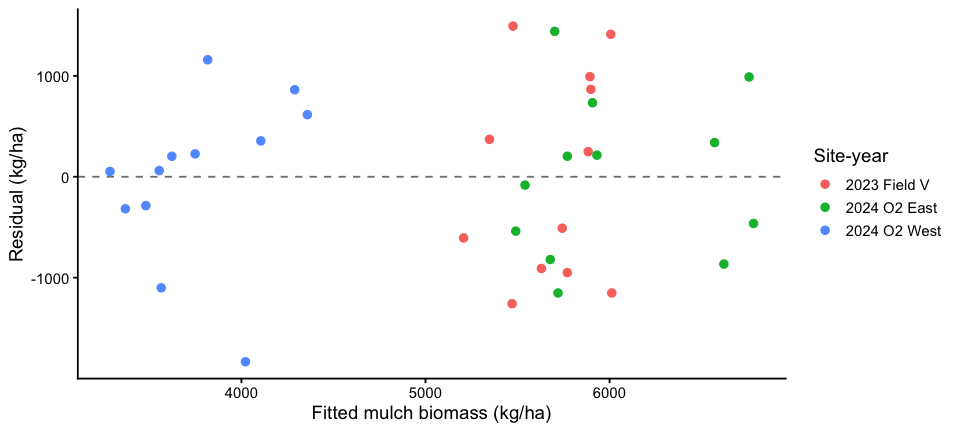
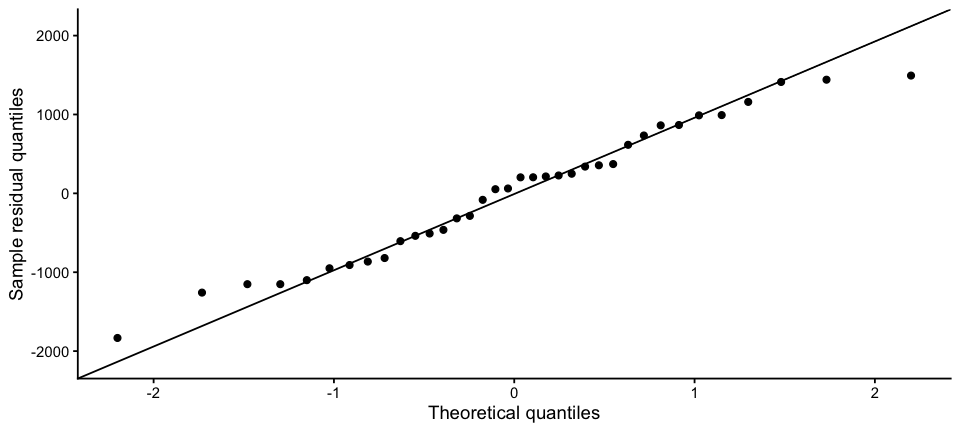
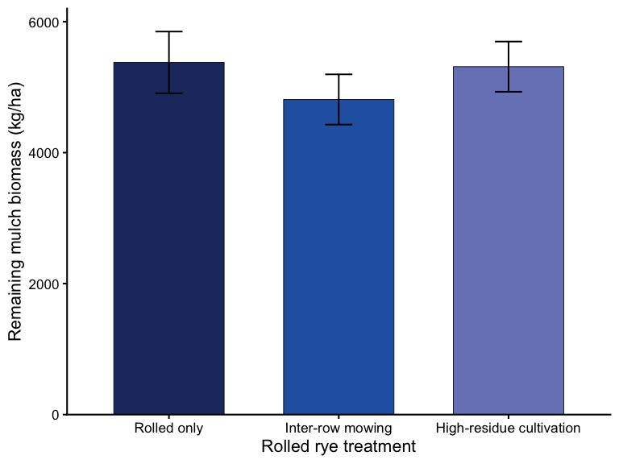
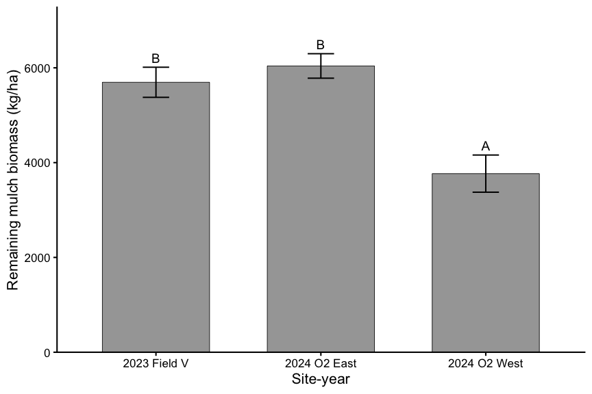
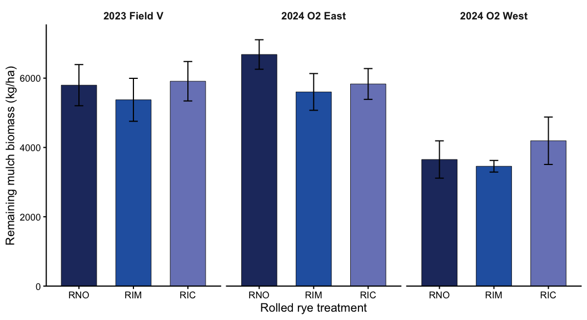
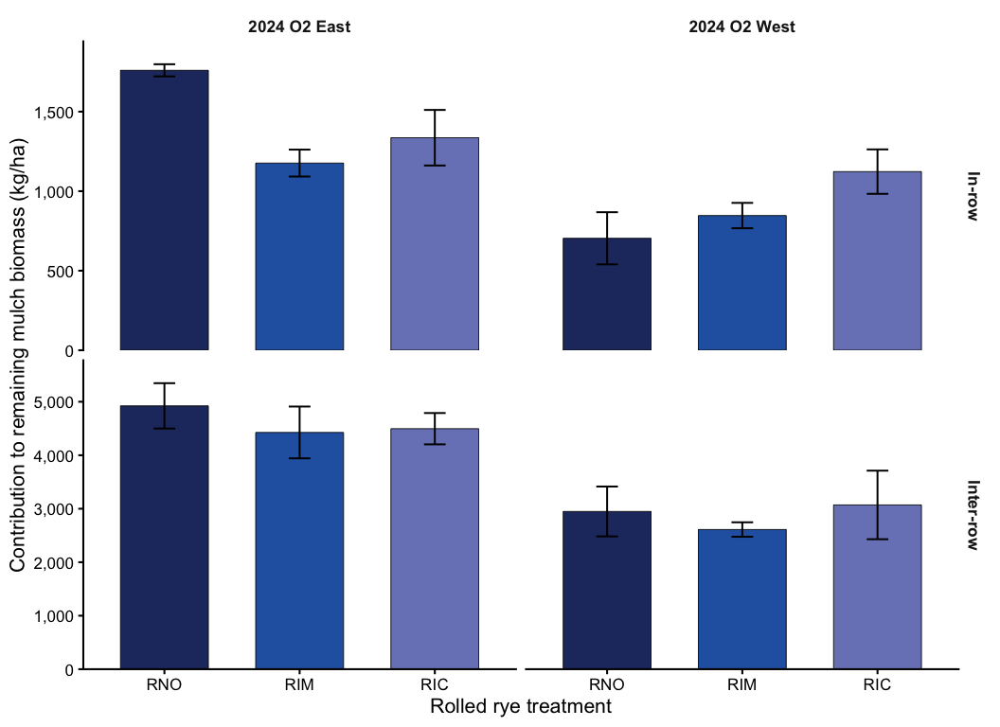

Total rolled mulch biomass at peak weed sampling
================

- [Question and experimental design](#question-and-experimental-design)
- [Setup](#setup)
- [Import and validate](#import-and-validate)
- [Describe the observations](#describe-the-observations)
- [Fit the primary model](#fit-the-primary-model)
- [Check assumptions and block
  variance](#check-assumptions-and-block-variance)
- [Tests and overall estimates](#tests-and-overall-estimates)
  - [Site-year estimates and Fisher’s
    LSD](#site-year-estimates-and-fishers-lsd)
- [Final figures: raw means ± SE](#final-figures-raw-means--se)
  - [Treatment means](#treatment-means)
  - [Site-year means](#site-year-means)
- [Results summary](#results-summary)
- [Appendix: supporting analyses](#appendix-supporting-analyses)
  - [Exploratory treatment patterns within
    site-years](#exploratory-treatment-patterns-within-site-years)
  - [In-row and inter-row mulch biomass (2024
    only)](#in-row-and-inter-row-mulch-biomass-2024-only)
  - [Interpretation notes](#interpretation-notes)
  - [R session](#r-session)

# Question and experimental design

Does supplemental inter-row weed management affect the amount of cereal
rye mulch remaining at peak weed sampling? The primary planned
comparison is inter-row mowing (RIM) versus rolled rye with no
supplemental management (RNO). High-residue cultivation (RIC) versus RNO
is a secondary planned comparison.

Only the three rolled treatments have mulch measurements. Total mulch
biomass was measured in 2023 Field V, 2024 O2 East, and 2024 O2 West,
with four randomized blocks per site-year. Each plot contributes one
independent observation (3 site-years × 4 blocks × 3 treatments = 36
plots). The response is **remaining mulch biomass**, not a direct
pre/post estimate of biomass removed by an operation.

# Setup

``` r
library(tidyverse)
library(here)
library(conflicted)
library(WrensBookshelf)
library(lmerTest)
library(emmeans)
library(multcomp)

conflicts_prefer(dplyr::filter)
conflicts_prefer(dplyr::select)
treatment_codes <- c("RNO", "RIM", "RIC", "TIM", "TIC")
treatment_colors <- setNames(
  WrensBookshelf::WB_brewer(name = "WhatWellBuild", n = 5, type = "discrete"),
  treatment_codes
)
rolled_colors <- treatment_colors[c("RNO", "RIM", "RIC")]
rolled_labels <- c("RNO" = "Rolled only", "RIM" = "Inter-row mowing",
                   "RIC" = "High-residue cultivation")
theme_set(theme_classic(base_size = 16))
emm_options(lmer.df = "satterthwaite")
show_table <- function(x, caption, digits = 1) {
  knitr::kable(x, digits = digits, caption = caption)
}

tab_dir <- here("output", "tables", "mulch_biomass")
dir.create(tab_dir, recursive = TRUE, showWarnings = FALSE)
```

# Import and validate

Set `data_path` to the location of the processed dataset in your
Mowtivation repository if none of these common locations applies. The
analysis uses the already converted `mulch_biomass_kg_ha` field, so no
second unit conversion is performed.

``` r
candidate_paths <- c(
  here("data", "processed", "combined_processed.rds"),
  here("data", "combined_processed.rds"),
  here("combined_processed.rds"),
  here("upload", "combined_processed(2).rds")
)
existing_paths <- candidate_paths[file.exists(candidate_paths)]
if (length(existing_paths) == 0) {
  stop("Cannot find combined_processed.rds. Set data_path to its location.")
}
data_path <- existing_paths[1]
combined <- readRDS(data_path)

mulch <- combined |>
  filter(as.character(treatment) %in% c("RNO", "RIM", "RIC")) |>
  transmute(
    site_year = factor(as.character(site_year),
                       levels = c("V_2023", "O2E_2024", "O2W_2024"),
                       labels = c("2023 Field V", "2024 O2 East", "2024 O2 West")),
    block = factor(block),
    treatment = factor(as.character(treatment), levels = c("RNO", "RIM", "RIC")),
    mulch_kg_ha = as.numeric(mulch_biomass_kg_ha)
  )

stopifnot(nrow(mulch) == 36, !anyNA(mulch),
          all(mulch$mulch_kg_ha > 0),
          all(as.vector(table(mulch$site_year, mulch$treatment)) == 4),
          all(as.vector(table(mulch$site_year, mulch$block)) == 3))

mulch |> count(site_year, treatment)
```

    ## # A tibble: 9 × 3
    ##   site_year    treatment     n
    ##   <fct>        <fct>     <int>
    ## 1 2023 Field V RNO           4
    ## 2 2023 Field V RIM           4
    ## 3 2023 Field V RIC           4
    ## 4 2024 O2 East RNO           4
    ## 5 2024 O2 East RIM           4
    ## 6 2024 O2 East RIC           4
    ## 7 2024 O2 West RNO           4
    ## 8 2024 O2 West RIM           4
    ## 9 2024 O2 West RIC           4

# Describe the observations

The tables and figures below show **observed plot means ± standard
errors**. They are not model-adjusted estimates. With a balanced design,
each site-year contributes equally to the overall treatment means.

``` r
summary_by_site <- mulch |>
  group_by(site_year, treatment) |>
  summarise(n = n(), mean = mean(mulch_kg_ha),
            sd = sd(mulch_kg_ha), se = sd / sqrt(n), .groups = "drop")

summary_overall <- mulch |>
  group_by(treatment) |>
  summarise(n = n(), mean = mean(mulch_kg_ha),
            sd = sd(mulch_kg_ha), se = sd / sqrt(n), .groups = "drop")

# Average the three rolled subplots within blocks before calculating the
# site-year SE; this leaves four independent block means per site-year.
block_means <- mulch |>
  group_by(site_year, block) |>
  summarise(mulch_kg_ha = mean(mulch_kg_ha), .groups = "drop")
summary_site_year <- block_means |>
  group_by(site_year) |>
  summarise(n_blocks = n(), mean = mean(mulch_kg_ha),
            sd = sd(mulch_kg_ha), se = sd / sqrt(n_blocks), .groups = "drop")

show_table(summary_by_site, "Observed mulch biomass by site-year and treatment (kg/ha)")
```

| site_year    | treatment |   n |   mean |     sd |    se |
|:-------------|:----------|----:|-------:|-------:|------:|
| 2023 Field V | RNO       |   4 | 5798.0 | 1187.9 | 594.0 |
| 2023 Field V | RIM       |   4 | 5375.2 | 1239.7 | 619.8 |
| 2023 Field V | RIC       |   4 | 5911.5 | 1138.0 | 569.0 |
| 2024 O2 East | RNO       |   4 | 6683.0 |  851.4 | 425.7 |
| 2024 O2 East | RIM       |   4 | 5602.8 | 1060.0 | 530.0 |
| 2024 O2 East | RIC       |   4 | 5832.3 |  888.7 | 444.4 |
| 2024 O2 West | RNO       |   4 | 3652.7 | 1076.9 | 538.4 |
| 2024 O2 West | RIM       |   4 | 3457.8 |  335.9 | 167.9 |
| 2024 O2 West | RIC       |   4 | 4193.8 | 1368.5 | 684.2 |

Observed mulch biomass by site-year and treatment (kg/ha)

``` r
show_table(summary_overall, "Observed mulch biomass by treatment (kg/ha)")
```

| treatment |   n |   mean |     sd |    se |
|:----------|----:|-------:|-------:|------:|
| RNO       |  12 | 5377.9 | 1632.4 | 471.2 |
| RIM       |  12 | 4811.9 | 1328.9 | 383.6 |
| RIC       |  12 | 5312.5 | 1327.8 | 383.3 |

Observed mulch biomass by treatment (kg/ha)

``` r
show_table(summary_site_year, "Observed mulch biomass by site-year, averaged within blocks (kg/ha)")
```

| site_year    | n_blocks |   mean |    sd |    se |
|:-------------|---------:|-------:|------:|------:|
| 2023 Field V |        4 | 5694.9 | 635.3 | 317.7 |
| 2024 O2 East |        4 | 6039.4 | 516.4 | 258.2 |
| 2024 O2 West |        4 | 3768.1 | 784.1 | 392.0 |

Observed mulch biomass by site-year, averaged within blocks (kg/ha)

The across-site-year raw SE above includes between-site-year
variability. Because treatment was randomized *within* site-year and
block, that SE is descriptive and should not be used to test treatment
differences. Inference comes from the blocked model below.

# Fit the primary model

Site-year and treatment are fixed effects, including their interaction;
block nested in site-year is a random intercept. We retain the
interaction to assess whether mowing effects vary by site-year. We start
with a Gaussian model on the original kg/ha scale and inspect its
assumptions rather than assuming a transformation is needed.

``` r
options(contrasts = c("contr.sum", "contr.poly"))
mulch_model <- lmerTest::lmer(
  mulch_kg_ha ~ site_year * treatment + (1 | site_year:block),
  data = mulch, REML = TRUE
)
```

# Check assumptions and block variance

Inspect the residual-versus-fitted plot for changing variance or
systematic patterns, and the Q-Q plot for substantial departures from
normality. Site-year residual spreads are also summarized. If serious
heterogeneity appears, revisit the residual variance structure before
drawing conclusions.

``` r
variance_table <- as.data.frame(lme4::VarCorr(mulch_model)) |>
  transmute(component = grp, variance = vcov, SD = sdcor)
show_table(variance_table, "Variance components (kg/ha scale)")
```

| component       |  variance |     SD |
|:----------------|----------:|-------:|
| site_year:block |   85538.9 |  292.5 |
| Residual        | 1028528.3 | 1014.2 |

Variance components (kg/ha scale)

``` r
cat("Singular fit:", lme4::isSingular(mulch_model, tol = 1e-4), "\n")
```

    ## Singular fit: FALSE

``` r
diagnostics <- tibble(
  fitted = fitted(mulch_model),
  residual = resid(mulch_model),
  site_year = mulch$site_year
)

p_resid <- ggplot(diagnostics, aes(fitted, residual, color = site_year)) +
  geom_hline(yintercept = 0, linetype = "dashed", color = "grey50") +
  geom_point(size = 2.5) +
  labs(x = "Fitted mulch biomass (kg/ha)", y = "Residual (kg/ha)", color = "Site-year") +
  theme_classic(base_size = 14)

p_qq <- ggplot(diagnostics, aes(sample = residual)) +
  stat_qq(size = 2) + stat_qq_line() +
  labs(x = "Theoretical quantiles", y = "Sample residual quantiles") +
  theme_classic(base_size = 14)

print(p_resid)
```

<!-- -->

``` r
print(p_qq)
```

<!-- -->

``` r
diagnostics |> group_by(site_year) |>
  summarise(residual_sd = sd(residual), .groups = "drop") |>
  knitr::kable(digits = 1)
```

| site_year    | residual_sd |
|:-------------|------------:|
| 2023 Field V |      1019.1 |
| 2024 O2 East |       800.7 |
| 2024 O2 West |       822.8 |

# Tests and overall estimates

``` r
anova_table <- anova(mulch_model, type = 3, ddf = "Satterthwaite") |>
  as.data.frame() |>
  tibble::rownames_to_column("Effect") |>
  select(Effect, NumDF, DenDF, `F value`, `Pr(>F)`)
show_table(anova_table, "Type III tests (Satterthwaite degrees of freedom)", digits = 4)
```

| Effect              | NumDF | DenDF | F value | Pr(\>F) |
|:--------------------|------:|------:|--------:|--------:|
| site_year           |     2 |     9 | 13.9904 |  0.0017 |
| treatment           |     2 |    18 |  1.1186 |  0.3484 |
| site_year:treatment |     4 |    18 |  0.5086 |  0.7301 |

Type III tests (Satterthwaite degrees of freedom)

``` r
readr::write_csv(anova_table,
                 file.path(tab_dir, "primary_model_anova.csv"))
```

The main inferential question is **RIM − RNO** averaged equally over the
three site-years. We also report RIC − RNO, adjusting these two control
comparisons using Dunnett’s method. A negative difference means less
remaining mulch than RNO. If the treatment × site-year interaction is
important, interpret the site-year-specific differences alongside (or
instead of) the pooled average.

``` r
emm_treatment <- emmeans(mulch_model, ~ treatment, weights = "equal")
```

    ## NOTE: Results may be misleading due to involvement in interactions

``` r
show_table(as.data.frame(confint(emm_treatment)),
           "Overall model-estimated treatment means (kg/ha)")
```

| treatment | emmean |    SE |   df | lower.CL | upper.CL |
|:----------|-------:|------:|-----:|---------:|---------:|
| RNO       | 5377.9 | 304.7 | 26.7 |   4752.4 |   6003.5 |
| RIM       | 4811.9 | 304.7 | 26.7 |   4186.4 |   5437.4 |
| RIC       | 5312.5 | 304.7 | 26.7 |   4687.0 |   5938.1 |

Overall model-estimated treatment means (kg/ha)

``` r
planned_vs_rno <- contrast(emm_treatment, method = "trt.vs.ctrl", ref = 1)
planned_results <- as.data.frame(summary(
  planned_vs_rno, infer = c(TRUE, TRUE), adjust = "dunnettx"
))
show_table(planned_results, "Planned comparisons versus RNO (Dunnett-adjusted)", digits = 3)
```

| contrast  | estimate |      SE |  df |  lower.CL | upper.CL | t.ratio | p.value |
|:----------|---------:|--------:|----:|----------:|---------:|--------:|--------:|
| RIM - RNO | -566.008 | 414.031 |  18 | -1565.679 |  433.662 |  -1.367 |   0.320 |
| RIC - RNO |  -65.383 | 414.031 |  18 | -1065.054 |  934.287 |  -0.158 |   0.974 |

Planned comparisons versus RNO (Dunnett-adjusted)

``` r
readr::write_csv(as.data.frame(confint(emm_treatment)),
                 file.path(tab_dir, "treatment_model_means.csv"))
readr::write_csv(planned_results,
                 file.path(tab_dir, "planned_comparisons_vs_rno.csv"))
```

## Site-year estimates and Fisher’s LSD

The site-year omnibus effect was significant in these data, so we
examine pairwise differences using Fisher’s LSD (unadjusted post-hoc
comparisons). These compare site-year averages across treatments,
**not** treatment effects within individual site-years. Inference is
limited to the three observed site-years.

``` r
emm_site_year <- emmeans(mulch_model, ~ site_year, weights = "equal")
```

    ## NOTE: Results may be misleading due to involvement in interactions

``` r
show_table(as.data.frame(confint(emm_site_year)),
           "Model-estimated site-year means (kg/ha)")
```

| site_year    | emmean |    SE |  df | lower.CL | upper.CL |
|:-------------|-------:|------:|----:|---------:|---------:|
| 2023 Field V | 5694.9 | 327.3 |   9 |   4954.6 |   6435.2 |
| 2024 O2 East | 6039.4 | 327.3 |   9 |   5299.1 |   6779.7 |
| 2024 O2 West | 3768.1 | 327.3 |   9 |   3027.8 |   4508.4 |

Model-estimated site-year means (kg/ha)

``` r
site_year_p <- anova_table[["Pr(>F)"]][anova_table$Effect == "site_year"]
stopifnot(length(site_year_p) == 1L)
if (site_year_p < 0.05) {
  site_year_pairs <- as.data.frame(summary(
    pairs(emm_site_year, adjust = "none"), infer = c(TRUE, TRUE)
  ))
  show_table(site_year_pairs, "Site-year Fisher's LSD comparisons", digits = 3)
  readr::write_csv(site_year_pairs,
                 file.path(tab_dir, "site_year_comparisons_fisher_lsd.csv"))
} else {
  cat("Site-year omnibus test not significant; no post-hoc comparisons.\n")
}


readr::write_csv(as.data.frame(confint(emm_site_year)),
                 file.path(tab_dir, "site_year_model_means.csv"))
```

# Final figures: raw means ± SE

The overall treatment test is nonsignificant, so no exploratory Fisher’s
LSD post-hoc grouping or CLD letters are shown. The prespecified
comparisons against RNO above address the mowing and cultivation
questions directly and do not require a significant omnibus treatment
test. Figure means and error bars are descriptive; statistical inference
uses the blocked mixed model.

## Treatment means

``` r
mulch_overall_fig <- ggplot(summary_overall, aes(treatment, mean, fill = treatment)) +
  geom_col(width = 0.65, color = "black", linewidth = 0.3) +
  geom_errorbar(aes(ymin = mean - se, ymax = mean + se),
                width = 0.16, linewidth = 0.7) +
  scale_fill_manual(values = rolled_colors, guide = "none") +
  scale_x_discrete(labels = rolled_labels) +
  scale_y_continuous(expand = expansion(mult = c(0, 0.06))) +
  labs(x = "Rolled rye treatment", y = "Remaining mulch biomass (kg/ha)") +
  theme(axis.text.x = element_text(size = 13))

mulch_overall_fig
```

<!-- -->

## Site-year means

The three rolled treatments are averaged within each block before
calculating the site-year mean ± SE (four blocks per site-year).
Uppercase letters, if shown, come from the model-based Fisher’s LSD
site-year comparisons, not from the descriptive error bars.

``` r
site_year_plot_data <- summary_site_year
if (site_year_p < 0.05) {
  site_year_letters <- multcomp::cld(
    emm_site_year, adjust = "none", Letters = LETTERS
  ) |>
    as.data.frame() |>
    transmute(site_year, cld = gsub(" ", "", .group))
  site_year_plot_data <- site_year_plot_data |>
    left_join(site_year_letters, by = "site_year")
}

mulch_site_year_fig <- ggplot(site_year_plot_data, aes(site_year, mean)) +
  geom_col(width = 0.65, fill = "grey65", color = "black", linewidth = 0.3) +
  geom_errorbar(aes(ymin = mean - se, ymax = mean + se),
                width = 0.16, linewidth = 0.7) +
  scale_y_continuous(expand = expansion(mult = c(0, 0.12))) +
  labs(x = "Site-year", y = "Remaining mulch biomass (kg/ha)")
if (site_year_p < 0.05) {
  mulch_site_year_fig <- mulch_site_year_fig +
    geom_text(aes(y = mean + se + 200, label = cld), size = 5)
}

mulch_site_year_fig
```

<!-- -->

``` r
dir.create(here("figures", "mulch_biomass"), showWarnings = FALSE, recursive = TRUE)
ggsave(here("figures", "mulch_biomass", "treatment_raw_means.png"),
       mulch_overall_fig, width = 8, height = 6, dpi = 300, bg = "white")
ggsave(here("figures", "mulch_biomass", "site_year_raw_means.png"),
       mulch_site_year_fig, width = 9, height = 6, dpi = 300, bg = "white")
```

# Results summary

The site-year effect was significant (p = 0.00173), but the treatment
effect (p = 0.348) and treatment-by-site-year interaction (p = 0.73)
were not. The planned RIM–RNO contrast was -566 kg/ha (Dunnett-adjusted
95% CI: -1566 to 434 kg/ha; p = 0.32). This single post-treatment
sampling occasion does not directly quantify biomass lost through mowing
or cultivation.

# Appendix: supporting analyses

## Exploratory treatment patterns within site-years

The faceted plot helps visualize site-year-specific treatment patterns,
but is not the figure used to show the significant overall site-year
effect. No within-site-year treatment letters are displayed because the
interaction was nonsignificant and these were not the primary planned
comparisons.

``` r
mulch_site_treatment_fig <- ggplot(summary_by_site,
                                  aes(treatment, mean, fill = treatment)) +
  geom_col(width = 0.65, color = "black", linewidth = 0.3) +
  geom_errorbar(aes(ymin = mean - se, ymax = mean + se),
                width = 0.16, linewidth = 0.7) +
  facet_wrap(~ site_year, nrow = 1) +
  scale_fill_manual(values = rolled_colors, guide = "none") +
  scale_x_discrete(labels = c("RNO", "RIM", "RIC")) +
  scale_y_continuous(expand = expansion(mult = c(0, 0.06))) +
  labs(x = "Rolled rye treatment", y = "Remaining mulch biomass (kg/ha)") +
  theme(strip.background = element_blank(),
        strip.text = element_text(face = "bold", size = 14))
mulch_site_treatment_fig
```

<!-- -->

## In-row and inter-row mulch biomass (2024 only)

In 2024, mulch was separated into in-row and inter-row components using
the same sampling and area-weighting approach as the weed biomass
measurements. The two components sum to total mulch biomass. The values
below therefore represent contributions to the plot-level kg/ha total,
not independent measurements of biomass density over each sampling zone.

This descriptive analysis asks whether differences among rolled
treatments are concentrated in the area directly managed by mowing or
cultivation. Both sampling zones belong to the same plot, so they should
not be treated as independent experimental replicates in any subsequent
statistical model.

``` r
mulch_zones_wide <- combined |>
  filter(as.character(site_year) %in% c("O2E_2024", "O2W_2024"),
         as.character(treatment) %in% c("RNO", "RIM", "RIC")) |>
  transmute(
    site_year = factor(as.character(site_year),
                       levels = c("O2E_2024", "O2W_2024"),
                       labels = c("2024 O2 East", "2024 O2 West")),
    block = factor(block),
    treatment = factor(as.character(treatment), levels = c("RNO", "RIM", "RIC")),
    in_row = as.numeric(inrow_mulch_biomass_kg_ha),
    inter_row = as.numeric(interrow_mulch_biomass_kg_ha),
    total = as.numeric(mulch_biomass_kg_ha)
  )

stopifnot(
  nrow(mulch_zones_wide) == 24L,
  !anyNA(mulch_zones_wide),
  all(as.vector(table(mulch_zones_wide$site_year,
                      mulch_zones_wide$treatment)) == 4L),
  isTRUE(all.equal(mulch_zones_wide$in_row + mulch_zones_wide$inter_row,
                   mulch_zones_wide$total, tolerance = 1e-7))
)

mulch_zones <- mulch_zones_wide |>
  select(site_year, block, treatment, in_row, inter_row) |>
  pivot_longer(c(in_row, inter_row),
               names_to = "sampling_zone", values_to = "mulch_kg_ha") |>
  mutate(sampling_zone = factor(sampling_zone,
                                levels = c("in_row", "inter_row"),
                                labels = c("In-row", "Inter-row")))

mulch_zone_summary <- mulch_zones |>
  group_by(site_year, sampling_zone, treatment) |>
  summarise(n = n(), mean = mean(mulch_kg_ha),
            sd = sd(mulch_kg_ha), se = sd / sqrt(n), .groups = "drop")

show_table(mulch_zone_summary,
           "2024 in-row and inter-row contributions to mulch biomass (kg/ha)")
```

| site_year    | sampling_zone | treatment |   n |   mean |     sd |    se |
|:-------------|:--------------|:----------|----:|-------:|-------:|------:|
| 2024 O2 East | In-row        | RNO       |   4 | 1759.8 |   76.5 |  38.2 |
| 2024 O2 East | In-row        | RIM       |   4 | 1176.6 |  169.3 |  84.6 |
| 2024 O2 East | In-row        | RIC       |   4 | 1336.0 |  349.4 | 174.7 |
| 2024 O2 East | Inter-row     | RNO       |   4 | 4923.3 |  847.7 | 423.9 |
| 2024 O2 East | Inter-row     | RIM       |   4 | 4426.2 |  968.5 | 484.2 |
| 2024 O2 East | Inter-row     | RIC       |   4 | 4496.3 |  585.5 | 292.8 |
| 2024 O2 West | In-row        | RNO       |   4 |  703.8 |  328.0 | 164.0 |
| 2024 O2 West | In-row        | RIM       |   4 |  846.7 |  159.4 |  79.7 |
| 2024 O2 West | In-row        | RIC       |   4 | 1123.0 |  279.3 | 139.7 |
| 2024 O2 West | Inter-row     | RNO       |   4 | 2948.9 |  932.6 | 466.3 |
| 2024 O2 West | Inter-row     | RIM       |   4 | 2611.1 |  270.4 | 135.2 |
| 2024 O2 West | Inter-row     | RIC       |   4 | 3070.9 | 1281.8 | 640.9 |

2024 in-row and inter-row contributions to mulch biomass (kg/ha)

``` r
mulch_zone_fig <- ggplot(mulch_zone_summary,
                         aes(treatment, mean, fill = treatment)) +
  geom_col(width = 0.65, color = "black", linewidth = 0.3) +
  geom_errorbar(aes(ymin = mean - se, ymax = mean + se),
                width = 0.16, linewidth = 0.7) +
  facet_grid(sampling_zone ~ site_year, scales = "free_y") +
  scale_fill_manual(values = rolled_colors, guide = "none") +
  scale_x_discrete(labels = c("RNO", "RIM", "RIC")) +
  scale_y_continuous(labels = scales::label_comma(),
                     expand = expansion(mult = c(0, 0.08))) +
  labs(x = "Rolled rye treatment",
       y = "Contribution to remaining mulch biomass (kg/ha)") +
  theme(strip.background = element_blank(),
        strip.text = element_text(face = "bold", size = 13))
mulch_zone_fig
```

<!-- -->

The error bars show raw plot-level means ± SE (four plots per treatment
within each site-year and sampling zone). No post-hoc comparisons are
made here. The free y-scales help compare treatments *within* a zone but
should not be used to judge the relative magnitudes of in-row and
inter-row contributions.

## Interpretation notes

- Report the interaction test first to describe whether treatment
  effects differ among site-years.
- Prioritize the estimated RIM − RNO difference, confidence interval,
  and adjusted *p*-value. Report RIC − RNO as the other comparison
  against the undisturbed control.
- Distinguish **remaining mulch biomass** from mulch *loss*. Because
  this is a single sampling occasion, the data do not directly quantify
  loss caused by mowing or cultivation.
- The pooled raw SE includes site-year variation; use the model-based
  contrast interval for treatment inference.
- Follow-up analyses can examine 2024 in-row/inter-row mulch
  distribution and associations with weed biomass, accounting for
  site-year and block.

## R session

``` r
sessionInfo()
```

    ## R version 4.5.2 (2025-10-31)
    ## Platform: aarch64-apple-darwin20
    ## Running under: macOS Tahoe 26.7.1
    ## 
    ## Matrix products: default
    ## BLAS:   /System/Library/Frameworks/Accelerate.framework/Versions/A/Frameworks/vecLib.framework/Versions/A/libBLAS.dylib 
    ## LAPACK: /Library/Frameworks/R.framework/Versions/4.5-arm64/Resources/lib/libRlapack.dylib;  LAPACK version 3.12.1
    ## 
    ## locale:
    ## [1] en_US.UTF-8/en_US.UTF-8/en_US.UTF-8/C/en_US.UTF-8/en_US.UTF-8
    ## 
    ## time zone: America/New_York
    ## tzcode source: internal
    ## 
    ## attached base packages:
    ## [1] stats     graphics  grDevices utils     datasets  methods   base     
    ## 
    ## other attached packages:
    ##  [1] multcomp_1.4-29      TH.data_1.1-4        MASS_7.3-65         
    ##  [4] survival_3.8-3       mvtnorm_1.3-3        emmeans_1.11.2-8    
    ##  [7] lmerTest_3.1-3       lme4_1.1-37          Matrix_1.7-4        
    ## [10] WrensBookshelf_0.1.0 conflicted_1.2.0     here_1.0.2          
    ## [13] lubridate_1.9.4      forcats_1.0.1        stringr_1.5.2       
    ## [16] dplyr_1.1.4          purrr_1.1.0          readr_2.1.5         
    ## [19] tidyr_1.3.1          tibble_3.3.0         ggplot2_4.0.0       
    ## [22] tidyverse_2.0.0     
    ## 
    ## loaded via a namespace (and not attached):
    ##  [1] gtable_0.3.6        xfun_0.61           lattice_0.22-7     
    ##  [4] tzdb_0.5.0          numDeriv_2016.8-1.1 vctrs_0.6.5        
    ##  [7] tools_4.5.2         Rdpack_2.6.4        generics_0.1.4     
    ## [10] parallel_4.5.2      sandwich_3.1-1      pkgconfig_2.0.3    
    ## [13] RColorBrewer_1.1-3  S7_0.2.0            lifecycle_1.0.4    
    ## [16] compiler_4.5.2      farver_2.1.2        textshaping_1.0.4  
    ## [19] codetools_0.2-20    htmltools_0.5.8.1   yaml_2.3.10        
    ## [22] crayon_1.5.3        pillar_1.11.1       nloptr_2.2.1       
    ## [25] cachem_1.1.0        reformulas_0.4.4    boot_1.3-32        
    ## [28] nlme_3.1-168        tidyselect_1.2.1    digest_0.6.37      
    ## [31] stringi_1.8.7       labeling_0.4.3      splines_4.5.2      
    ## [34] rprojroot_2.1.1     fastmap_1.2.0       grid_4.5.2         
    ## [37] cli_3.6.5           magrittr_2.0.4      utf8_1.2.6         
    ## [40] withr_3.0.2         scales_1.4.0        bit64_4.6.0-1      
    ## [43] timechange_0.3.0    estimability_1.5.1  rmarkdown_2.30     
    ## [46] bit_4.6.0           ragg_1.5.0          zoo_1.8-14         
    ## [49] hms_1.1.4           memoise_2.0.1       coda_0.19-4.1      
    ## [52] evaluate_1.0.5      knitr_1.50          rbibutils_2.3      
    ## [55] rlang_1.1.6         Rcpp_1.1.0          xtable_1.8-4       
    ## [58] glue_1.8.0          vroom_1.6.6         rstudioapi_0.17.1  
    ## [61] minqa_1.2.8         R6_2.6.1            systemfonts_1.3.1  
    ## [64] multcompView_0.1-10
