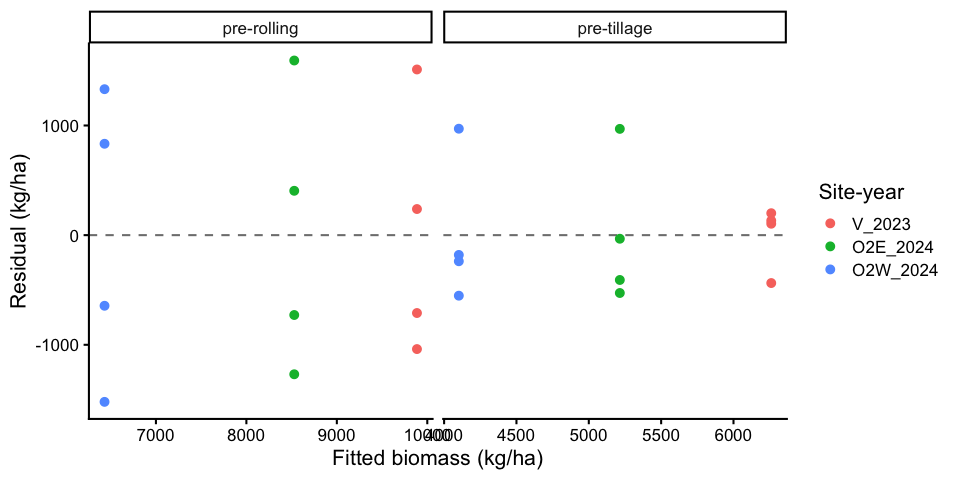
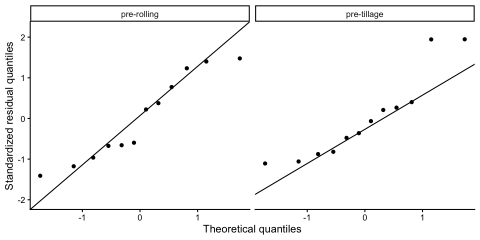

Pre-termination cereal rye biomass
================

- [Question and sampling design](#question-and-sampling-design)
- [Setup](#setup)
- [Import and validate](#import-and-validate)
- [Describe the observations](#describe-the-observations)
- [Fit the site-year models](#fit-the-site-year-models)
- [Check assumptions](#check-assumptions)
  - [Unequal-variance sensitivity
    check](#unequal-variance-sensitivity-check)
- [Tests and site-year estimates](#tests-and-site-year-estimates)
  - [pre-tillage](#pre-tillage)
  - [pre-rolling](#pre-rolling)
- [Final table for manuscript](#final-table-for-manuscript)
- [Interpretation notes](#interpretation-notes)
- [R session](#r-session)

# Question and sampling design

How did cereal rye biomass immediately before termination differ among
the three Mowtivation site-years? Rye was sampled from one 0.5-m²
quadrat per block (four blocks per site-year) before tillage and, on a
later date, before roller-crimping. The two sampling events are **not
randomized termination treatments**. We test site-year differences
separately for each event; results describe the observed site-years, not
the isolated effects of rye variety, weather, or sampling date.

# Setup

``` r
library(tidyverse)
library(here)
library(emmeans)
library(conflicted)

conflicts_prefer(dplyr::filter)
conflicts_prefer(dplyr::select)
theme_set(theme_classic(base_size = 16))

site_labels <- c(
  V_2023 = "2023 – Field V",
  O2E_2024 = "2024 – Field O2 East",
  O2W_2024 = "2024 – Field O2 West"
)
event_levels <- c("pre-tillage", "pre-rolling")
tab_dir <- here("output", "tables", "pretermination_rye_biomass")
dir.create(tab_dir, recursive = TRUE, showWarnings = FALSE)

show_table <- function(x, caption, digits = 1) {
  x <- as.data.frame(x)
  p_cols <- intersect(names(x), c("p.value", "p_value", "Pr(>F)"))
  for (nm in p_cols) {
    x[[nm]] <- ifelse(is.na(x[[nm]]), NA_character_,
                      ifelse(x[[nm]] < 0.001, "<0.001", sprintf("%.3f", x[[nm]])))
  }
  knitr::kable(x, digits = digits, caption = caption)
}

# Accept both ISO (2024-04-29) and month/day/year (4/29/24 or 4/29/2024).
parse_sampling_date <- function(x) {
  x <- trimws(as.character(x))
  result <- as.Date(rep(NA_character_, length(x)))
  formats <- list(
    list(pattern = "^[0-9]{4}-[0-9]{2}-[0-9]{2}$", format = "%Y-%m-%d"),
    list(pattern = "^[0-9]{1,2}/[0-9]{1,2}/[0-9]{4}$", format = "%m/%d/%Y"),
    list(pattern = "^[0-9]{1,2}/[0-9]{1,2}/[0-9]{2}$", format = "%m/%d/%y")
  )
  for (spec in formats) {
    matching <- !is.na(x) & grepl(spec$pattern, x)
    result[matching] <- as.Date(x[matching], format = spec$format)
  }
  if (anyNA(result)) {
    stop("Unrecognized sampling date(s): ",
         paste(unique(x[is.na(result)]), collapse = ", "))
  }
  result
}
```

# Import and validate

Raw biomass is recorded in grams from 0.5-m² quadrats. Conversion is
`g / area_m2 * 10`, or **g × 20** for the specified quadrat size. The
CSV may contain an already converted column; we calculate biomass
directly from the raw grams to avoid double conversion.

``` r
raw <- readr::read_csv(here("data", "raw", "pretermination_rye_biomass.csv"),
                       show_col_types = FALSE)
required <- c("site_year", "block", "sampling_date", "event",
              "cereal_rye_variety", "sampling_area_m2", "cereal_rye_biomass_g")
missing_columns <- setdiff(required, names(raw))
if (length(missing_columns)) {
  stop("Missing raw-data columns: ", paste(missing_columns, collapse = ", "))
}

rye <- raw |>
  transmute(
    site_year = factor(trimws(as.character(site_year)), levels = names(site_labels)),
    block = factor(block),
    sampling_date = parse_sampling_date(sampling_date),
    event = factor(trimws(as.character(event)), levels = event_levels),
    cereal_rye_variety = trimws(as.character(cereal_rye_variety)),
    sampling_area_m2 = as.numeric(sampling_area_m2),
    cereal_rye_biomass_g = as.numeric(cereal_rye_biomass_g)
  ) |>
  mutate(
    biomass_kg_ha = cereal_rye_biomass_g / sampling_area_m2 * 10,
    block_id = interaction(site_year, block, drop = TRUE)
  ) |>
  arrange(site_year, event, block)

stopifnot(
  nrow(rye) == 24L,
  !anyNA(rye),
  all(rye$sampling_area_m2 == 0.5),
  all(rye$cereal_rye_biomass_g > 0),
  all(as.vector(table(rye$site_year, rye$event)) == 4L),
  all(as.vector(table(rye$site_year, rye$event, rye$block)) == 1L),
  all(as.integer(format(rye$sampling_date, "%Y")) ==
        as.integer(sub(".*_", "", as.character(rye$site_year))))
)

group_checks <- rye |>
  group_by(site_year, event) |>
  summarise(n_dates = n_distinct(sampling_date),
            n_varieties = n_distinct(cereal_rye_variety), .groups = "drop")
stopifnot(all(group_checks$n_dates == 1L), all(group_checks$n_varieties == 1L))

show_table(rye |> count(site_year, event), "Validated block-level rye observations")
```

| site_year | event       |   n |
|:----------|:------------|----:|
| V_2023    | pre-tillage |   4 |
| V_2023    | pre-rolling |   4 |
| O2E_2024  | pre-tillage |   4 |
| O2E_2024  | pre-rolling |   4 |
| O2W_2024  | pre-tillage |   4 |
| O2W_2024  | pre-rolling |   4 |

Validated block-level rye observations

``` r
readr::write_csv(rye, file.path(tab_dir, "block_level_biomass_kg_ha.csv"))
```

# Describe the observations

Observed means, SDs, and SEs use four block-level measurements per
site-year and sampling event. These summaries are descriptive;
statistical comparisons are based on the models below.

``` r
summary_long <- rye |>
  group_by(site_year, event) |>
  summarise(
    sampling_date = first(sampling_date),
    cereal_rye_variety = first(cereal_rye_variety),
    n_blocks = n(),
    mean_kg_ha = mean(biomass_kg_ha),
    sd_kg_ha = sd(biomass_kg_ha),
    se_kg_ha = sd_kg_ha / sqrt(n_blocks),
    .groups = "drop"
  )

show_table(summary_long, "Observed pre-termination rye biomass (kg/ha)")
```

| site_year | event | sampling_date | cereal_rye_variety | n_blocks | mean_kg_ha | sd_kg_ha | se_kg_ha |
|:---|:---|:---|:---|---:|---:|---:|---:|
| V_2023 | pre-tillage | 2023-05-15 | Aroostook | 4 | 6260.9 | 294.0 | 147.0 |
| V_2023 | pre-rolling | 2023-05-31 | Aroostook | 4 | 9885.8 | 1143.6 | 571.8 |
| O2E_2024 | pre-tillage | 2024-04-29 | ND Gardner | 4 | 5214.4 | 679.7 | 339.8 |
| O2E_2024 | pre-rolling | 2024-05-21 | ND Gardner | 4 | 8529.1 | 1270.3 | 635.1 |
| O2W_2024 | pre-tillage | 2024-04-29 | Aroostook | 4 | 4101.7 | 667.4 | 333.7 |
| O2W_2024 | pre-rolling | 2024-05-21 | Aroostook | 4 | 6431.8 | 1315.7 | 657.8 |

Observed pre-termination rye biomass (kg/ha)

``` r
readr::write_csv(summary_long, file.path(tab_dir, "rye_biomass_summary_long.csv"))
```

# Fit the site-year models

Fit separate Gaussian linear models for pre-tillage and pre-rolling
biomass. Each event has 12 independent block-level sampling units, with
one observation per block within a site-year. A block random intercept
cannot be estimated separately from residual variance in these
**event-specific** models. No pre-tillage versus pre-rolling treatment
comparison is conducted.

``` r
fit_event <- function(event_name) {
  dat <- rye |> filter(event == event_name) |> droplevels()
  model <- lm(biomass_kg_ha ~ site_year, data = dat)
  test <- anova(model) |>
    as.data.frame() |>
    tibble::rownames_to_column("Effect") |>
    filter(Effect == "site_year") |>
    transmute(event = event_name, Effect, NumDF = Df,
              DenDF = df.residual(model), `F value` = `F value`,
              `Pr(>F)` = `Pr(>F)`)
  means <- as.data.frame(confint(emmeans(model, ~ site_year))) |>
    mutate(event = event_name, .before = 1)
  list(model = model, test = test, means = means)
}

models <- setNames(lapply(event_levels, fit_event), event_levels)
anova_table <- bind_rows(lapply(models, `[[`, "test"))
model_means <- bind_rows(lapply(models, `[[`, "means"))
```

# Check assumptions

Review residual-versus-fitted and Q-Q plots for each event, with
particular attention to marked heterogeneity or outlying blocks. With
only four observations per site-year, formal normality testing has
limited power.

``` r
diagnostics <- purrr::imap_dfr(models, function(obj, event_name) {
  tibble(event = event_name, site_year = model.frame(obj$model)$site_year,
         fitted = fitted(obj$model), residual = resid(obj$model),
         standardized_residual = rstandard(obj$model))
})

ggplot(diagnostics, aes(fitted, residual, color = site_year)) +
  geom_hline(yintercept = 0, linetype = "dashed", color = "grey50") +
  geom_point(size = 2.5) +
  facet_wrap(~ event, scales = "free_x") +
  labs(x = "Fitted biomass (kg/ha)", y = "Residual (kg/ha)", color = "Site-year")
```

<!-- -->

``` r
ggplot(diagnostics, aes(sample = standardized_residual)) +
  stat_qq(size = 2) + stat_qq_line() +
  facet_wrap(~ event) +
  labs(x = "Theoretical quantiles", y = "Standardized residual quantiles")
```

<!-- -->

``` r
residual_spread <- diagnostics |>
  group_by(event, site_year) |>
  summarise(residual_sd = sd(residual), .groups = "drop")
show_table(residual_spread, "Residual SD by sampling event and site-year (kg/ha)")
```

| event       | site_year | residual_sd |
|:------------|:----------|------------:|
| pre-rolling | V_2023    |      1143.6 |
| pre-rolling | O2E_2024  |      1270.3 |
| pre-rolling | O2W_2024  |      1315.7 |
| pre-tillage | V_2023    |       294.0 |
| pre-tillage | O2E_2024  |       679.7 |
| pre-tillage | O2W_2024  |       667.4 |

Residual SD by sampling event and site-year (kg/ha)

## Unequal-variance sensitivity check

The primary site-year ANOVAs assume a common residual variance across
the three site-years. As a sensitivity check, Welch’s one-way ANOVA
allows the site-year variances to differ. We also report unadjusted
Welch pairwise comparisons within each sampling event, with pointwise
95% confidence intervals, to assess whether conclusions depend on the
common-variance assumption. These checks do **not** replace the primary
ANOVA or its Fisher’s LSD-style CLDs.

``` r
welch_anova <- list()
welch_pairs <- list()

for (event_name in event_levels) {
  dat <- rye |>
    filter(event == event_name) |>
    droplevels()

  wt <- oneway.test(biomass_kg_ha ~ site_year, data = dat, var.equal = FALSE)
  welch_anova[[event_name]] <- tibble(
    event = event_name,
    F_value = unname(wt$statistic),
    numerator_df = unname(wt$parameter[1]),
    denominator_df = unname(wt$parameter[2]),
    p.value = wt$p.value
  )

  levels_site <- levels(dat$site_year)
  pair_ids <- combn(levels_site, 2, simplify = FALSE)
  welch_pairs[[event_name]] <- purrr::map_dfr(pair_ids, function(ids) {
    x <- dat$biomass_kg_ha[dat$site_year == ids[1]]
    y <- dat$biomass_kg_ha[dat$site_year == ids[2]]
    test <- t.test(x, y, var.equal = FALSE)
    tibble(
      event = event_name,
      contrast = paste(ids, collapse = " - "),
      estimate = unname(diff(rev(test$estimate))),
      df = unname(test$parameter),
      lower.CL = unname(test$conf.int[1]),
      upper.CL = unname(test$conf.int[2]),
      p.value = test$p.value
    )
  })
}

welch_anova_table <- dplyr::bind_rows(welch_anova)
welch_pairs_table <- dplyr::bind_rows(welch_pairs)

show_table(welch_anova_table, "Welch site-year ANOVA sensitivity checks", digits = 3)
```

| event       | F_value | numerator_df | denominator_df | p.value |
|:------------|--------:|-------------:|---------------:|:--------|
| pre-tillage |  17.113 |            2 |          5.121 | 0.005   |
| pre-rolling |   7.076 |            2 |          5.978 | 0.027   |

Welch site-year ANOVA sensitivity checks

``` r
show_table(welch_pairs_table,
           "Unadjusted Welch pairwise sensitivity comparisons (95% pointwise CIs)",
           digits = 3)
```

| event       | contrast            | estimate |    df | lower.CL | upper.CL | p.value |
|:------------|:--------------------|---------:|------:|---------:|---------:|:--------|
| pre-tillage | V_2023 - O2E_2024   |  1046.50 | 4.085 |   26.814 | 2066.186 | 0.046   |
| pre-tillage | V_2023 - O2W_2024   |  2159.20 | 4.122 | 1158.477 | 3159.923 | 0.004   |
| pre-tillage | O2E_2024 - O2W_2024 |  1112.70 | 5.998 |  -52.838 | 2278.238 | 0.058   |
| pre-rolling | V_2023 - O2E_2024   |  1356.70 | 5.935 | -740.054 | 3453.454 | 0.164   |
| pre-rolling | V_2023 - O2W_2024   |  3453.95 | 5.886 | 1311.099 | 5596.801 | 0.008   |
| pre-rolling | O2E_2024 - O2W_2024 |  2097.25 | 5.993 | -140.910 | 4335.410 | 0.062   |

Unadjusted Welch pairwise sensitivity comparisons (95% pointwise CIs)

``` r
readr::write_csv(welch_anova_table,
                 file.path(tab_dir, "site_year_welch_anova_sensitivity.csv"))
readr::write_csv(welch_pairs_table,
                 file.path(tab_dir, "site_year_welch_pairs_sensitivity.csv"))
```

# Tests and site-year estimates

Report each site-year omnibus F test. If significant at α = 0.05, use
unadjusted Fisher’s LSD-style pairwise site-year tests and model-based
lowercase grouping letters. Comparisons are **within** sampling events
only.

``` r
show_table(anova_table, "Separate site-year ANOVAs", digits = 3)
```

| event       | Effect    | NumDF | DenDF | F value | Pr(\>F) |
|:------------|:----------|------:|------:|--------:|:--------|
| pre-tillage | site_year |     2 |     9 |  14.077 | 0.002   |
| pre-rolling | site_year |     2 |     9 |   7.810 | 0.011   |

Separate site-year ANOVAs

``` r
show_table(model_means, "Model-estimated site-year means (kg/ha)")
```

| event       | site_year | emmean |    SE |  df | lower.CL | upper.CL |
|:------------|:----------|-------:|------:|----:|---------:|---------:|
| pre-tillage | V_2023    | 6260.9 | 287.8 |   9 |   5609.9 |   6911.9 |
| pre-tillage | O2E_2024  | 5214.4 | 287.8 |   9 |   4563.4 |   5865.4 |
| pre-tillage | O2W_2024  | 4101.7 | 287.8 |   9 |   3450.7 |   4752.7 |
| pre-rolling | V_2023    | 9885.8 | 622.7 |   9 |   8477.2 |  11294.4 |
| pre-rolling | O2E_2024  | 8529.1 | 622.7 |   9 |   7120.5 |   9937.7 |
| pre-rolling | O2W_2024  | 6431.8 | 622.7 |   9 |   5023.3 |   7840.4 |

Model-estimated site-year means (kg/ha)

``` r
readr::write_csv(anova_table, file.path(tab_dir, "site_year_anova.csv"))
readr::write_csv(model_means, file.path(tab_dir, "site_year_model_means.csv"))
```

``` r
pair_tables <- list()
letter_tables <- list()
for (event_name in event_levels) {
  p <- models[[event_name]]$test[["Pr(>F)"]]
  cat("\n\n### ", event_name, "\n\n", sep = "")
  if (p < 0.05) {
    emm <- emmeans(models[[event_name]]$model, ~ site_year)
    tab <- as.data.frame(summary(pairs(emm, adjust = "none"),
                                 infer = c(TRUE, TRUE))) |>
      mutate(event = event_name, .before = 1)
    pair_tables[[event_name]] <- tab
    print(show_table(tab, paste("Fisher's LSD-style comparisons:", event_name), 3))
    letters_event <- multcomp::cld(emm, adjust = "none", Letters = letters,
                                  reversed = TRUE) |>
      as.data.frame() |>
      transmute(event = event_name, site_year,
                cld = gsub("\\s+", "", .group))
    letter_tables[[event_name]] <- letters_event
  } else {
    cat("No post-hoc comparisons: omnibus site-year test not significant.\n\n")
  }
}
```

### pre-tillage

| event | contrast | estimate | SE | df | lower.CL | upper.CL | t.ratio | p.value |
|:---|:---|---:|---:|---:|---:|---:|---:|:---|
| pre-tillage | V_2023 - O2E_2024 | 1046.5 | 406.996 | 9 | 125.812 | 1967.188 | 2.571 | 0.030 |
| pre-tillage | V_2023 - O2W_2024 | 2159.2 | 406.996 | 9 | 1238.512 | 3079.888 | 5.305 | \<0.001 |
| pre-tillage | O2E_2024 - O2W_2024 | 1112.7 | 406.996 | 9 | 192.012 | 2033.388 | 2.734 | 0.023 |

Fisher’s LSD-style comparisons: pre-tillage

### pre-rolling

| event | contrast | estimate | SE | df | lower.CL | upper.CL | t.ratio | p.value |
|:---|:---|---:|---:|---:|---:|---:|---:|:---|
| pre-rolling | V_2023 - O2E_2024 | 1356.70 | 880.581 | 9 | -635.312 | 3348.712 | 1.541 | 0.158 |
| pre-rolling | V_2023 - O2W_2024 | 3453.95 | 880.581 | 9 | 1461.938 | 5445.962 | 3.922 | 0.003 |
| pre-rolling | O2E_2024 - O2W_2024 | 2097.25 | 880.581 | 9 | 105.238 | 4089.262 | 2.382 | 0.041 |

Fisher’s LSD-style comparisons: pre-rolling

``` r
if (length(pair_tables)) {
  readr::write_csv(bind_rows(pair_tables),
                   file.path(tab_dir, "site_year_fisher_lsd.csv"))
}
if (length(letter_tables)) {
  readr::write_csv(bind_rows(letter_tables),
                   file.path(tab_dir, "site_year_cld_unadjusted.csv"))
}
```

# Final table for manuscript

One row per site-year, with pre-tillage and pre-rolling biomass in
separate columns. Means and SEs are **raw descriptive summaries**; any
lowercase letters are derived from the event-specific models. Keep the
numeric CSV for subsequent table construction.

``` r
all_letters <- if (length(letter_tables)) bind_rows(letter_tables) else
  tibble(event = character(), site_year = factor(levels = names(site_labels)),
         cld = character())

summary_with_letters <- summary_long |>
  left_join(all_letters, by = c("site_year", "event"))

summary_wide <- summary_with_letters |>
  mutate(sampling_event = recode(as.character(event),
                                 `pre-tillage` = "before_tillage",
                                 `pre-rolling` = "before_rolling")) |>
  select(site_year, cereal_rye_variety, sampling_event, sampling_date,
         n_blocks, mean_kg_ha, sd_kg_ha, se_kg_ha, cld) |>
  pivot_wider(names_from = sampling_event,
              values_from = c(sampling_date, n_blocks, mean_kg_ha,
                              sd_kg_ha, se_kg_ha, cld),
              names_glue = "{sampling_event}_{.value}") |>
  arrange(site_year)

show_table(summary_wide, "Site-year characteristics: pre-termination rye biomass")
```

| site_year | cereal_rye_variety | before_tillage_sampling_date | before_rolling_sampling_date | before_tillage_n_blocks | before_rolling_n_blocks | before_tillage_mean_kg_ha | before_rolling_mean_kg_ha | before_tillage_sd_kg_ha | before_rolling_sd_kg_ha | before_tillage_se_kg_ha | before_rolling_se_kg_ha | before_tillage_cld | before_rolling_cld |
|:---|:---|:---|:---|---:|---:|---:|---:|---:|---:|---:|---:|:---|:---|
| V_2023 | Aroostook | 2023-05-15 | 2023-05-31 | 4 | 4 | 6260.9 | 9885.8 | 294.0 | 1143.6 | 147.0 | 571.8 | a | a |
| O2E_2024 | ND Gardner | 2024-04-29 | 2024-05-21 | 4 | 4 | 5214.4 | 8529.1 | 679.7 | 1270.3 | 339.8 | 635.1 | b | a |
| O2W_2024 | Aroostook | 2024-04-29 | 2024-05-21 | 4 | 4 | 4101.7 | 6431.8 | 667.4 | 1315.7 | 333.7 | 657.8 | c | b |

Site-year characteristics: pre-termination rye biomass

``` r
readr::write_csv(summary_wide, file.path(tab_dir, "rye_biomass_site_year_table.csv"))
```

# Interpretation notes

Pre-termination rye biomass is a useful measure of potential rye mulch
production and a site-year characteristic relevant to weed suppression.
Site-year contrasts combine differences in field, weather, variety, and
sampling timing; these models do not isolate any of those factors.
Because pre-tillage and pre-rolling measurements are taken on different
dates and in distinct management areas, do not interpret their
difference as a termination-method effect. The unequal-variance
sensitivity checks are reported separately and do not determine the
primary CLDs. No presentation figure is required.

# R session

``` r
sessionInfo()
```

    ## R version 4.5.2 (2025-10-31)
    ## Platform: aarch64-apple-darwin20
    ## Running under: macOS 27.2.1
    ## 
    ## Matrix products: default
    ## BLAS:   /System/Library/Frameworks/Accelerate.framework/Versions/A/Frameworks/vecLib.framework/Versions/A/libBLAS.dylib 
    ## LAPACK: /Library/Frameworks/R.framework/Versions/4.5-arm64/Resources/lib/libRlapack.dylib;  LAPACK version 3.12.1
    ## 
    ## locale:
    ## [1] en_US.UTF-8/en_US.UTF-8/en_US.UTF-8/C/en_US.UTF-8/en_US.UTF-8
    ## 
    ## time zone: America/New_York
    ## tzcode source: internal
    ## 
    ## attached base packages:
    ## [1] stats     graphics  grDevices utils     datasets  methods   base     
    ## 
    ## other attached packages:
    ##  [1] conflicted_1.2.0 emmeans_1.11.2-8 here_1.0.2       lubridate_1.9.4 
    ##  [5] forcats_1.0.1    stringr_1.5.2    dplyr_1.1.4      purrr_1.1.0     
    ##  [9] readr_2.1.5      tidyr_1.3.1      tibble_3.3.0     ggplot2_4.0.0   
    ## [13] tidyverse_2.0.0 
    ## 
    ## loaded via a namespace (and not attached):
    ##  [1] sandwich_3.1-1      generics_0.1.4      stringi_1.8.7      
    ##  [4] lattice_0.22-7      hms_1.1.4           digest_0.6.37      
    ##  [7] magrittr_2.0.4      evaluate_1.0.5      grid_4.5.2         
    ## [10] timechange_0.3.0    estimability_1.5.1  RColorBrewer_1.1-3 
    ## [13] mvtnorm_1.3-3       fastmap_1.2.0       Matrix_1.7-4       
    ## [16] rprojroot_2.1.1     survival_3.8-3      multcomp_1.4-29    
    ## [19] scales_1.4.0        TH.data_1.1-4       codetools_0.2-20   
    ## [22] cli_3.6.5           crayon_1.5.3        rlang_1.1.6        
    ## [25] bit64_4.6.0-1       splines_4.5.2       cachem_1.1.0       
    ## [28] withr_3.0.2         yaml_2.3.10         multcompView_0.1-10
    ## [31] parallel_4.5.2      tools_4.5.2         tzdb_0.5.0         
    ## [34] memoise_2.0.1       coda_0.19-4.1       vctrs_0.6.5        
    ## [37] R6_2.6.1            zoo_1.8-14          lifecycle_1.0.4    
    ## [40] bit_4.6.0           vroom_1.6.6         MASS_7.3-65        
    ## [43] pkgconfig_2.0.3     pillar_1.11.1       gtable_0.3.6       
    ## [46] glue_1.8.0          xfun_0.61           tidyselect_1.2.1   
    ## [49] rstudioapi_0.17.1   knitr_1.50          xtable_1.8-4       
    ## [52] farver_2.1.2        htmltools_0.5.8.1   labeling_0.4.3     
    ## [55] rmarkdown_2.30      compiler_4.5.2      S7_0.2.0
