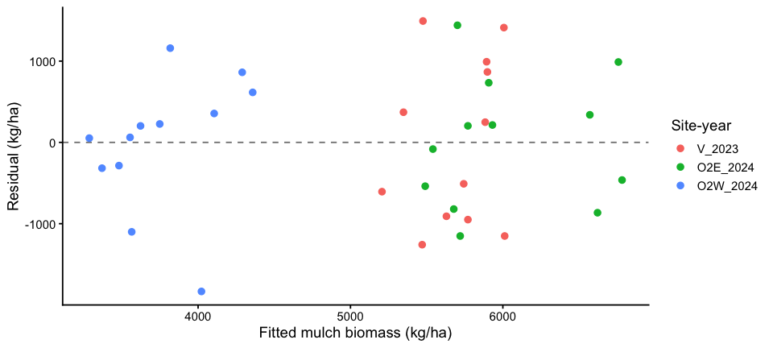
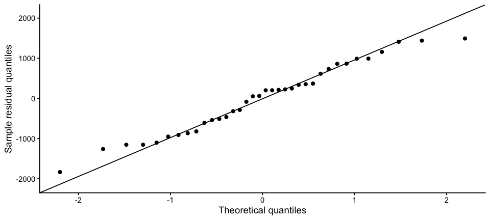
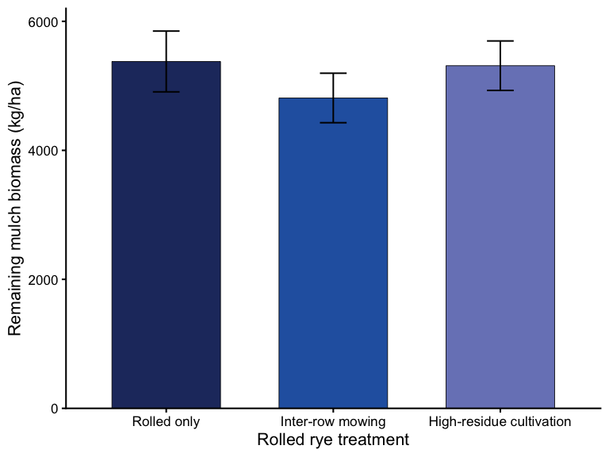
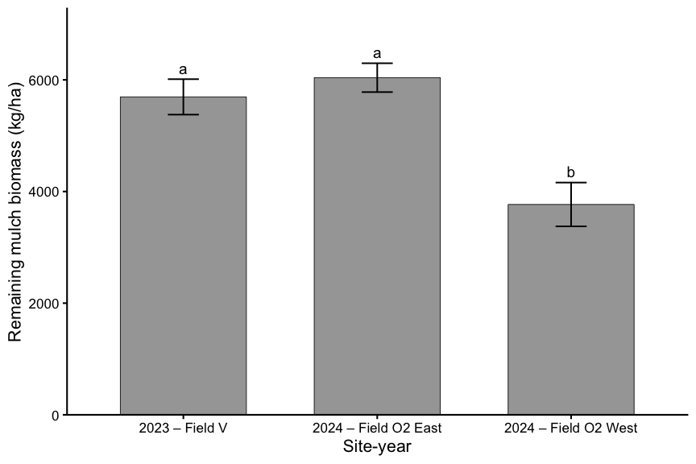
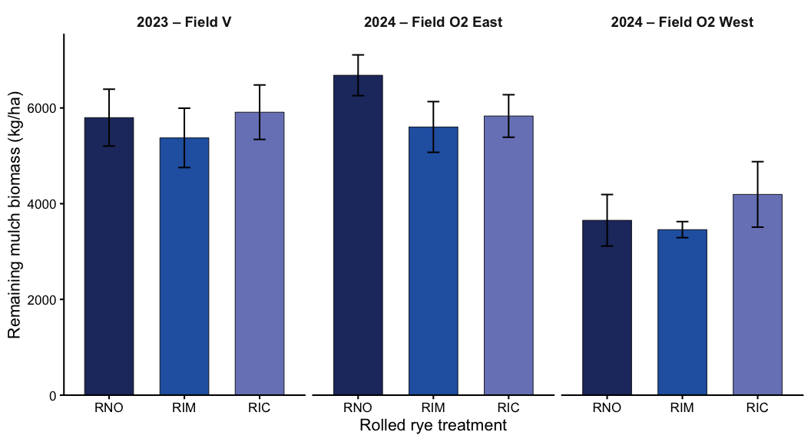
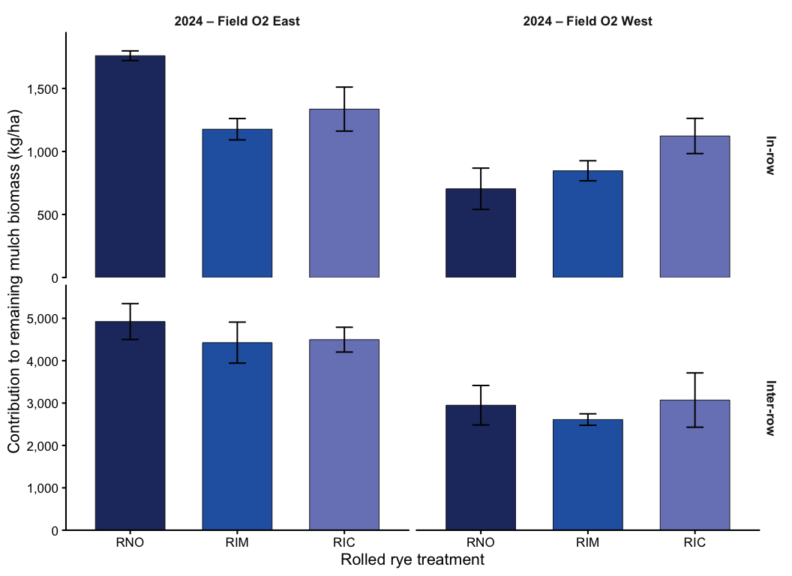

Total rolled mulch biomass at peak weed sampling
================

- [Question and experimental design](#question-and-experimental-design)
- [Setup](#setup)
- [Import and validate](#import-and-validate)
- [Describe the observations](#describe-the-observations)
- [Fit the primary model](#fit-the-primary-model)
- [Check assumptions and block
  variance](#check-assumptions-and-block-variance)
- [Tests and overall estimates](#tests-and-overall-estimates)
  - [Site-year estimates and Fisher’s
    LSD](#site-year-estimates-and-fishers-lsd)
- [Final figures: raw means ± SE](#final-figures-raw-means--se)
  - [Treatment means](#treatment-means)
  - [Site-year means](#site-year-means)
- [Results summary](#results-summary)
- [Appendix: supporting analyses](#appendix-supporting-analyses)
  - [Exploratory treatment patterns within
    site-years](#exploratory-treatment-patterns-within-site-years)
  - [In-row and inter-row mulch biomass (2024
    only)](#in-row-and-inter-row-mulch-biomass-2024-only)
  - [Interpretation notes](#interpretation-notes)
  - [R session](#r-session)

# Question and experimental design

Does supplemental inter-row weed management affect the amount of cereal
rye mulch remaining at peak weed sampling? The primary planned
comparison is inter-row mowing (RIM) versus rolled rye with no
supplemental management (RNO). High-residue cultivation (RIC) versus RNO
is a secondary planned comparison.

Only the three rolled treatments have mulch measurements. Total mulch
biomass was measured in 2023 Field V, 2024 O2 East, and 2024 O2 West,
with four randomized blocks per site-year. Each rolled subplot
contributes one observation (3 site-years × 4 blocks × 3 treatments = 36
subplots), with subplots grouped within 12 rolled main plots. The
response is **remaining mulch biomass**, not a direct pre/post estimate
of biomass removed by an operation.

# Setup

``` r
library(tidyverse)
library(here)
library(conflicted)
library(WrensBookshelf)
library(lmerTest)
library(emmeans)

conflicts_prefer(dplyr::filter)
conflicts_prefer(dplyr::select)
treatment_codes <- c("RNO", "RIM", "RIC", "TIM", "TIC")
treatment_colors <- setNames(
  WrensBookshelf::WB_brewer(name = "WhatWellBuild", n = 5, type = "discrete"),
  treatment_codes
)
rolled_colors <- treatment_colors[c("RNO", "RIM", "RIC")]
rolled_labels <- c("RNO" = "Rolled only", "RIM" = "Inter-row mowing",
                   "RIC" = "High-residue cultivation")
theme_set(theme_classic(base_size = 16))
emm_options(lmer.df = "satterthwaite")
show_table <- function(x, caption, digits = 1) {
  x <- as.data.frame(x)
  p_cols <- names(x)[names(x) %in% c("p.value", "Pr(>F)", "p_holm") |
                         grepl("^p_", names(x))]
  for (nm in p_cols) {
    x[[nm]] <- ifelse(is.na(x[[nm]]), NA_character_,
                      ifelse(x[[nm]] < 0.001, "<0.001", sprintf("%.3f", x[[nm]])))
  }
  knitr::kable(x, digits = digits, caption = caption)
}

experiment_labels <- c(
  V_2023 = "2023 – Field V",
  O2E_2024 = "2024 – Field O2 East",
  O2W_2024 = "2024 – Field O2 West"
)
tab_dir <- here("output", "tables", "mulch_biomass")
dir.create(tab_dir, recursive = TRUE, showWarnings = FALSE)
dir.create(here("figures", "mulch_biomass"), recursive = TRUE, showWarnings = FALSE)
```

# Import and validate

Read the standardized processed dataset directly from the Mowtivation
project. Mulch biomass is already in kg/ha, so no second conversion is
needed.

``` r
data_path <- here("data", "processed", "combined_processed.rds")
combined <- readRDS(data_path)

required <- c("site_year", "block", "treatment", "mulch_biomass_kg_ha",
              "inrow_mulch_biomass_kg_ha", "interrow_mulch_biomass_kg_ha")
missing_columns <- setdiff(required, names(combined))
if (length(missing_columns)) {
  stop("Missing processed-data columns: ", paste(missing_columns, collapse = ", "))
}

mulch <- combined |>
  filter(as.character(treatment) %in% c("RNO", "RIM", "RIC")) |>
  transmute(
    site_year = factor(as.character(site_year), levels = names(experiment_labels)),
    block = factor(block),
    treatment = factor(as.character(treatment), levels = c("RNO", "RIM", "RIC")),
    mulch_kg_ha = as.numeric(mulch_biomass_kg_ha)
  ) |>
  mutate(
    termination_method = factor("Roller-crimper", levels = c("Roller-crimper", "Moldboard plow")),
    block_id = interaction(site_year, block, drop = TRUE),
    main_plot_id = interaction(block_id, termination_method, drop = TRUE)
  )

stopifnot(nrow(mulch) == 36, !anyNA(mulch),
          all(mulch$mulch_kg_ha > 0),
          all(as.vector(table(mulch$site_year, mulch$treatment)) == 4),
          all(as.vector(table(mulch$site_year, mulch$block)) == 3))

stopifnot(n_distinct(mulch$block_id) == 12L,
          n_distinct(mulch$main_plot_id) == 12L)
show_table(mulch |> count(site_year, treatment), "Validated rolled mulch observations")
```

| site_year | treatment |   n |
|:----------|:----------|----:|
| V_2023    | RNO       |   4 |
| V_2023    | RIM       |   4 |
| V_2023    | RIC       |   4 |
| O2E_2024  | RNO       |   4 |
| O2E_2024  | RIM       |   4 |
| O2E_2024  | RIC       |   4 |
| O2W_2024  | RNO       |   4 |
| O2W_2024  | RIM       |   4 |
| O2W_2024  | RIC       |   4 |

Validated rolled mulch observations

# Describe the observations

The tables and figures below show **observed plot means ± standard
errors**. They are not model-adjusted estimates. With a balanced design,
each site-year contributes equally to the overall treatment means.

``` r
summary_by_site <- mulch |>
  group_by(site_year, treatment) |>
  summarise(n = n(), mean = mean(mulch_kg_ha),
            sd = sd(mulch_kg_ha), se = sd / sqrt(n), .groups = "drop")

summary_overall <- mulch |>
  group_by(treatment) |>
  summarise(n = n(), mean = mean(mulch_kg_ha),
            sd = sd(mulch_kg_ha), se = sd / sqrt(n), .groups = "drop")

# Average rolled subplots within each block before calculating site-year SE.
block_means <- mulch |>
  group_by(site_year, block_id) |>
  summarise(mulch_kg_ha = mean(mulch_kg_ha), .groups = "drop")
summary_site_year <- block_means |>
  group_by(site_year) |>
  summarise(n_blocks = n(), mean = mean(mulch_kg_ha),
            sd = sd(mulch_kg_ha), se = sd / sqrt(n_blocks), .groups = "drop")

show_table(summary_by_site, "Observed mulch biomass by site-year and treatment (kg/ha)")
```

| site_year | treatment |   n |   mean |     sd |    se |
|:----------|:----------|----:|-------:|-------:|------:|
| V_2023    | RNO       |   4 | 5798.0 | 1187.9 | 594.0 |
| V_2023    | RIM       |   4 | 5375.2 | 1239.7 | 619.8 |
| V_2023    | RIC       |   4 | 5911.5 | 1138.0 | 569.0 |
| O2E_2024  | RNO       |   4 | 6683.0 |  851.4 | 425.7 |
| O2E_2024  | RIM       |   4 | 5602.8 | 1060.0 | 530.0 |
| O2E_2024  | RIC       |   4 | 5832.3 |  888.7 | 444.4 |
| O2W_2024  | RNO       |   4 | 3652.7 | 1076.9 | 538.4 |
| O2W_2024  | RIM       |   4 | 3457.8 |  335.9 | 167.9 |
| O2W_2024  | RIC       |   4 | 4193.8 | 1368.5 | 684.2 |

Observed mulch biomass by site-year and treatment (kg/ha)

``` r
show_table(summary_overall, "Observed mulch biomass by treatment (kg/ha)")
```

| treatment |   n |   mean |     sd |    se |
|:----------|----:|-------:|-------:|------:|
| RNO       |  12 | 5377.9 | 1632.4 | 471.2 |
| RIM       |  12 | 4811.9 | 1328.9 | 383.6 |
| RIC       |  12 | 5312.5 | 1327.8 | 383.3 |

Observed mulch biomass by treatment (kg/ha)

``` r
show_table(summary_site_year, "Observed mulch biomass by site-year, averaged within blocks (kg/ha)")
```

| site_year | n_blocks |   mean |    sd |    se |
|:----------|---------:|-------:|------:|------:|
| V_2023    |        4 | 5694.9 | 635.3 | 317.7 |
| O2E_2024  |        4 | 6039.4 | 516.4 | 258.2 |
| O2W_2024  |        4 | 3768.1 | 784.1 | 392.0 |

Observed mulch biomass by site-year, averaged within blocks (kg/ha)

The across-site-year raw SE above includes between-site-year
variability. Because treatment was randomized *within* site-year and
block, that SE is descriptive and should not be used to test treatment
differences. Inference comes from the blocked model below.

# Fit the primary model

Site-year and treatment are fixed effects, including their interaction;
`block_id` identifies blocks nested within site-years. All three sampled
subplots belong to the same rolled main plot in each block, so a
separate `main_plot_id` random intercept is redundant here. The Gaussian
model is fitted on the original kg/ha scale and evaluated using residual
diagnostics.

``` r
options(contrasts = c("contr.sum", "contr.poly"))
mulch_model <- lmerTest::lmer(
  mulch_kg_ha ~ site_year * treatment + (1 | block_id),
  data = mulch, REML = TRUE
)
```

# Check assumptions and block variance

Inspect the residual-versus-fitted plot for changing variance or
systematic patterns, and the Q-Q plot for substantial departures from
normality. Site-year residual spreads are also summarized. If serious
heterogeneity appears, revisit the residual variance structure before
drawing conclusions.

``` r
variance_table <- as.data.frame(lme4::VarCorr(mulch_model)) |>
  transmute(component = grp, variance = vcov, SD = sdcor)
show_table(variance_table, "Variance components (kg/ha scale)")
```

| component |  variance |     SD |
|:----------|----------:|-------:|
| block_id  |   85538.9 |  292.5 |
| Residual  | 1028528.3 | 1014.2 |

Variance components (kg/ha scale)

``` r
cat("Singular fit:", lme4::isSingular(mulch_model, tol = 1e-4), "\n")
```

    ## Singular fit: FALSE

``` r
diagnostics <- tibble(
  fitted = fitted(mulch_model),
  residual = resid(mulch_model),
  site_year = mulch$site_year
)

p_resid <- ggplot(diagnostics, aes(fitted, residual, color = site_year)) +
  geom_hline(yintercept = 0, linetype = "dashed", color = "grey50") +
  geom_point(size = 2.5) +
  labs(x = "Fitted mulch biomass (kg/ha)", y = "Residual (kg/ha)", color = "Site-year") +
  theme_classic(base_size = 14)

p_qq <- ggplot(diagnostics, aes(sample = residual)) +
  stat_qq(size = 2) + stat_qq_line() +
  labs(x = "Theoretical quantiles", y = "Sample residual quantiles") +
  theme_classic(base_size = 14)

print(p_resid)
```

<!-- -->

``` r
print(p_qq)
```

<!-- -->

``` r
diagnostics |> group_by(site_year) |>
  summarise(residual_sd = sd(residual), .groups = "drop") |>
  knitr::kable(digits = 1)
```

| site_year | residual_sd |
|:----------|------------:|
| V_2023    |      1019.1 |
| O2E_2024  |       800.7 |
| O2W_2024  |       822.8 |

# Tests and overall estimates

``` r
anova_table <- anova(mulch_model, type = 3, ddf = "Satterthwaite") |>
  as.data.frame() |>
  tibble::rownames_to_column("Effect") |>
  select(Effect, NumDF, DenDF, `F value`, `Pr(>F)`)
show_table(anova_table, "Type III tests (Satterthwaite degrees of freedom)", digits = 4)
```

| Effect              | NumDF | DenDF | F value | Pr(\>F) |
|:--------------------|------:|------:|--------:|:--------|
| site_year           |     2 |     9 | 13.9904 | 0.002   |
| treatment           |     2 |    18 |  1.1186 | 0.348   |
| site_year:treatment |     4 |    18 |  0.5086 | 0.730   |

Type III tests (Satterthwaite degrees of freedom)

``` r
readr::write_csv(anova_table,
                 file.path(tab_dir, "primary_model_anova.csv"))
```

The main inferential question is **RIM − RNO** averaged equally over the
three site-years. We also report RIC − RNO. These prespecified
comparisons are reported with unadjusted pointwise 95% confidence
intervals and two-sided tests, consistent with the soybean yield
analysis. Because the omnibus treatment test was nonsignificant, they
are not protected Fisher’s LSD comparisons and should not be interpreted
as confirmatory post-hoc findings. A negative difference indicates less
remaining mulch than RNO. Comparisons are averaged equally across the
three site-years.

``` r
emm_treatment <- emmeans(mulch_model, ~ treatment, weights = "equal")
show_table(as.data.frame(confint(emm_treatment)),
           "Overall model-estimated treatment means (kg/ha)")
```

| treatment | emmean |    SE |   df | lower.CL | upper.CL |
|:----------|-------:|------:|-----:|---------:|---------:|
| RNO       | 5377.9 | 304.7 | 26.7 |   4752.4 |   6003.5 |
| RIM       | 4811.9 | 304.7 | 26.7 |   4186.4 |   5437.4 |
| RIC       | 5312.5 | 304.7 | 26.7 |   4687.0 |   5938.1 |

Overall model-estimated treatment means (kg/ha)

``` r
planned_vs_rno <- contrast(emm_treatment, method = "trt.vs.ctrl", ref = 1)
planned_results <- as.data.frame(summary(
  planned_vs_rno, infer = c(TRUE, TRUE), adjust = "none"
))
show_table(planned_results, "Planned comparisons versus RNO (unadjusted, pointwise 95% CIs)", digits = 3)
```

| contrast  | estimate |      SE |  df |  lower.CL | upper.CL | t.ratio | p.value |
|:----------|---------:|--------:|----:|----------:|---------:|--------:|:--------|
| RIM - RNO | -566.008 | 414.031 |  18 | -1435.854 |  303.838 |  -1.367 | 0.188   |
| RIC - RNO |  -65.383 | 414.031 |  18 |  -935.229 |  804.463 |  -0.158 | 0.876   |

Planned comparisons versus RNO (unadjusted, pointwise 95% CIs)

``` r
readr::write_csv(as.data.frame(confint(emm_treatment)),
                 file.path(tab_dir, "treatment_model_means.csv"))
readr::write_csv(planned_results,
                 file.path(tab_dir, "planned_comparisons_vs_rno.csv"))
```

## Site-year estimates and Fisher’s LSD

The site-year omnibus effect was significant, so we retain unadjusted
pairwise site-year comparisons (Fisher’s LSD-style). These compare
site-year averages across the rolled treatments, not treatment effects
within each site-year. Inference is limited to the observed site-years.

``` r
emm_site_year <- emmeans(mulch_model, ~ site_year, weights = "equal")
show_table(as.data.frame(confint(emm_site_year)),
           "Model-estimated site-year means (kg/ha)")
```

| site_year | emmean |    SE |  df | lower.CL | upper.CL |
|:----------|-------:|------:|----:|---------:|---------:|
| V_2023    | 5694.9 | 327.3 |   9 |   4954.6 |   6435.2 |
| O2E_2024  | 6039.4 | 327.3 |   9 |   5299.1 |   6779.7 |
| O2W_2024  | 3768.1 | 327.3 |   9 |   3027.8 |   4508.4 |

Model-estimated site-year means (kg/ha)

``` r
site_year_p <- anova_table[["Pr(>F)"]][anova_table$Effect == "site_year"]
stopifnot(length(site_year_p) == 1L)
if (site_year_p < 0.05) {
  site_year_pairs <- as.data.frame(summary(
    pairs(emm_site_year, adjust = "none"), infer = c(TRUE, TRUE)
  ))
  show_table(site_year_pairs, "Site-year Fisher's LSD comparisons", digits = 3)
  readr::write_csv(site_year_pairs,
                 file.path(tab_dir, "site_year_comparisons_fisher_lsd.csv"))
} else {
  cat("Site-year omnibus test not significant; no post-hoc comparisons.\n")
}


readr::write_csv(as.data.frame(confint(emm_site_year)),
                 file.path(tab_dir, "site_year_model_means.csv"))
```

# Final figures: raw means ± SE

The overall treatment test is nonsignificant, so no exploratory Fisher’s
LSD post-hoc grouping or CLD letters are shown. The prespecified
comparisons against RNO above provide exploratory estimates for the
mowing and cultivation questions despite the nonsignificant omnibus
treatment test. Figure means and error bars are descriptive; statistical
inference uses the blocked mixed model.

## Treatment means

``` r
mulch_overall_fig <- ggplot(summary_overall, aes(treatment, mean, fill = treatment)) +
  geom_col(width = 0.65, color = "black", linewidth = 0.3) +
  geom_errorbar(aes(ymin = mean - se, ymax = mean + se),
                width = 0.16, linewidth = 0.7) +
  scale_fill_manual(values = rolled_colors, guide = "none") +
  scale_x_discrete(labels = rolled_labels) +
  scale_y_continuous(expand = expansion(mult = c(0, 0.06))) +
  labs(x = "Rolled rye treatment", y = "Remaining mulch biomass (kg/ha)") +
  theme(axis.text.x = element_text(size = 13))

mulch_overall_fig
```

<!-- -->

## Site-year means

The rolled treatments are averaged within each block before calculating
observed site-year means ± SE (four blocks per site-year). Lowercase
letters, when shown, come from model-based unadjusted site-year
comparisons.

``` r
site_year_plot_data <- summary_site_year
if (site_year_p < 0.05) {
  site_year_letters <- multcomp::cld(
    emm_site_year, adjust = "none", Letters = letters, reversed = TRUE
  ) |>
    as.data.frame() |>
    transmute(site_year, cld = gsub(" ", "", .group))
  site_year_plot_data <- site_year_plot_data |>
    left_join(site_year_letters, by = "site_year")
  readr::write_csv(site_year_letters,
                   file.path(tab_dir, "site_year_cld_unadjusted.csv"))
}

mulch_site_year_fig <- ggplot(site_year_plot_data, aes(site_year, mean)) +
  geom_col(width = 0.65, fill = "grey65", color = "black", linewidth = 0.3) +
  geom_errorbar(aes(ymin = mean - se, ymax = mean + se),
                width = 0.16, linewidth = 0.7) +
  scale_x_discrete(labels = experiment_labels) +
  scale_y_continuous(expand = expansion(mult = c(0, 0.12))) +
  labs(x = "Site-year", y = "Remaining mulch biomass (kg/ha)")
if (site_year_p < 0.05) {
  mulch_site_year_fig <- mulch_site_year_fig +
    geom_text(aes(y = mean + se + 200, label = cld), size = 5)
}

mulch_site_year_fig
```

<!-- -->

``` r
dir.create(here("figures", "mulch_biomass"), showWarnings = FALSE, recursive = TRUE)
ggsave(here("figures", "mulch_biomass", "treatment_raw_means.png"),
       mulch_overall_fig, width = 8, height = 6, dpi = 300, bg = "white")
ggsave(here("figures", "mulch_biomass", "site_year_raw_means.png"),
       mulch_site_year_fig, width = 9, height = 6, dpi = 300, bg = "white")
```

# Results summary

The site-year effect was significant (p = 0.002), but treatment (p =
0.348) and the treatment × site-year interaction (p = 0.73) were not
significant. The planned RIM–RNO contrast was -566 kg/ha (unadjusted
pointwise 95% CI: -1436 to 304 kg/ha; p = 0.188). This single
post-treatment sampling occasion does not directly quantify biomass lost
through mowing or cultivation.

# Appendix: supporting analyses

## Exploratory treatment patterns within site-years

The faceted plot helps visualize site-year-specific treatment patterns,
but is not the figure used to show the significant overall site-year
effect. No within-site-year treatment letters are displayed because the
interaction was nonsignificant and these were not the primary planned
comparisons.

``` r
mulch_site_treatment_fig <- ggplot(summary_by_site,
                                  aes(treatment, mean, fill = treatment)) +
  geom_col(width = 0.65, color = "black", linewidth = 0.3) +
  geom_errorbar(aes(ymin = mean - se, ymax = mean + se),
                width = 0.16, linewidth = 0.7) +
  facet_wrap(~ site_year, nrow = 1,
             labeller = labeller(site_year = experiment_labels)) +
  scale_fill_manual(values = rolled_colors, guide = "none") +
  scale_x_discrete(labels = c("RNO", "RIM", "RIC")) +
  scale_y_continuous(expand = expansion(mult = c(0, 0.06))) +
  labs(x = "Rolled rye treatment", y = "Remaining mulch biomass (kg/ha)") +
  theme(strip.background = element_blank(),
        strip.text = element_text(face = "bold", size = 14))
mulch_site_treatment_fig
```

<!-- -->

``` r
ggsave(here("figures", "mulch_biomass", "site_year_treatment_raw_means.png"),
       mulch_site_treatment_fig, width = 11, height = 6, dpi = 300, bg = "white")
```

## In-row and inter-row mulch biomass (2024 only)

In 2024, mulch was separated into in-row and inter-row components using
the same sampling and area-weighting approach as the weed biomass
measurements. The two components sum to total mulch biomass. The values
below therefore represent contributions to the plot-level kg/ha total,
not independent measurements of biomass density over each sampling zone.

This descriptive analysis asks whether differences among rolled
treatments are concentrated in the area directly managed by mowing or
cultivation. Both sampling zones belong to the same plot, so they should
not be treated as independent experimental replicates in any subsequent
statistical model.

``` r
mulch_zones_wide <- combined |>
  filter(as.character(site_year) %in% c("O2E_2024", "O2W_2024"),
         as.character(treatment) %in% c("RNO", "RIM", "RIC")) |>
  transmute(
    site_year = factor(as.character(site_year),
                       levels = c("O2E_2024", "O2W_2024")),
    block = factor(block),
    treatment = factor(as.character(treatment), levels = c("RNO", "RIM", "RIC")),
    in_row = as.numeric(inrow_mulch_biomass_kg_ha),
    inter_row = as.numeric(interrow_mulch_biomass_kg_ha),
    total = as.numeric(mulch_biomass_kg_ha)
  )

stopifnot(
  nrow(mulch_zones_wide) == 24L,
  !anyNA(mulch_zones_wide),
  all(as.vector(table(mulch_zones_wide$site_year,
                      mulch_zones_wide$treatment)) == 4L),
  isTRUE(all.equal(mulch_zones_wide$in_row + mulch_zones_wide$inter_row,
                   mulch_zones_wide$total, tolerance = 1e-7))
)

mulch_zones <- mulch_zones_wide |>
  select(site_year, block, treatment, in_row, inter_row) |>
  pivot_longer(c(in_row, inter_row),
               names_to = "sampling_zone", values_to = "mulch_kg_ha") |>
  mutate(sampling_zone = factor(sampling_zone,
                                levels = c("in_row", "inter_row"),
                                labels = c("In-row", "Inter-row")))

mulch_zone_summary <- mulch_zones |>
  group_by(site_year, sampling_zone, treatment) |>
  summarise(n = n(), mean = mean(mulch_kg_ha),
            sd = sd(mulch_kg_ha), se = sd / sqrt(n), .groups = "drop")

show_table(mulch_zone_summary,
           "2024 in-row and inter-row contributions to mulch biomass (kg/ha)")
```

| site_year | sampling_zone | treatment |   n |   mean |     sd |    se |
|:----------|:--------------|:----------|----:|-------:|-------:|------:|
| O2E_2024  | In-row        | RNO       |   4 | 1759.8 |   76.5 |  38.2 |
| O2E_2024  | In-row        | RIM       |   4 | 1176.6 |  169.3 |  84.6 |
| O2E_2024  | In-row        | RIC       |   4 | 1336.0 |  349.4 | 174.7 |
| O2E_2024  | Inter-row     | RNO       |   4 | 4923.3 |  847.7 | 423.9 |
| O2E_2024  | Inter-row     | RIM       |   4 | 4426.2 |  968.5 | 484.2 |
| O2E_2024  | Inter-row     | RIC       |   4 | 4496.3 |  585.5 | 292.8 |
| O2W_2024  | In-row        | RNO       |   4 |  703.8 |  328.0 | 164.0 |
| O2W_2024  | In-row        | RIM       |   4 |  846.7 |  159.4 |  79.7 |
| O2W_2024  | In-row        | RIC       |   4 | 1123.0 |  279.3 | 139.7 |
| O2W_2024  | Inter-row     | RNO       |   4 | 2948.9 |  932.6 | 466.3 |
| O2W_2024  | Inter-row     | RIM       |   4 | 2611.1 |  270.4 | 135.2 |
| O2W_2024  | Inter-row     | RIC       |   4 | 3070.9 | 1281.8 | 640.9 |

2024 in-row and inter-row contributions to mulch biomass (kg/ha)

``` r
mulch_zone_fig <- ggplot(mulch_zone_summary,
                         aes(treatment, mean, fill = treatment)) +
  geom_col(width = 0.65, color = "black", linewidth = 0.3) +
  geom_errorbar(aes(ymin = mean - se, ymax = mean + se),
                width = 0.16, linewidth = 0.7) +
  facet_grid(sampling_zone ~ site_year, scales = "free_y",
             labeller = labeller(site_year = experiment_labels)) +
  scale_fill_manual(values = rolled_colors, guide = "none") +
  scale_x_discrete(labels = c("RNO", "RIM", "RIC")) +
  scale_y_continuous(labels = scales::label_comma(),
                     expand = expansion(mult = c(0, 0.08))) +
  labs(x = "Rolled rye treatment",
       y = "Contribution to remaining mulch biomass (kg/ha)") +
  theme(strip.background = element_blank(),
        strip.text = element_text(face = "bold", size = 13))
mulch_zone_fig
```

<!-- -->

``` r
ggsave(here("figures", "mulch_biomass", "zone_2024_raw_means.png"),
       mulch_zone_fig, width = 11, height = 8, dpi = 300, bg = "white")
```

The error bars show raw plot-level means ± SE (four plots per treatment
within each site-year and sampling zone). No post-hoc comparisons are
made here. The free y-scales help compare treatments *within* a zone but
should not be used to judge the relative magnitudes of in-row and
inter-row contributions.

## Interpretation notes

Emphasize the site-year test and the nonsignificant treatment and
interaction tests. Report RIM − RNO and RIC − RNO as planned, unadjusted
comparisons, interpreted cautiously in light of the nonsignificant
omnibus treatment test. Biomass was sampled once after treatment, so
remaining mulch is not a direct measure of mulch loss. Raw SEs are
descriptive; planned contrasts use model-based uncertainty. The 2024
zone data are descriptive and do not provide independent treatment
tests.

## R session

``` r
sessionInfo()
```

    ## R version 4.5.2 (2025-10-31)
    ## Platform: aarch64-apple-darwin20
    ## Running under: macOS 27.2.1
    ## 
    ## Matrix products: default
    ## BLAS:   /System/Library/Frameworks/Accelerate.framework/Versions/A/Frameworks/vecLib.framework/Versions/A/libBLAS.dylib 
    ## LAPACK: /Library/Frameworks/R.framework/Versions/4.5-arm64/Resources/lib/libRlapack.dylib;  LAPACK version 3.12.1
    ## 
    ## locale:
    ## [1] en_US.UTF-8/en_US.UTF-8/en_US.UTF-8/C/en_US.UTF-8/en_US.UTF-8
    ## 
    ## time zone: America/New_York
    ## tzcode source: internal
    ## 
    ## attached base packages:
    ## [1] stats     graphics  grDevices utils     datasets  methods   base     
    ## 
    ## other attached packages:
    ##  [1] emmeans_1.11.2-8     lmerTest_3.1-3       lme4_1.1-37         
    ##  [4] Matrix_1.7-4         WrensBookshelf_0.1.0 conflicted_1.2.0    
    ##  [7] here_1.0.2           lubridate_1.9.4      forcats_1.0.1       
    ## [10] stringr_1.5.2        dplyr_1.1.4          purrr_1.1.0         
    ## [13] readr_2.1.5          tidyr_1.3.1          tibble_3.3.0        
    ## [16] ggplot2_4.0.0        tidyverse_2.0.0     
    ## 
    ## loaded via a namespace (and not attached):
    ##  [1] gtable_0.3.6        xfun_0.61           lattice_0.22-7     
    ##  [4] tzdb_0.5.0          numDeriv_2016.8-1.1 vctrs_0.6.5        
    ##  [7] tools_4.5.2         Rdpack_2.6.4        generics_0.1.4     
    ## [10] parallel_4.5.2      sandwich_3.1-1      pkgconfig_2.0.3    
    ## [13] RColorBrewer_1.1-3  S7_0.2.0            lifecycle_1.0.4    
    ## [16] compiler_4.5.2      farver_2.1.2        textshaping_1.0.4  
    ## [19] codetools_0.2-20    htmltools_0.5.8.1   yaml_2.3.10        
    ## [22] crayon_1.5.3        pillar_1.11.1       nloptr_2.2.1       
    ## [25] MASS_7.3-65         cachem_1.1.0        reformulas_0.4.4   
    ## [28] boot_1.3-32         multcomp_1.4-29     nlme_3.1-168       
    ## [31] tidyselect_1.2.1    digest_0.6.37       mvtnorm_1.3-3      
    ## [34] stringi_1.8.7       labeling_0.4.3      splines_4.5.2      
    ## [37] rprojroot_2.1.1     fastmap_1.2.0       grid_4.5.2         
    ## [40] cli_3.6.5           magrittr_2.0.4      survival_3.8-3     
    ## [43] TH.data_1.1-4       withr_3.0.2         scales_1.4.0       
    ## [46] bit64_4.6.0-1       timechange_0.3.0    estimability_1.5.1 
    ## [49] rmarkdown_2.30      bit_4.6.0           ragg_1.5.0         
    ## [52] zoo_1.8-14          hms_1.1.4           memoise_2.0.1      
    ## [55] coda_0.19-4.1       evaluate_1.0.5      knitr_1.50         
    ## [58] rbibutils_2.3       rlang_1.1.6         Rcpp_1.1.0         
    ## [61] xtable_1.8-4        glue_1.8.0          vroom_1.6.6        
    ## [64] rstudioapi_0.17.1   minqa_1.2.8         R6_2.6.1           
    ## [67] systemfonts_1.3.1   multcompView_0.1-10
