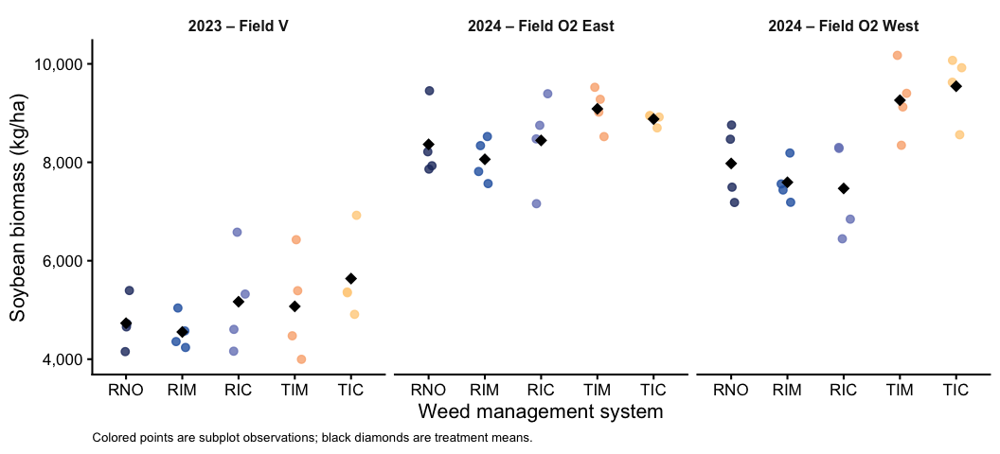
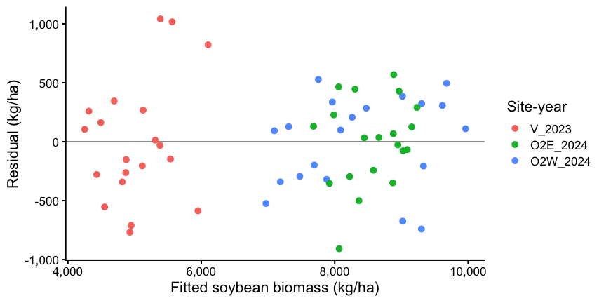
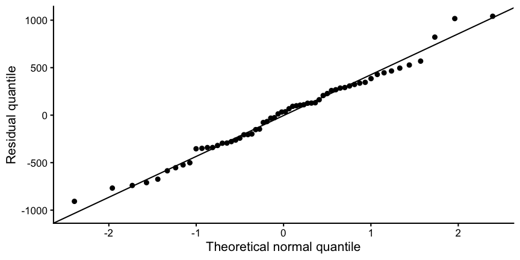
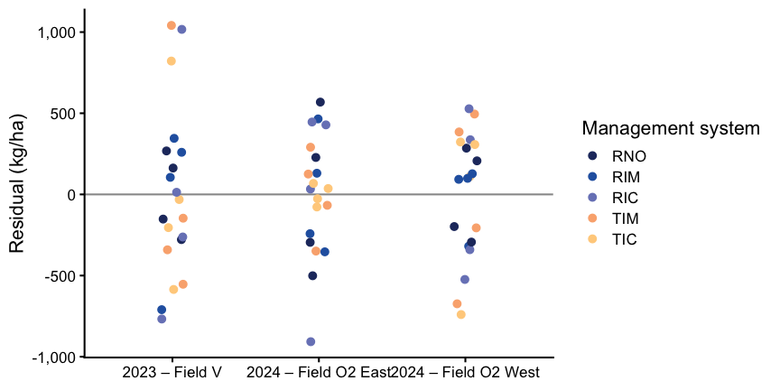
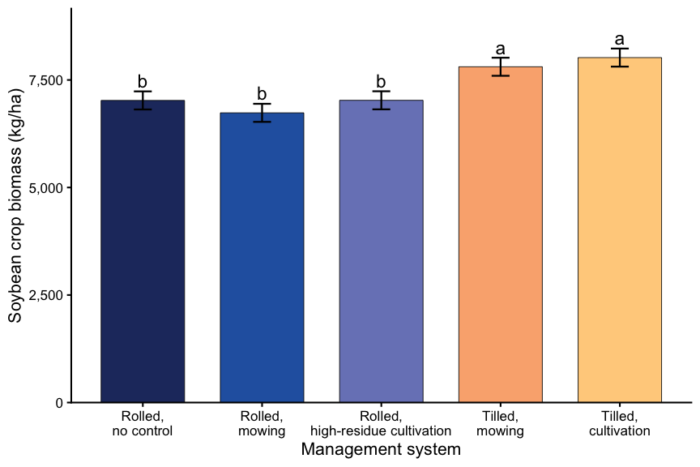
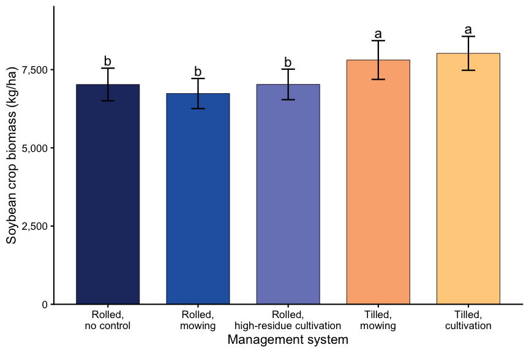
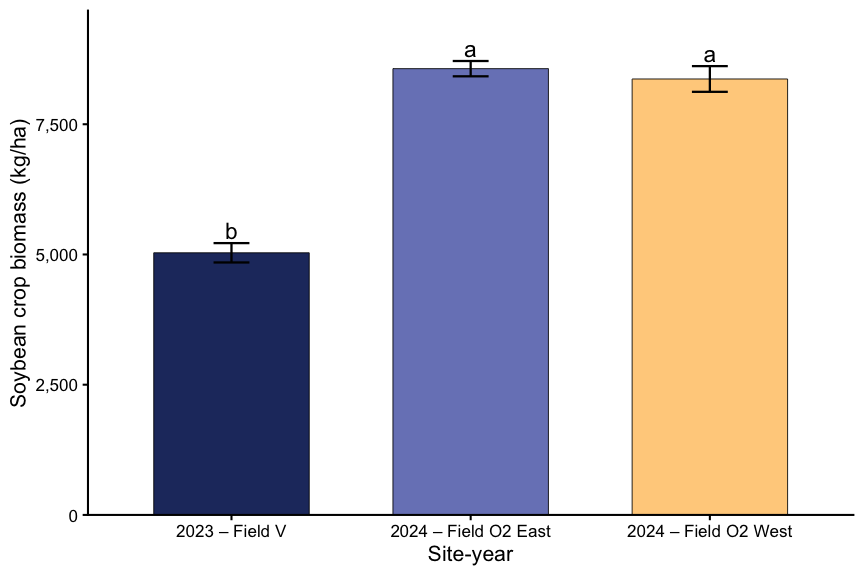

Soybean biomass
================

- [Question and experimental design](#question-and-experimental-design)
- [Setup](#setup)

# Question and experimental design

Did soybean aboveground biomass differ among five management systems,
and did system differences vary among experiments (site-years)?

The experiment was a split-plot design evaluating five management
systems. Cereal rye termination method was assigned to whole plots
within blocks: moldboard plowing (tilled) or roller-crimping (rolled).
Within tilled whole plots, subplots received cultivation (TIC) or mowing
(TIM). Within rolled whole plots, subplots received no supplemental weed
control (RNO), mowing (RIM), or high-residue cultivation (RIC). One
soybean biomass observation was collected per subplot. Thus, subplots
are the observational units, while comparisons between systems with
different termination methods depend on whole-plot replication. The five
systems are not a fully crossed factorial treatment.

The 2023 field layout had a documented implementation deviation; the
realized 2023 assignments should be used. The 2024 layout followed the
planned design. RIC received only one late cultivation event, rather
than the intended repeated cultivations. Interpret RIC as implemented,
not as originally prescribed.

# Setup

``` r
library(tidyverse)
library(here)
library(conflicted)
library(WrensBookshelf)
library(lmerTest)
library(emmeans)

conflicts_prefer(dplyr::filter)
conflicts_prefer(dplyr::select)

method_levels <- c("Roller-crimper", "Moldboard plow")
treatment_levels <- c("RNO", "RIM", "RIC", "TIM", "TIC")
treatment_labels <- c(
  RNO = "Rolled,\nno control",
  RIM = "Rolled,\nmowing",
  RIC = "Rolled,\nhigh-residue cultivation",
  TIM = "Tilled,\nmowing",
  TIC = "Tilled,\ncultivation"
)

experiment_labels <- c(
  V_2023 = "2023 – Field V",
  O2E_2024 = "2024 – Field O2 East",
  O2W_2024 = "2024 – Field O2 West"
)

experiment_colors <- setNames(
  WrensBookshelf::WB_brewer(
    name = "WhatWellBuild", n = 5, type = "discrete"
  )[c(1, 3, 5)],
  names(experiment_labels)
)
method_lookup <- c(
  RNO = "Roller-crimper", RIM = "Roller-crimper",
  RIC = "Roller-crimper", TIM = "Moldboard plow",
  TIC = "Moldboard plow"
)

treatment_colors <- setNames(
  WrensBookshelf::WB_brewer(name = "WhatWellBuild", n = 5, type = "discrete"),
  treatment_levels
)

theme_set(theme_classic(base_size = 16))

# Plain tables render in both HTML and GitHub Markdown.
show_table <- function(x, caption, digits = 1) {
  knitr::kable(x, digits = digits, caption = caption)
}

# Use the same degrees-of-freedom method in ANOVA and estimated means.
emm_options(lmer.df = "satterthwaite")

fmt_p <- function(x) {
  if (x < 0.001) "< 0.001" else
    paste("=", formatC(x, format = "f", digits = 3))
}
```

``` r
processed_data <- readRDS(
  here("data", "processed", "combined_processed.rds")
)

required <- c(
  "site_year", "block", "treatment", "bean_biomass_kg_ha"
)

missing_columns <- setdiff(required, names(processed_data))

if (length(missing_columns)) {
  stop("Missing columns: ", paste(missing_columns, collapse = ", "))
}

plot_data <- processed_data |>
  select(all_of(required)) |>
  mutate(across(c(site_year, block, treatment), as.character))

if (anyNA(plot_data[c("site_year", "block", "treatment")]) ||
    any(vapply(
      plot_data[c("site_year", "block", "treatment")],
      function(x) any(trimws(x) == ""),
      logical(1)
    ))) {
  stop("Missing or blank site-year, block, or treatment identifiers.")
}

if (!setequal(unique(plot_data$site_year), names(experiment_labels))) {
  stop("Site-year identifiers do not match experiment_labels.")
}

if (!setequal(unique(plot_data$treatment), treatment_levels)) {
  stop("Treatment identifiers do not match treatment_levels.")
}

y <- plot_data$bean_biomass_kg_ha

if (!is.numeric(y) || any(!is.finite(y)) || any(y < 0)) {
  stop("Biomass must contain finite, nonnegative numeric values with no missing data.")
}

plot_counts <- plot_data |>
  count(site_year, block, treatment)

block_counts <- plot_counts |>
  count(site_year, block, name = "n_treatments")

experiment_counts <- block_counts |>
  count(site_year, name = "n_blocks")

if (any(plot_counts$n != 1L) ||
    any(block_counts$n_treatments != 5L) ||
    any(experiment_counts$n_blocks != 4L)) {
  stop(
    "Expected one record per treatment, five treatments per block, ",
    "and four blocks per site-year."
  )
}

plot_data <- plot_data |>
  mutate(
    site_year = factor(site_year, levels = names(experiment_labels)),
    treatment = factor(treatment, levels = treatment_levels),
    primary_method = factor(
      unname(method_lookup[as.character(treatment)]),
      levels = method_levels
    ),
    block_id = interaction(site_year, block, drop = TRUE),
    whole_plot_id = interaction(
      block_id, primary_method, drop = TRUE
    )
  )

validation_summary <- plot_data |>
  group_by(site_year) |>
  summarise(
    plots = n(),
    blocks = n_distinct(block_id),
    whole_plots = n_distinct(whole_plot_id),
    min_biomass = min(bean_biomass_kg_ha),
    max_biomass = max(bean_biomass_kg_ha),
    .groups = "drop"
  )

show_table(
  validation_summary,
  "Validated records and soybean biomass range (kg/ha)"
)
```

| site_year | plots | blocks | whole_plots | min_biomass | max_biomass |
|:----------|------:|-------:|------------:|------------:|------------:|
| V_2023    |    20 |      4 |           8 |      3997.4 |      6923.5 |
| O2E_2024  |    20 |      4 |           8 |      7159.3 |      9524.1 |
| O2W_2024  |    20 |      4 |           8 |      6446.0 |     10173.1 |

Validated records and soybean biomass range (kg/ha)

``` r
biomass_data <- plot_data |>
  mutate(
    treatment = factor(treatment, levels = treatment_levels)
  )

contrasts(biomass_data$treatment) <- contr.sum(5)
contrasts(biomass_data$site_year) <- contr.sum(3)
```

``` r
biomass_summary <- biomass_data |>
  group_by(site_year, treatment) |>
  summarise(
    n_plots = n(),
    mean_biomass = mean(bean_biomass_kg_ha),
    sd_biomass = sd(bean_biomass_kg_ha),
    .groups = "drop"
  )

show_table(
  biomass_summary,
  "Observed subplot soybean biomass: mean and SD (kg/ha)"
)
```

| site_year | treatment | n_plots | mean_biomass | sd_biomass |
|:----------|:----------|--------:|-------------:|-----------:|
| V_2023    | RNO       |       4 |       4731.6 |      509.9 |
| V_2023    | RIM       |       4 |       4552.4 |      353.6 |
| V_2023    | RIC       |       4 |       5167.6 |     1056.0 |
| V_2023    | TIM       |       4 |       5072.6 |     1072.4 |
| V_2023    | TIC       |       4 |       5637.2 |      883.0 |
| O2E_2024  | RNO       |       4 |       8364.9 |      741.7 |
| O2E_2024  | RIM       |       4 |       8061.0 |      445.9 |
| O2E_2024  | RIC       |       4 |       8444.7 |      939.2 |
| O2E_2024  | TIM       |       4 |       9086.5 |      429.0 |
| O2E_2024  | TIC       |       4 |       8878.4 |      120.2 |
| O2W_2024  | RNO       |       4 |       7976.3 |      755.6 |
| O2W_2024  | RIM       |       4 |       7593.6 |      426.1 |
| O2W_2024  | RIC       |       4 |       7468.9 |      964.6 |
| O2W_2024  | TIM       |       4 |       9261.5 |      754.3 |
| O2W_2024  | TIC       |       4 |       9544.9 |      682.1 |

Observed subplot soybean biomass: mean and SD (kg/ha)

``` r
ggplot(biomass_data, aes(treatment, bean_biomass_kg_ha)) +
  geom_point(
    aes(color = treatment),
    position = position_jitter(width = 0.12, height = 0),
    size = 2.5,
    alpha = 0.8
  ) +
  stat_summary(
    fun = mean,
    geom = "point",
    shape = 18,
    size = 4,
    color = "black"
  ) +
  facet_wrap(
    ~site_year,
    labeller = labeller(site_year = experiment_labels)
  ) +
  scale_color_manual(values = treatment_colors, guide = "none") +
  scale_y_continuous(labels = scales::label_comma()) +
  labs(
    x = "Weed management system",
    y = "Soybean biomass (kg/ha)",
    caption = paste(
      "Colored points are subplot observations;",
      "black diamonds are treatment means."
    )
  ) +
  theme(
    strip.background = element_blank(),
    strip.text = element_text(face = "bold", size = 12),
    plot.caption = element_text(size = 10, hjust = 0)
  )
```

<!-- -->

``` r
biomass_model_full <- lmerTest::lmer(
  bean_biomass_kg_ha ~ treatment * site_year +
    (1 | block_id) + (1 | whole_plot_id),
  data = biomass_data,
  REML = TRUE
)
```

``` r
biomass_model <- lmerTest::lmer(
  bean_biomass_kg_ha ~ treatment * site_year +
    (1 | whole_plot_id),
  data = biomass_data,
  REML = TRUE
)

show_table(
  as.data.frame(lme4::VarCorr(biomass_model)) |>
    transmute(component = grp, variance = vcov, SD = sdcor),
  "Variance components for simplified biomass model",
  digits = 1
)
```

| component     | variance |    SD |
|:--------------|---------:|------:|
| whole_plot_id | 215890.6 | 464.6 |
| Residual      | 313585.4 | 560.0 |

Variance components for simplified biomass model

``` r
cat(
  "Biomass model singular:",
  lme4::isSingular(biomass_model, tol = 1e-4),
  "\n"
)
```

    ## Biomass model singular: FALSE

``` r
variance_table <- as.data.frame(lme4::VarCorr(biomass_model)) |>
  transmute(
    component = grp,
    variance = vcov,
    SD = sdcor
  )

show_table(
  variance_table,
  "Variance components for soybean biomass (kg/ha)",
  digits = 1
)
```

| component     | variance |    SD |
|:--------------|---------:|------:|
| whole_plot_id | 215890.6 | 464.6 |
| Residual      | 313585.4 | 560.0 |

Variance components for soybean biomass (kg/ha)

``` r
cat(
  "Singular fit:",
  lme4::isSingular(biomass_model, tol = 1e-4),
  "\n"
)
```

    ## Singular fit: FALSE

``` r
diag_data <- biomass_data |>
  mutate(
    fitted = fitted(biomass_model),
    residual = residuals(biomass_model)
  )
```

``` r
ggplot(diag_data, aes(fitted, residual, color = site_year)) +
  geom_hline(yintercept = 0, color = "grey60") +
  geom_point(size = 2.5) +
  scale_x_continuous(labels = scales::label_comma()) +
  scale_y_continuous(labels = scales::label_comma()) +
  labs(
    x = "Fitted soybean biomass (kg/ha)",
    y = "Residual (kg/ha)",
    color = "Site-year"
  )
```

<!-- -->

``` r
ggplot(diag_data, aes(sample = residual)) +
  stat_qq() +
  stat_qq_line() +
  labs(
    x = "Theoretical normal quantile",
    y = "Residual quantile"
  )
```

<!-- -->

``` r
ggplot(diag_data, aes(site_year, residual, color = treatment)) +
  geom_hline(yintercept = 0, color = "grey60") +
  geom_point(
    position = position_jitter(width = 0.08, height = 0, seed = 123),
    size = 2.5
  ) +
  scale_color_manual(values = treatment_colors) +
  scale_x_discrete(labels = experiment_labels) +
  scale_y_continuous(labels = scales::label_comma()) +
  labs(
    x = NULL,
    y = "Residual (kg/ha)",
    color = "Management system"
  )
```

<!-- -->

``` r
biomass_anova <- anova(
  biomass_model,
  type = 3,
  ddf = "Satterthwaite"
)

show_table(
  as.data.frame(biomass_anova) |>
    tibble::rownames_to_column("term"),
  "Type III ANOVA for soybean biomass",
  digits = 3
)
```

| term                |   Sum Sq |    Mean Sq | NumDF |  DenDF | F value | Pr(\>F) |
|:--------------------|---------:|-----------:|------:|-------:|--------:|--------:|
| treatment           |  6208297 |  1552074.2 |     4 | 33.409 |   4.949 |   0.003 |
| site_year           | 56554818 | 28277409.1 |     2 | 17.484 |  90.174 |   0.000 |
| treatment:site_year |  3131650 |   391456.3 |     8 | 33.409 |   1.248 |   0.303 |

Type III ANOVA for soybean biomass

``` r
biomass_emm <- emmeans(
  biomass_model,
  ~ treatment,
  weights = "equal"
)

biomass_emm_table <- as.data.frame(summary(biomass_emm)) |>
  select(treatment, emmean, SE, df, lower.CL, upper.CL)

show_table(
  biomass_emm_table,
  "Estimated marginal mean soybean biomass by management system (kg/ha)",
  digits = 1
)
```

| treatment | emmean |    SE |   df | lower.CL | upper.CL |
|:----------|-------:|------:|-----:|---------:|---------:|
| RNO       | 7024.3 | 210.1 | 35.9 |   6598.2 |   7450.3 |
| RIM       | 6735.7 | 210.1 | 35.9 |   6309.6 |   7161.7 |
| RIC       | 7027.1 | 210.1 | 35.9 |   6601.0 |   7453.1 |
| TIM       | 7806.9 | 210.1 | 35.9 |   7380.8 |   8232.9 |
| TIC       | 8020.2 | 210.1 | 35.9 |   7594.1 |   8446.2 |

Estimated marginal mean soybean biomass by management system (kg/ha)

``` r
biomass_pairs <- pairs(
  biomass_emm,
  adjust = "tukey"
)

biomass_pairs_table <- as.data.frame(summary(biomass_pairs)) |>
  select(contrast, estimate, SE, df, t.ratio, p.value)

show_table(
  biomass_pairs_table,
  "Pairwise comparisons among soybean management systems (kg/ha)",
  digits = 3
)
```

| contrast  |  estimate |      SE |     df | t.ratio | p.value |
|:----------|----------:|--------:|-------:|--------:|--------:|
| RNO - RIM |   288.583 | 228.614 | 27.328 |   1.262 |   0.716 |
| RNO - RIC |    -2.817 | 228.614 | 27.328 |  -0.012 |   1.000 |
| RNO - TIM |  -782.625 | 297.062 | 35.879 |  -2.635 |   0.085 |
| RNO - TIC |  -995.917 | 297.062 | 35.879 |  -3.353 |   0.015 |
| RIM - RIC |  -291.400 | 228.614 | 27.328 |  -1.275 |   0.708 |
| RIM - TIM | -1071.208 | 297.062 | 35.879 |  -3.606 |   0.008 |
| RIM - TIC | -1284.500 | 297.062 | 35.879 |  -4.324 |   0.001 |
| RIC - TIM |  -779.808 | 297.062 | 35.879 |  -2.625 |   0.087 |
| RIC - TIC |  -993.100 | 297.062 | 35.879 |  -3.343 |   0.016 |
| TIM - TIC |  -213.292 | 228.614 | 27.328 |  -0.933 |   0.882 |

Pairwise comparisons among soybean management systems (kg/ha)

``` r
within_method <- contrast(
  biomass_emm,
  method = list(
    "TIM - TIC" = c(0, 0, 0, 1, -1),
    "RIM - RIC" = c(0, 1, -1, 0, 0),
    "RNO - RIM" = c(1, -1, 0, 0, 0),
    "RNO - RIC" = c(1, 0, -1, 0, 0)
  )
)

show_table(
  as.data.frame(summary(within_method, adjust = "holm")) |>
    select(contrast, estimate, SE, df, t.ratio, p.value),
  "Within-termination management comparisons (kg/ha)",
  digits = 3
)
```

| contrast  | estimate |      SE |     df | t.ratio | p.value |
|:----------|---------:|--------:|-------:|--------:|--------:|
| TIM - TIC | -213.292 | 228.614 | 27.328 |  -0.933 |   0.853 |
| RIM - RIC | -291.400 | 228.614 | 27.328 |  -1.275 |   0.853 |
| RNO - RIM |  288.583 | 228.614 | 27.328 |   1.262 |   0.853 |
| RNO - RIC |   -2.817 | 228.614 | 27.328 |  -0.012 |   0.990 |

Within-termination management comparisons (kg/ha)

``` r
# Fisher's LSD: unadjusted pairwise comparisons.
crop_biomass_lsd <- pairs(biomass_emm, adjust = "none")

show_table(
  as.data.frame(summary(crop_biomass_lsd)) |>
    select(contrast, estimate, SE, df, t.ratio, p.value),
  "Fisher's LSD comparisons among management systems (kg/ha)",
  digits = 3
)
```

| contrast  |  estimate |      SE |     df | t.ratio | p.value |
|:----------|----------:|--------:|-------:|--------:|--------:|
| RNO - RIM |   288.583 | 228.614 | 27.328 |   1.262 |   0.218 |
| RNO - RIC |    -2.817 | 228.614 | 27.328 |  -0.012 |   0.990 |
| RNO - TIM |  -782.625 | 297.062 | 35.879 |  -2.635 |   0.012 |
| RNO - TIC |  -995.917 | 297.062 | 35.879 |  -3.353 |   0.002 |
| RIM - RIC |  -291.400 | 228.614 | 27.328 |  -1.275 |   0.213 |
| RIM - TIM | -1071.208 | 297.062 | 35.879 |  -3.606 |   0.001 |
| RIM - TIC | -1284.500 | 297.062 | 35.879 |  -4.324 |   0.000 |
| RIC - TIM |  -779.808 | 297.062 | 35.879 |  -2.625 |   0.013 |
| RIC - TIC |  -993.100 | 297.062 | 35.879 |  -3.343 |   0.002 |
| TIM - TIC |  -213.292 | 228.614 | 27.328 |  -0.933 |   0.359 |

Fisher’s LSD comparisons among management systems (kg/ha)

``` r
# Compact letter display, ordered from highest to lowest biomass.
crop_biomass_cld <- multcomp::cld(
  biomass_emm,
  adjust = "none",
  Letters = letters,
  sort = TRUE,
  reversed = TRUE
) |>
  as.data.frame() |>
  mutate(
    .group = gsub("\\s+", "", .group),
    treatment = factor(treatment, levels = treatment_levels)
  )

show_table(
  crop_biomass_cld |>
    select(treatment, emmean, SE, .group),
  "Fisher's LSD groupings for soybean crop biomass",
  digits = 1
)
```

|     | treatment | emmean |    SE | .group |
|:----|:----------|-------:|------:|:-------|
| 2   | TIC       | 8020.2 | 210.1 | a      |
| 1   | TIM       | 7806.9 | 210.1 | a      |
| 3   | RIC       | 7027.1 | 210.1 | b      |
| 4   | RNO       | 7024.3 | 210.1 | b      |
| 5   | RIM       | 6735.7 | 210.1 | b      |

Fisher’s LSD groupings for soybean crop biomass

``` r
crop_biomass_treatment_data <- crop_biomass_cld |>
  mutate(label_y = emmean + SE + 250)

crop_biomass_treatment_fig <- ggplot(
  crop_biomass_treatment_data,
  aes(x = treatment, y = emmean, fill = treatment)
) +
  geom_col(width = 0.7, color = "black", linewidth = 0.3) +
  geom_errorbar(
    aes(ymin = emmean - SE, ymax = emmean + SE),
    width = 0.15,
    linewidth = 0.8
  ) +
  geom_text(
    aes(y = label_y, label = .group),
    size = 6,
    color = "black"
  ) +
  scale_fill_manual(values = treatment_colors, guide = "none") +
scale_x_discrete(labels = treatment_labels) +
scale_y_continuous(
  labels = scales::label_comma(),
  limits = c(0, NA),
  expand = expansion(mult = c(0, 0.08))
) +
  labs(
    x = "Management system",
    y = "Soybean crop biomass (kg/ha)"
  ) +
  theme_classic(base_size = 16)

crop_biomass_treatment_fig
```

<!-- -->

``` r
dir.create(here("figures"), showWarnings = FALSE, recursive = TRUE)
ggsave(
  here("figures", "soybean_crop_biomass_treatment_model.png"),
  plot = crop_biomass_treatment_fig,
  width = 10, height = 8, dpi = 300, bg = "white"
)
```

``` r
crop_biomass_treatment_raw <- biomass_data |>
  group_by(treatment) |>
  summarise(
    n = n(),
    mean_biomass = mean(bean_biomass_kg_ha),
    sd_biomass = sd(bean_biomass_kg_ha),
    se_biomass = sd_biomass / sqrt(n),
    .groups = "drop"
  ) |>
  left_join(
    crop_biomass_cld |>
      select(treatment, .group),
    by = "treatment"
  ) |>
  mutate(label_y = mean_biomass + se_biomass + 250)

crop_biomass_treatment_raw_fig <- ggplot(
  crop_biomass_treatment_raw,
  aes(x = treatment, y = mean_biomass, fill = treatment)
) +
  geom_col(width = 0.7, color = "black", linewidth = 0.3) +
  geom_errorbar(
    aes(
      ymin = mean_biomass - se_biomass,
      ymax = mean_biomass + se_biomass
    ),
    width = 0.15,
    linewidth = 0.8
  ) +
  geom_text(
    aes(y = label_y, label = .group),
    size = 6
  ) +
  scale_fill_manual(values = treatment_colors, guide = "none") +
  scale_x_discrete(labels = treatment_labels) +
  scale_y_continuous(
    labels = scales::label_comma(),
    limits = c(0, NA),
    expand = expansion(mult = c(0, 0.08))
  ) +
  labs(
    x = "Management system",
    y = "Soybean crop biomass (kg/ha)"
  ) +
  theme_classic(base_size = 16)

crop_biomass_treatment_raw_fig
```

<!-- -->

``` r
dir.create(here("figures"), showWarnings = FALSE, recursive = TRUE)
ggsave(
  here("figures", "soybean_crop_biomass_treatment_raw.png"),
  plot = crop_biomass_treatment_raw_fig,
  width = 10, height = 8, dpi = 300, bg = "white"
)
```

``` r
crop_biomass_year_emm <- emmeans(
  biomass_model,
  ~ site_year,
  weights = "equal"
)

crop_biomass_year_lsd <- pairs(
  crop_biomass_year_emm,
  adjust = "none"
)

show_table(
  as.data.frame(summary(crop_biomass_year_lsd)) |>
    select(contrast, estimate, SE, df, t.ratio, p.value),
  "Fisher's LSD comparisons among site-years (kg/ha)",
  digits = 3
)
```

| contrast            |  estimate |      SE |     df | t.ratio | p.value |
|:--------------------|----------:|--------:|-------:|--------:|--------:|
| V_2023 - O2E_2024   | -3534.830 | 295.787 | 17.484 | -11.951 |   0.000 |
| V_2023 - O2W_2024   | -3336.745 | 295.787 | 17.484 | -11.281 |   0.000 |
| O2E_2024 - O2W_2024 |   198.085 | 295.787 | 17.484 |   0.670 |   0.512 |

Fisher’s LSD comparisons among site-years (kg/ha)

``` r
crop_biomass_year_data <- multcomp::cld(
  crop_biomass_year_emm,
  adjust = "none",
  Letters = letters,
  sort = TRUE,
  reversed = TRUE
) |>
  as.data.frame() |>
  mutate(
    site_year = factor(site_year, levels = names(experiment_labels)),
    .group = gsub("\\s+", "", .group),
    label_y = emmean + SE + 250
  )

crop_biomass_year_fig <- ggplot(
  crop_biomass_year_data,
  aes(x = site_year, y = emmean, fill = site_year)
) +
  geom_col(width = 0.65, color = "black", linewidth = 0.3) +
  geom_errorbar(
    aes(ymin = emmean - SE, ymax = emmean + SE),
    width = 0.15,
    linewidth = 0.8
  ) +
  geom_text(
    aes(y = label_y, label = .group),
    size = 6
  ) +
  scale_fill_manual(values = experiment_colors, guide = "none") +
  scale_x_discrete(labels = experiment_labels) +
  scale_y_continuous(
    labels = scales::label_comma(),
    limits = c(0, NA),
    expand = expansion(mult = c(0, 0.08))
  ) +
  labs(
    x = "Site-year",
    y = "Soybean crop biomass (kg/ha)"
  ) +
  theme_classic(base_size = 16)

crop_biomass_year_fig
```

<!-- -->

``` r
dir.create(here("figures"), showWarnings = FALSE, recursive = TRUE)
ggsave(
  here("figures", "soybean_crop_biomass_site_year_model.png"),
  plot = crop_biomass_year_fig,
  width = 10, height = 8, dpi = 300, bg = "white"
)
```

``` r
crop_biomass_year_raw <- biomass_data |>
  group_by(site_year) |>
  summarise(
    n = n(),
    mean_biomass = mean(bean_biomass_kg_ha),
    sd_biomass = sd(bean_biomass_kg_ha),
    se_biomass = sd_biomass / sqrt(n),
    .groups = "drop"
  ) |>
  left_join(
    crop_biomass_year_data |>
      select(site_year, .group),
    by = "site_year"
  ) |>
  mutate(label_y = mean_biomass + se_biomass + 250)

crop_biomass_year_raw_fig <- ggplot(
  crop_biomass_year_raw,
  aes(x = site_year, y = mean_biomass, fill = site_year)
) +
  geom_col(width = 0.65, color = "black", linewidth = 0.3) +
  geom_errorbar(
    aes(
      ymin = mean_biomass - se_biomass,
      ymax = mean_biomass + se_biomass
    ),
    width = 0.15,
    linewidth = 0.8
  ) +
  geom_text(
    aes(y = label_y, label = .group),
    size = 6
  ) +
  scale_fill_manual(values = experiment_colors, guide = "none") +
  scale_x_discrete(labels = experiment_labels) +
  scale_y_continuous(
    labels = scales::label_comma(),
    limits = c(0, NA),
    expand = expansion(mult = c(0, 0.08))
  ) +
  labs(
    x = "Site-year",
    y = "Soybean crop biomass (kg/ha)"
  ) +
  theme_classic(base_size = 16)

crop_biomass_year_raw_fig
```

<!-- -->

``` r
dir.create(here("figures"), showWarnings = FALSE, recursive = TRUE)
ggsave(
  here("figures", "soybean_crop_biomass_site_year_raw.png"),
  plot = crop_biomass_year_raw_fig,
  width = 10, height = 8, dpi = 300, bg = "white"
)
```
