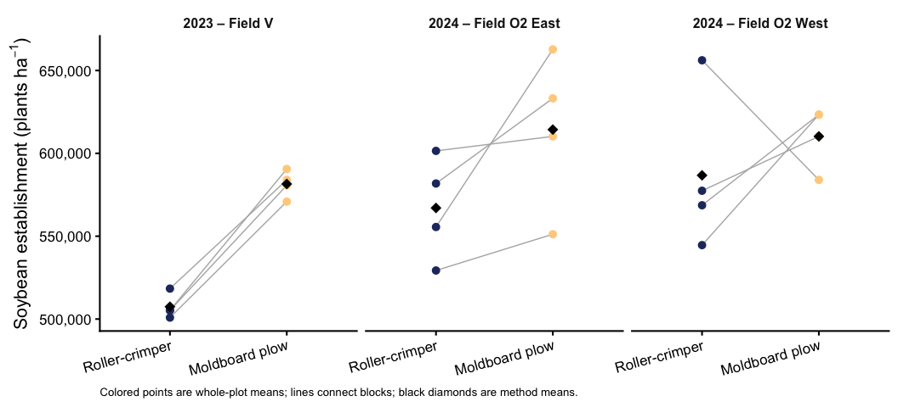
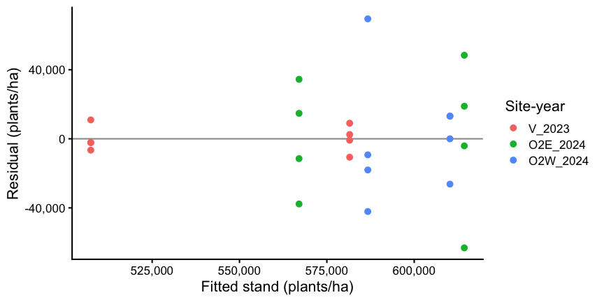
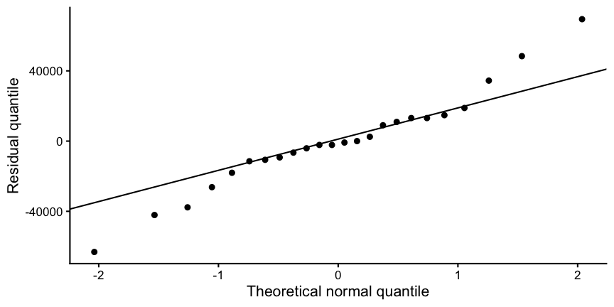
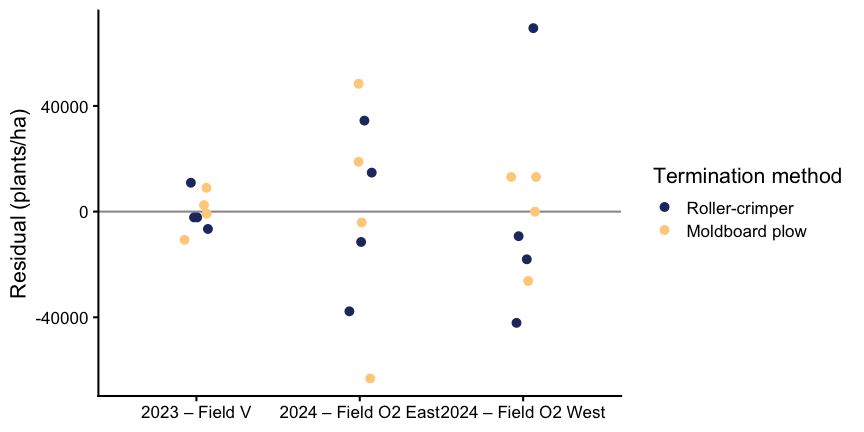
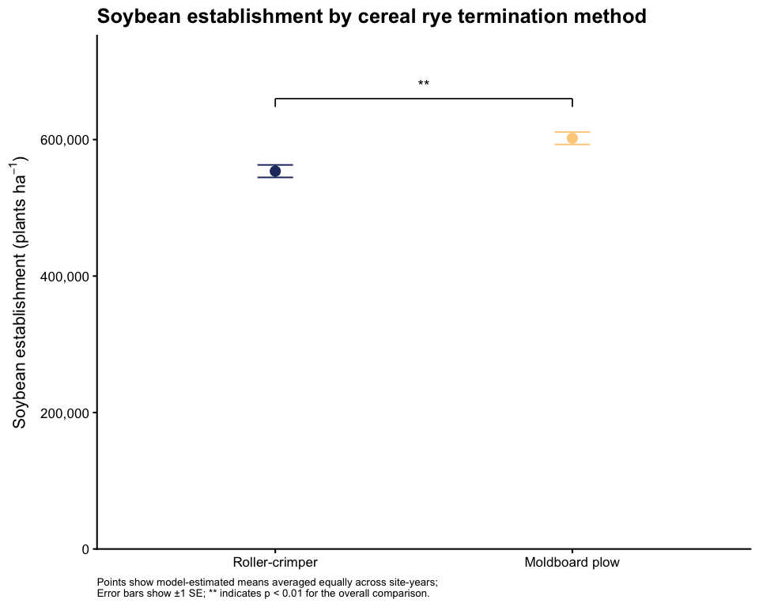

Soybean stand establishment
================

- [Question and experimental design](#question-and-experimental-design)
- [Setup](#setup)
- [Import and validate](#import-and-validate)
- [Prepare whole-plot means](#prepare-whole-plot-means)
- [Describe the observations](#describe-the-observations)
- [Fit the primary model](#fit-the-primary-model)
- [Check assumptions and block
  variance](#check-assumptions-and-block-variance)
- [Tests and overall estimates](#tests-and-overall-estimates)
- [Final figure: model-estimated means ±
  SE](#final-figure-model-estimated-means--se)
- [Results summary](#results-summary)
- [Appendix: supporting analyses](#appendix-supporting-analyses)
  - [Sensitivity to blocking and unequal
    variance](#sensitivity-to-blocking-and-unequal-variance)
  - [Site-year estimates from the primary
    model](#site-year-estimates-from-the-primary-model)
  - [R session](#r-session)

# Question and experimental design

This analysis asks whether soybean stand establishment differed between
cereal rye termination methods (roller-crimping and moldboard plowing)
and whether that difference varied among site-years. Stand was measured
15 days after planting, so it reflects establishment rather than
emergence alone. The comparison also includes differences in seedbed
conditions resulting from the two termination methods.

Within each block, termination method was randomized to whole plots.
Roller-crimped whole plots contained three subplots, and
moldboard-plowed whole plots contained two. Because follow-up
weed-control treatments had not occurred when stand was measured,
subplot observations were averaged within each whole plot. This gives 24
experimental units: two termination methods × four blocks × three
site-years. Analyses of later responses will also account for the
applied subplot treatments.

Site-year is treated as a fixed effect, with blocks nested within
site-years treated as random effects. The overall termination-method
comparison weights the three site-years equally and describes the
average difference across these observed site-years.

# Setup

``` r
library(tidyverse)
library(here)
library(conflicted)
library(WrensBookshelf)
library(lmerTest)
library(emmeans)
# nlme is used via explicit namespace calls for the sensitivity analysis.

conflicts_prefer(dplyr::filter)
conflicts_prefer(dplyr::select)

method_levels <- c("Roller-crimper", "Moldboard plow")
treatment_levels <- c("RNO", "RIM", "RIC", "TIM", "TIC")
experiment_labels <- c(
  V_2023 = "2023 – Field V",
  O2E_2024 = "2024 – Field O2 East",
  O2W_2024 = "2024 – Field O2 West"
)
method_lookup <- c(
  RNO = "Roller-crimper", RIM = "Roller-crimper",
  RIC = "Roller-crimper", TIM = "Moldboard plow", TIC = "Moldboard plow"
)
treatment_colors <- setNames(
  WrensBookshelf::WB_brewer(name = "WhatWellBuild", n = 5, type = "discrete"),
  treatment_levels
)
method_colors <- c(
  "Roller-crimper" = treatment_colors[["RNO"]],
  "Moldboard plow" = treatment_colors[["TIC"]]
)
theme_set(theme_classic(base_size = 16))

# Plain tables render in both HTML and GitHub Markdown.
show_table <- function(x, caption, digits = 0) {
  knitr::kable(x, digits = digits, caption = caption)
}
# Use the same degrees-of-freedom method in ANOVA and estimated means.
emm_options(lmer.df = "satterthwaite")
fmt_stand <- function(x) formatC(x, format = "f", digits = 0, big.mark = ",")
fmt_p <- function(x) if (x < 0.001) "< 0.001" else paste("=", formatC(x, format = "f", digits = 3))
method_difference <- list("Moldboard plow - Roller-crimper" = c(-1, 1))
```

# Import and validate

Checks stop the analysis if identifiers, plot counts, or stand values do
not match the expected complete design. If future data contain missing
records, review and document them before changing these checks; do not
silently drop them.

``` r
processed_data <- readRDS(here("data", "processed", "combined_processed.rds"))
required <- c("site_year", "block", "treatment", "bean_emergence_plants_ha")
missing_columns <- setdiff(required, names(processed_data))
if (length(missing_columns)) {
  stop("Missing columns: ", paste(missing_columns, collapse = ", "))
}
plot_data <- processed_data |>
  select(all_of(required)) |>
  mutate(across(c(site_year, block, treatment), as.character))
if (anyNA(plot_data[c("site_year", "block", "treatment")]) ||
    any(vapply(plot_data[c("site_year", "block", "treatment")],
               function(x) any(trimws(x) == ""), logical(1)))) {
  stop("Missing or blank site-year, block, or treatment identifiers.")
}
if (!setequal(unique(plot_data$site_year), names(experiment_labels))) {
  stop("Site-year identifiers do not match experiment_labels.")
}
if (!setequal(unique(plot_data$treatment), treatment_levels)) {
  stop("Treatment identifiers do not match treatment_levels.")
}
y <- plot_data$bean_emergence_plants_ha
if (!is.numeric(y) || any(!is.finite(y)) || any(y < 0)) {
  stop("Stand must contain finite, nonnegative numeric values with no missing data.")
}
plot_counts <- plot_data |> count(site_year, block, treatment)
block_counts <- plot_counts |> count(site_year, block, name = "n_treatments")
experiment_counts <- block_counts |> count(site_year, name = "n_blocks")
if (any(plot_counts$n != 1L) || any(block_counts$n_treatments != 5L) ||
    any(experiment_counts$n_blocks != 4L)) {
  stop("Expected one record per treatment, five treatments per block, and four blocks per site-year.")
}
plot_data <- plot_data |>
  mutate(
    site_year = factor(site_year, levels = names(experiment_labels)),
    primary_method = factor(unname(method_lookup[treatment]), levels = method_levels),
    block_id = interaction(site_year, block, drop = TRUE)
  )
validation_summary <- plot_data |>
  group_by(site_year) |>
  summarise(plots = n(), blocks = n_distinct(block_id),
            min_stand = min(bean_emergence_plants_ha),
            max_stand = max(bean_emergence_plants_ha), .groups = "drop")
show_table(validation_summary, "Validated records and stand range (plants/ha)")
```

| site_year | plots | blocks | min_stand | max_stand |
|:----------|------:|-------:|----------:|----------:|
| V_2023    |    20 |      4 |    472441 |    610236 |
| O2E_2024  |    20 |      4 |    479003 |    675853 |
| O2W_2024  |    20 |      4 |    524934 |    708661 |

Validated records and stand range (plants/ha)

# Prepare whole-plot means

Subplot observations are averaged within each whole plot. Whole plots
receive equal weight; the additional rolled subplot is not an
independent replicate of termination method.

``` r
stand_data <- plot_data |>
  group_by(site_year, block_id, primary_method) |>
  summarise(stand_mean = mean(bean_emergence_plants_ha),
            n_subplots = n(), .groups = "drop")
expected_n <- ifelse(stand_data$primary_method == "Roller-crimper", 3L, 2L)
stopifnot(nrow(stand_data) == 24L, all(stand_data$n_subplots == expected_n))
# Thousands of plants/ha improve numerical scaling; outputs are converted back.
stand_data <- stand_data |> mutate(stand_k = stand_mean / 1000)
contrasts(stand_data$primary_method) <- contr.sum(2)
contrasts(stand_data$site_year) <- contr.sum(3)
```

# Describe the observations

SD describes variation among whole-plot means. It is distinct from the
model-based SE displayed in the final figure. Lines in the exploratory
figure connect the two whole plots belonging to the same block.

``` r
stand_summary <- stand_data |>
  group_by(site_year, primary_method) |>
  summarise(n_blocks = n(), mean_stand = mean(stand_mean),
            sd_stand = sd(stand_mean), .groups = "drop")
show_table(stand_summary, "Observed whole-plot stand: mean and SD (plants/ha)")
```

| site_year | primary_method | n_blocks | mean_stand | sd_stand |
|:----------|:---------------|---------:|-----------:|---------:|
| V_2023    | Roller-crimper |        4 |     507437 |     7577 |
| V_2023    | Moldboard plow |        4 |     581529 |     8202 |
| O2E_2024  | Roller-crimper |        4 |     567038 |    31412 |
| O2E_2024  | Moldboard plow |        4 |     614337 |    47270 |
| O2W_2024  | Roller-crimper |        4 |     586724 |    48330 |
| O2W_2024  | Moldboard plow |        4 |     610236 |    18559 |

Observed whole-plot stand: mean and SD (plants/ha)

``` r
ggplot(stand_data, aes(primary_method, stand_mean)) +
  geom_line(aes(group = block_id), color = "grey70", linewidth = 0.5) +
  geom_point(aes(color = primary_method), size = 2.5) +
  stat_summary(fun = mean, geom = "point", shape = 18, size = 4) +
  facet_wrap(~site_year, labeller = labeller(site_year = experiment_labels)) +
  scale_color_manual(values = method_colors, guide = "none") +
  scale_y_continuous(labels = scales::label_comma()) +
  labs(x = NULL, y = expression("Soybean establishment (plants ha"^{-1}*")"),
       caption = "Colored points are whole-plot means; lines connect blocks; black diamonds are method means.") +
  theme(strip.background = element_blank(), strip.text = element_text(face = "bold", size = 12),
        axis.text.x = element_text(angle = 15, hjust = 1),
        plot.caption = element_text(size = 10, hjust = 0))
```

<!-- -->

# Fit the primary model

The termination-method-by-site-year interaction allows the method
difference to vary among site-years. A random intercept accounts for
blocks nested within site-years. The model assumes a common residual
variance across site-years and termination methods. The overall contrast
averages the three site-year differences equally while retaining the
interaction.

``` r
stand_model <- lmerTest::lmer(
  stand_k ~ primary_method * site_year + (1 | block_id),
  data = stand_data, REML = TRUE
)
```

    ## boundary (singular) fit: see help('isSingular')

# Check assumptions and block variance

The plots assess residual shape and spread. A singular fit indicates a
block-variance estimate at or near zero. The appendix checks sensitivity
to treating blocks as fixed and allowing residual variance to differ
among site-years.

``` r
variance_table <- as.data.frame(lme4::VarCorr(stand_model)) |>
  transmute(component = grp, variance = vcov * 1000^2, SD = sdcor * 1000)
show_table(variance_table, "Variance components on the plants/ha scale", digits = 1)
```

| component |   variance |      SD |
|:----------|-----------:|--------:|
| block_id  |          0 |     0.0 |
| Residual  | 1004332641 | 31691.2 |

Variance components on the plants/ha scale

``` r
cat("Singular fit:", lme4::isSingular(stand_model, tol = 1e-4), "\n")
```

    ## Singular fit: TRUE

``` r
diag_data <- stand_data |>
  mutate(fitted = fitted(stand_model) * 1000,
         residual = residuals(stand_model) * 1000)
```

``` r
ggplot(diag_data, aes(fitted, residual, color = site_year)) +
  geom_hline(yintercept = 0, color = "grey60") + geom_point(size = 2.5) +
  labs(x = "Fitted stand (plants/ha)", y = "Residual (plants/ha)", color = "Site-year") +
  scale_x_continuous(labels = scales::label_comma()) +
  scale_y_continuous(labels = scales::label_comma())
```

<!-- -->

``` r
ggplot(diag_data, aes(sample = residual)) +
  stat_qq() + stat_qq_line() + labs(x = "Theoretical normal quantile", y = "Residual quantile")
```

<!-- -->

``` r
ggplot(diag_data, aes(site_year, residual, color = primary_method)) +
  geom_hline(yintercept = 0, color = "grey60") +
  geom_point(position = position_jitter(width = 0.08, height = 0, seed = 123), size = 2.5) +
  scale_color_manual(values = method_colors) +
  scale_x_discrete(labels = experiment_labels) +
  labs(x = NULL, y = "Residual (plants/ha)", color = "Termination method")
```

<!-- -->

# Tests and overall estimates

The overall contrast describes the average termination-method difference
across the three site-years. The interaction tests whether that
difference varies among site-years; a nonsignificant interaction does
not establish identical effects.

``` r
anova_table <- anova(stand_model, type = 3, ddf = "Satterthwaite") |>
  as.data.frame() |> tibble::rownames_to_column("Effect") |>
  select(Effect, NumDF, DenDF, `F value`, `Pr(>F)`)
show_table(anova_table, "Type III tests (Satterthwaite degrees of freedom)", digits = 4)
```

| Effect                   | NumDF | DenDF | F value | Pr(\>F) |
|:-------------------------|------:|------:|--------:|--------:|
| primary_method           |     1 |    18 | 13.9377 |  0.0015 |
| site_year                |     2 |    18 |  6.7857 |  0.0064 |
| primary_method:site_year |     2 |    18 |  1.2751 |  0.3035 |

Type III tests (Satterthwaite degrees of freedom)

``` r
# Rescale reporting columns from thousands to plants/ha.
plants_ha <- function(x) {
  x <- as.data.frame(x)
  for (nm in intersect(c("emmean", "estimate", "SE", "lower.CL", "upper.CL",
                         "asymp.LCL", "asymp.UCL"), names(x))) x[[nm]] <- x[[nm]] * 1000
  x
}
# Calculate once: use this same object for the overall table and final figure.
emm_primary_method <- emmeans(stand_model, ~ primary_method, weights = "equal",
                               lmer.df = "satterthwaite")
```

    ## NOTE: Results may be misleading due to involvement in interactions

``` r
overall_means <- plants_ha(confint(emm_primary_method))
show_table(overall_means, "Overall estimated stand (plants/ha; equal site-year weights)", digits = 1)
```

| primary_method |   emmean |     SE |  df | lower.CL | upper.CL |
|:---------------|---------:|-------:|----:|---------:|---------:|
| Roller-crimper | 553732.9 | 9148.5 |  18 | 534512.7 | 572953.1 |
| Moldboard plow | 602034.1 | 9148.5 |  18 | 582813.9 | 621254.3 |

Overall estimated stand (plants/ha; equal site-year weights)

``` r
overall_difference <- plants_ha(summary(
  contrast(emm_primary_method, method = method_difference),
  infer = c(TRUE, TRUE), adjust = "none"
))
show_table(overall_difference, "Overall plow minus roller-crimper difference (plants/ha; 95% CI)", digits = 3)
```

| contrast | estimate | SE | df | lower.CL | upper.CL | t.ratio | p.value |
|:---|---:|---:|---:|---:|---:|---:|---:|
| Moldboard plow - Roller-crimper | 48301.25 | 12937.88 | 18 | 21119.77 | 75482.73 | 3.733 | 0.002 |

Overall plow minus roller-crimper difference (plants/ha; 95% CI)

# Final figure: model-estimated means ± SE

Points show equally weighted model-estimated means across site-years,
with ±1 SE bars. The bracket reports the overall termination-method
contrast.

``` r
figure_top <- max(overall_means$emmean + overall_means$SE)
bracket_y <- figure_top * 1.08
bracket_tip <- figure_top * 0.02
bracket_p <- overall_difference$p.value
bracket_label <- if (bracket_p < 0.001) "***" else if (bracket_p < 0.01) "**" else if (bracket_p < 0.05) "*" else "ns"
bracket_definition <- if (bracket_p < 0.001) {
  "*** indicates p < 0.001"
} else if (bracket_p < 0.01) {
  "** indicates p < 0.01"
} else if (bracket_p < 0.05) {
  "* indicates p < 0.05"
} else {
  "ns indicates p ≥ 0.05"
}
fig_primary_method <- ggplot(overall_means,
                             aes(primary_method, emmean, color = primary_method)) +
  geom_errorbar(aes(ymin = emmean - SE, ymax = emmean + SE),
                width = 0.12, linewidth = 0.7) +
  geom_point(size = 4) +
  annotate("segment", x = 1, xend = 2, y = bracket_y, yend = bracket_y,
           color = "black", linewidth = 0.6) +
  annotate("segment", x = c(1, 2), xend = c(1, 2),
           y = bracket_y - bracket_tip, yend = bracket_y,
           color = "black", linewidth = 0.6) +
  annotate("text", x = 1.5, y = bracket_y + bracket_tip,
           label = bracket_label, color = "black", vjust = 0, size = 5) +
  scale_color_manual(values = method_colors, guide = "none") +
  scale_y_continuous(labels = scales::label_comma(),
                     expand = expansion(mult = c(0, 0.08))) +
  coord_cartesian(ylim = c(0, bracket_y + 3 * bracket_tip)) +
  labs(x = NULL, y = expression("Soybean establishment (plants ha"^{-1}*")"),
       title = "Soybean establishment by cereal rye termination method",
       caption = paste(
  "Points show model-estimated means averaged equally across site-years;",
  paste("Error bars show ±1 SE;", bracket_definition, "for the overall comparison."),
  sep = "\n"
)) +
  theme(axis.title.y = element_text(margin = margin(r = 8)),
        plot.title = element_text(face = "bold"),
        plot.caption = element_text(size = 10, hjust = 0))
fig_primary_method
```

<!-- -->

``` r
dir.create(here("figures"), showWarnings = FALSE, recursive = TRUE)
ggsave(here("figures", "soybean_establishment.png"), plot = fig_primary_method,
       width = 10, height = 8, dpi = 300, bg = "white")
```

# Results summary

Across the three site-years, estimated establishment was 553,733
plants/ha under roller-crimping and 602,034 plants/ha under moldboard
plowing. The overall plow-minus-roller-crimper difference was 48,301
plants/ha (95% CI: 21,120 to 75,483; p = 0.002). The interaction test
gave p = 0.303.

This comparison includes seedbed differences associated with the
termination methods. The appendix documents sensitivity to block and
residual-variance specifications, with particular attention to site-year
uncertainty.

# Appendix: supporting analyses

## Sensitivity to blocking and unequal variance

The primary fit estimated zero block variance, and observed spread was
smaller in 2023. These checks retain blocks as fixed effects and compare
common versus site-year-specific residual variance. Block IDs absorb
site-year main effects, so the fixed-block models use
method-by-site-year slopes without an additional aliased site-year main
effect.

``` r
# Numeric method indicator yields full-rank fixed-block models.
stand_data <- stand_data |>
  mutate(plow = as.numeric(primary_method == "Moldboard plow"))
fixed_additive <- lm(stand_k ~ block_id + plow, data = stand_data)
fixed_interaction <- lm(stand_k ~ block_id + plow:site_year, data = stand_data)
show_table(as.data.frame(anova(fixed_additive, fixed_interaction)),
           "Fixed-block test of variation in the method difference among site-years", digits = 4)
```

| Res.Df |       RSS |  Df | Sum of Sq |      F | Pr(\>F) |
|-------:|----------:|----:|----------:|-------:|--------:|
|     11 | 12168.999 |  NA |        NA |     NA |      NA |
|      9 |  9607.687 |   2 |  2561.312 | 1.1997 |  0.3453 |

Fixed-block test of variation in the method difference among site-years

``` r
# Same fixed effects in both GLS fits, so REML comparison is appropriate.
gls_equal <- nlme::gls(stand_k ~ block_id + plow:site_year,
                       data = stand_data, method = "REML")
gls_unequal <- nlme::gls(stand_k ~ block_id + plow:site_year,
                         weights = nlme::varIdent(form = ~1 | site_year),
                         data = stand_data, method = "REML")
show_table(as.data.frame(anova(gls_equal, gls_unequal)),
           "Common versus site-year-specific residual variance, with fixed blocks", digits = 4)
```

|  | call | Model | df | AIC | BIC | logLik | Test | L.Ratio | p-value |
|:---|:---|---:|---:|---:|---:|---:|:---|---:|---:|
| gls_equal | nlme::gls(model = stand_k ~ block_id + plow:site_year, data = stand_data, method = “REML”) | 1 | 16 | 130.6959 | 133.8515 | -49.3480 |  | NA | NA |
| gls_unequal | nlme::gls(model = stand_k ~ block_id + plow:site_year, data = stand_data, weights = nlme::varIdent(form = ~1 \| site_year), method = “REML”) | 2 | 18 | 126.3819 | 129.9319 | -45.1909 | 1 vs 2 | 8.3141 | 0.0157 |

Common versus site-year-specific residual variance, with fixed blocks

``` r
# Average the three method slopes directly. This avoids asking for predictions
# at impossible combinations of nested blocks and site-years.
extract_method_slopes <- function(model, label) {
  b <- coef(model)
  V <- vcov(model)
  idx <- grep("plow", names(b))
  stopifnot(length(idx) == 3L)
  w <- rep(1 / 3, 3)
  tibble(model = label, difference = sum(w * b[idx]) * 1000,
         SE = sqrt(as.numeric(t(w) %*% V[idx, idx, drop = FALSE] %*% w)) * 1000)
}
sensitivity_summary <- bind_rows(
  tibble(model = "Primary random-block model",
         difference = overall_difference$estimate, SE = overall_difference$SE),
  extract_method_slopes(fixed_interaction, "Fixed blocks, common variance"),
  extract_method_slopes(gls_unequal, "Fixed blocks, variance by site-year")
)
show_table(sensitivity_summary,
           "Sensitivity of the overall plow-minus-roller difference and SE (plants/ha)", digits = 1)
```

| model                               | difference |      SE |
|:------------------------------------|-----------:|--------:|
| Primary random-block model          |    48301.3 | 12937.9 |
| Fixed blocks, common variance       |    48301.3 | 13338.7 |
| Fixed blocks, variance by site-year |    48301.3 | 13338.7 |

Sensitivity of the overall plow-minus-roller difference and SE
(plants/ha)

The estimated overall difference ranges from 48,301 to 48,301 plants/ha
across these models, with SEs ranging from 12,938 to 13,339 plants/ha.
Similar overall SEs do not establish equal residual variances: in this
balanced design, the overall average can be stable while uncertainty
within individual site-years changes substantially.

## Site-year estimates from the primary model

These tables retain the common-variance model’s site-year estimates for
reference. Their uncertainty is sensitive to the variance assumption and
should not be treated as the final basis for site-year-specific
conclusions. The three site-year tests use Holm adjustment; confidence
intervals are pointwise 95% intervals.

``` r
stand_emmeans <- emmeans(stand_model, ~ primary_method | site_year,
                         lmer.df = "satterthwaite")
experiment_means <- plants_ha(confint(stand_emmeans))
show_table(experiment_means, "Estimated stand by site-year (plants/ha; 95% CI)", digits = 1)
```

| primary_method | site_year |   emmean |      SE |  df | lower.CL | upper.CL |
|:---------------|:----------|---------:|--------:|----:|---------:|---------:|
| Roller-crimper | V_2023    | 507436.6 | 15845.6 |  18 | 474146.2 | 540726.9 |
| Moldboard plow | V_2023    | 581528.9 | 15845.6 |  18 | 548238.5 | 614819.2 |
| Roller-crimper | O2E_2024  | 567038.5 | 15845.6 |  18 | 533748.1 | 600328.9 |
| Moldboard plow | O2E_2024  | 614337.3 | 15845.6 |  18 | 581046.9 | 647627.6 |
| Roller-crimper | O2W_2024  | 586723.5 | 15845.6 |  18 | 553433.2 | 620013.9 |
| Moldboard plow | O2W_2024  | 610236.2 | 15845.6 |  18 | 576945.8 | 643526.6 |

Estimated stand by site-year (plants/ha; 95% CI)

``` r
experiment_contrasts <- contrast(stand_emmeans, method = method_difference)
# Treat the three site-year-specific tests as one family for Holm adjustment.
# CIs remain pointwise 95% intervals; label this distinction explicitly.
experiment_differences <- plants_ha(summary(experiment_contrasts,
                                           infer = c(TRUE, TRUE), adjust = "none")) |>
  mutate(p_holm = p.adjust(p.value, method = "holm"))
show_table(experiment_differences,
           "Plow minus roller-crimper (plants/ha): pointwise 95% CIs, unadjusted p.value, and Holm-adjusted p_holm",
           digits = 3)
```

| contrast | site_year | estimate | SE | df | lower.CL | upper.CL | t.ratio | p.value | p_holm |
|:---|:---|---:|---:|---:|---:|---:|---:|---:|---:|
| Moldboard plow - Roller-crimper | V_2023 | 74092.30 | 22409.07 | 18 | 27012.596 | 121172.01 | 3.306 | 0.004 | 0.012 |
| Moldboard plow - Roller-crimper | O2E_2024 | 47298.78 | 22409.07 | 18 | 219.071 | 94378.48 | 2.111 | 0.049 | 0.098 |
| Moldboard plow - Roller-crimper | O2W_2024 | 23512.69 | 22409.07 | 18 | -23567.019 | 70592.39 | 1.049 | 0.308 | 0.308 |

Plow minus roller-crimper (plants/ha): pointwise 95% CIs, unadjusted
p.value, and Holm-adjusted p_holm

## R session

``` r
sessionInfo()
```

    ## R version 4.5.2 (2025-10-31)
    ## Platform: aarch64-apple-darwin20
    ## Running under: macOS Tahoe 26.7.1
    ## 
    ## Matrix products: default
    ## BLAS:   /System/Library/Frameworks/Accelerate.framework/Versions/A/Frameworks/vecLib.framework/Versions/A/libBLAS.dylib 
    ## LAPACK: /Library/Frameworks/R.framework/Versions/4.5-arm64/Resources/lib/libRlapack.dylib;  LAPACK version 3.12.1
    ## 
    ## locale:
    ## [1] en_US.UTF-8/en_US.UTF-8/en_US.UTF-8/C/en_US.UTF-8/en_US.UTF-8
    ## 
    ## time zone: America/New_York
    ## tzcode source: internal
    ## 
    ## attached base packages:
    ## [1] stats     graphics  grDevices utils     datasets  methods   base     
    ## 
    ## other attached packages:
    ##  [1] emmeans_1.11.2-8     lmerTest_3.1-3       lme4_1.1-37         
    ##  [4] Matrix_1.7-4         WrensBookshelf_0.1.0 conflicted_1.2.0    
    ##  [7] here_1.0.2           lubridate_1.9.4      forcats_1.0.1       
    ## [10] stringr_1.5.2        dplyr_1.1.4          purrr_1.1.0         
    ## [13] readr_2.1.5          tidyr_1.3.1          tibble_3.3.0        
    ## [16] ggplot2_4.0.0        tidyverse_2.0.0     
    ## 
    ## loaded via a namespace (and not attached):
    ##  [1] gtable_0.3.6        xfun_0.61           lattice_0.22-7     
    ##  [4] tzdb_0.5.0          numDeriv_2016.8-1.1 vctrs_0.6.5        
    ##  [7] tools_4.5.2         Rdpack_2.6.4        generics_0.1.4     
    ## [10] sandwich_3.1-1      pkgconfig_2.0.3     RColorBrewer_1.1-3 
    ## [13] S7_0.2.0            lifecycle_1.0.4     compiler_4.5.2     
    ## [16] farver_2.1.2        textshaping_1.0.4   codetools_0.2-20   
    ## [19] htmltools_0.5.8.1   yaml_2.3.10         pillar_1.11.1      
    ## [22] nloptr_2.2.1        MASS_7.3-65         cachem_1.1.0       
    ## [25] reformulas_0.4.4    boot_1.3-32         multcomp_1.4-29    
    ## [28] nlme_3.1-168        tidyselect_1.2.1    digest_0.6.37      
    ## [31] mvtnorm_1.3-3       stringi_1.8.7       labeling_0.4.3     
    ## [34] splines_4.5.2       rprojroot_2.1.1     fastmap_1.2.0      
    ## [37] grid_4.5.2          cli_3.6.5           magrittr_2.0.4     
    ## [40] survival_3.8-3      TH.data_1.1-4       withr_3.0.2        
    ## [43] scales_1.4.0        timechange_0.3.0    estimability_1.5.1 
    ## [46] rmarkdown_2.30      ragg_1.5.0          zoo_1.8-14         
    ## [49] hms_1.1.4           memoise_2.0.1       coda_0.19-4.1      
    ## [52] evaluate_1.0.5      knitr_1.50          rbibutils_2.3      
    ## [55] rlang_1.1.6         Rcpp_1.1.0          xtable_1.8-4       
    ## [58] glue_1.8.0          rstudioapi_0.17.1   minqa_1.2.8        
    ## [61] R6_2.6.1            systemfonts_1.3.1
