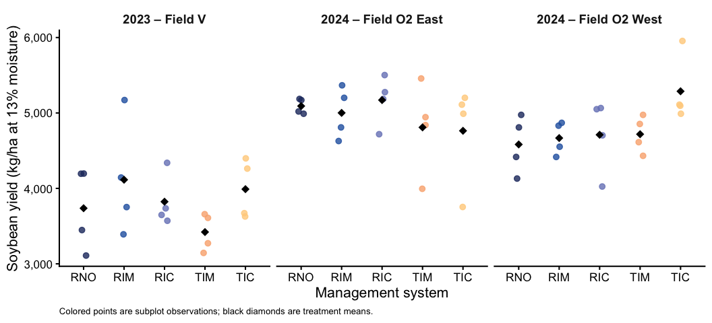
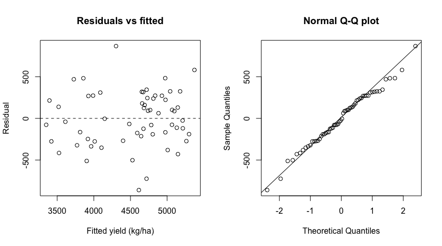
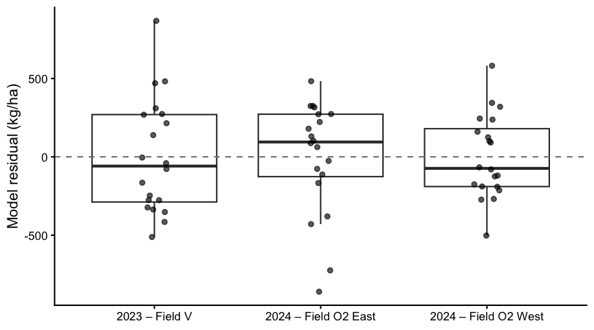
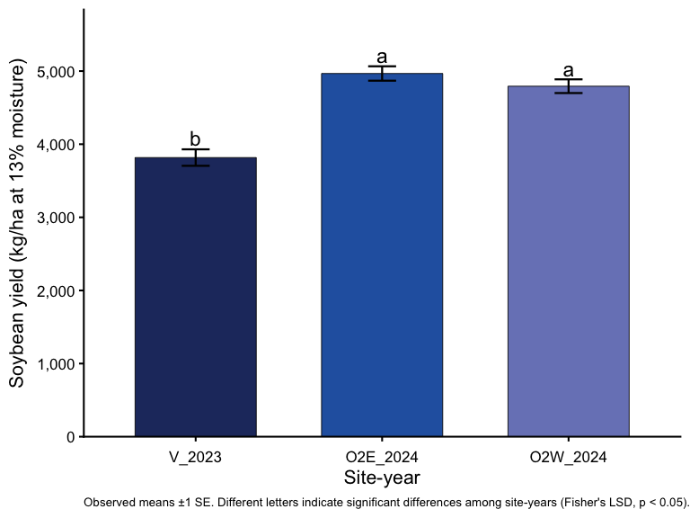
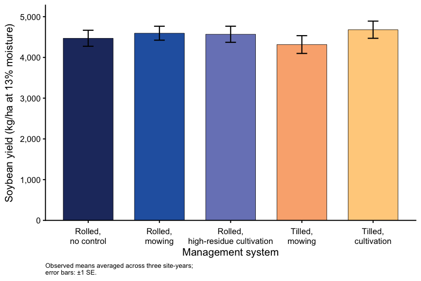

Soybean yield
================

- [Question and experimental design](#question-and-experimental-design)
- [Setup](#setup)
- [Data preparation](#data-preparation)
- [Observed yield summaries](#observed-yield-summaries)
- [Primary model](#primary-model)
- [Model diagnostics and variance
  components](#model-diagnostics-and-variance-components)
- [Tests and overall estimates](#tests-and-overall-estimates)
- [Estimated means and planned
  comparisons](#estimated-means-and-planned-comparisons)
- [Final figure: Observed soybean yield by management
  system](#final-figure-observed-soybean-yield-by-management-system)
- [Yield estimates in bushels per
  acre](#yield-estimates-in-bushels-per-acre)
- [Results summary](#results-summary)
- [Interpretation notes](#interpretation-notes)
- [Appendix: sensitivity to the singular block
  effect](#appendix-sensitivity-to-the-singular-block-effect)
- [Appendix: exploratory noninferiority and
  equivalence](#appendix-exploratory-noninferiority-and-equivalence)
  - [Secondary treatment comparisons against tilled
    cultivation](#secondary-treatment-comparisons-against-tilled-cultivation)
- [R session](#r-session)

# Question and experimental design

Did soybean yield differ among the five weed-management treatments, and
was yield different between roller-crimped cereal rye and tilled
systems? Did treatment differences vary among site-years?

The study used a split-plot randomized complete block design. Rye
termination system (rolled or tilled) was randomized to whole plots
within blocks, and weed-control treatments were assigned to subplots
within each system. There were three rolled treatments (no supplemental
control, inter-row mowing, and high-residue cultivation) and two tilled
treatments (inter-row mowing and cultivation). The trial includes three
site-years: 2023 Field V, 2024 O2 East, and 2024 O2 West.

The primary analysis includes all site-years. Site-year is fixed because
these three specific experiments are of interest; blocks and main plots
are random. The five-level treatment factor is used because the design
is not a complete system-by-weed-control factorial. Consequently, a
rolled-versus-tilled contrast averages over *different* weed-control
treatment sets and should be interpreted as a comparison of the tested
management packages, not a pure termination-method effect.

# Setup

``` r
library(tidyverse)
```

    ## ── Attaching core tidyverse packages ──────────────────────── tidyverse 2.0.0 ──
    ## ✔ dplyr     1.1.4     ✔ readr     2.1.5
    ## ✔ forcats   1.0.1     ✔ stringr   1.5.2
    ## ✔ ggplot2   4.0.0     ✔ tibble    3.3.0
    ## ✔ lubridate 1.9.4     ✔ tidyr     1.3.1
    ## ✔ purrr     1.1.0     
    ## ── Conflicts ────────────────────────────────────────── tidyverse_conflicts() ──
    ## ✖ dplyr::filter() masks stats::filter()
    ## ✖ dplyr::lag()    masks stats::lag()
    ## ℹ Use the conflicted package (<http://conflicted.r-lib.org/>) to force all conflicts to become errors

``` r
library(lmerTest)
```

    ## Loading required package: lme4
    ## Loading required package: Matrix
    ## 
    ## Attaching package: 'Matrix'
    ## 
    ## The following objects are masked from 'package:tidyr':
    ## 
    ##     expand, pack, unpack
    ## 
    ## 
    ## Attaching package: 'lmerTest'
    ## 
    ## The following object is masked from 'package:lme4':
    ## 
    ##     lmer
    ## 
    ## The following object is masked from 'package:stats':
    ## 
    ##     step

``` r
library(emmeans)
```

    ## Welcome to emmeans.
    ## Caution: You lose important information if you filter this package's results.
    ## See '? untidy'

``` r
library(here)
```

    ## here() starts at /Users/ey239/Github/Mowtivation

``` r
library(WrensBookshelf)

options(contrasts = c("contr.sum", "contr.poly"))

trt_levels <- c("Rolled, no control", "Rolled, mowing",
                "Rolled, high-residue cultivation", "Tilled, mowing",
                "Tilled, cultivation")
trt_labels <- c("Rolled,\nno control", "Rolled,\nmowing",
                "Rolled,\nhigh-residue cultivation", "Tilled,\nmowing",
                "Tilled,\ncultivation")
treatment_codes <- c("RNO", "RIM", "RIC", "TIM", "TIC")
experiment_labels <- c(
  V_2023 = "2023 – Field V",
  O2E_2024 = "2024 – Field O2 East",
  O2W_2024 = "2024 – Field O2 West"
)
# Treatment colors match the other Mowtivation analyses.
treatment_colors <- setNames(
  WrensBookshelf::WB_brewer(name = "WhatWellBuild", n = 5,
                            type = "discrete"), treatment_codes
)
fill_cols <- setNames(unname(treatment_colors), trt_levels)
theme_set(theme_classic(base_size = 16))
emm_options(lmer.df = "satterthwaite")
# Format displayed p-values only; CSV exports retain numeric precision.
fmt_p <- function(x) {
  ifelse(is.na(x), NA_character_,
         ifelse(x < 0.001, "<0.001", sprintf("%.3f", x)))
}
show_table <- function(x, caption, digits = 1) {
  x <- as.data.frame(x)
  p_columns <- names(x)[grepl("^p[._]|[._]p$", names(x)) |
                          startsWith(names(x), "Pr(")]
  x[p_columns] <- lapply(x[p_columns], fmt_p)
  knitr::kable(x, digits = digits, caption = caption)
}
hypothesis_comparisons <- list(
  "TIC - TIM" = c(0, 0, 0, -1, 1),
  "RIM - RNO" = c(-1, 1, 0, 0, 0),
  "RIC - RNO" = c(-1, 0, 1, 0, 0)
)
package_comparisons <- list(
  "Rolled minus tilled packages" = c(1/3, 1/3, 1/3, -1/2, -1/2),
  "Rolled mowing minus tilled mowing" = c(0, 1, 0, -1, 0)
)
kg_ha_per_bu_ac <- 67.2511  # Soybean: 60 lb/bu, for reporting conversions.

fig_dir <- here("figures", "soybean_yield")
tab_dir <- here("output", "tables", "soybean_yield")
dir.create(fig_dir, recursive = TRUE, showWarnings = FALSE)
dir.create(tab_dir, recursive = TRUE, showWarnings = FALSE)
```

# Data preparation

Read the standardized dataset created by `data_prep.Rmd`, as in the
other Mowtivation analyses. Grain yield (`bean_yield_adj_kg_ha`) is
already converted to kg/ha at 13% moisture. **Do not repeat raw import,
harvested-area conversion, or moisture adjustment in this Rmd.** Check
the input’s identity, columns, factor levels, and experimental
replication before fitting the model.

``` r
processed_file <- here("data", "processed", "combined_processed.rds")
processed_data <- readRDS(processed_file)

show_table(
  tibble(input = "data/processed/combined_processed.rds",
         MD5 = unname(tools::md5sum(processed_file))),
  "Processed-data provenance"
)
```

| input                                 | MD5                              |
|:--------------------------------------|:---------------------------------|
| data/processed/combined_processed.rds | 217fbf0aa2d75c95b9463ee4a0f0bbb8 |

Processed-data provenance

``` r
required <- c("site_year", "block", "treatment", "bean_yield_adj_kg_ha")
missing_columns <- setdiff(required, names(processed_data))
if (length(missing_columns)) {
  stop("Missing processed-data columns: ", paste(missing_columns, collapse = ", "),
       ". Confirm names and yield units in data_prep.Rmd before proceeding.")
}

plot_data <- processed_data |>
  select(all_of(required)) |>
  mutate(across(c(site_year, block, treatment), as.character))

if (anyNA(plot_data) ||
    any(vapply(plot_data[c("site_year", "block", "treatment")],
               function(x) any(trimws(x) == ""), logical(1)))) {
  stop("Missing values or blank identifiers; inspect data_prep.Rmd output.")
}
if (!is.numeric(plot_data$bean_yield_adj_kg_ha) ||
    any(!is.finite(plot_data$bean_yield_adj_kg_ha)) ||
    any(plot_data$bean_yield_adj_kg_ha < 0)) {
  stop("Processed soybean yield must be finite, nonnegative numeric kg/ha values.")
}
if (!setequal(unique(plot_data$site_year), names(experiment_labels)) ||
    !setequal(unique(plot_data$treatment), treatment_codes)) {
  stop("Site-year or treatment identifiers differ from the Mowtivation design.")
}

replication_check <- plot_data |> count(site_year, block, treatment)
block_check <- replication_check |> count(site_year, block, name = "n_treatments")
experiment_check <- block_check |> count(site_year, name = "n_blocks")
if (any(replication_check$n != 1L) || any(block_check$n_treatments != 5L) ||
    any(experiment_check$n_blocks != 4L)) {
  stop("Expected one yield value per subplot, five treatments per block, and four blocks per site-year.")
}

yield_dat <- plot_data |>
  mutate(
    site_year = factor(site_year, levels = names(experiment_labels)),
    block = factor(block),
    weed_trt = factor(trt_levels[match(treatment, treatment_codes)],
                      levels = trt_levels),
    termination_method = factor(
      if_else(treatment %in% c("RNO", "RIM", "RIC"),
              "Roller-crimper", "Moldboard plow"),
      levels = c("Roller-crimper", "Moldboard plow")
    ),
    block_id = interaction(site_year, block, drop = TRUE),
    main_plot_id = interaction(block_id, termination_method, drop = TRUE),
    yield_kg_ha = bean_yield_adj_kg_ha
  )

# Check the number of observations and randomization units.
show_table(yield_dat |>
  group_by(site_year) |>
  summarise(n_subplots = n(), n_main_plots = n_distinct(main_plot_id),
            yield_min = min(yield_kg_ha), yield_max = max(yield_kg_ha),
            .groups = "drop"),
  "Validated soybean yield records and range (kg/ha)")
```

| site_year | n_subplots | n_main_plots | yield_min | yield_max |
|:----------|-----------:|-------------:|----------:|----------:|
| V_2023    |         20 |            8 |    3109.8 |    5171.1 |
| O2E_2024  |         20 |            8 |    3753.6 |    5502.2 |
| O2W_2024  |         20 |            8 |    4024.9 |    5954.5 |

Validated soybean yield records and range (kg/ha)

# Observed yield summaries

``` r
raw_summary <- yield_dat |>
  group_by(site_year, weed_trt) |>
  summarise(n = n(), raw_mean = mean(yield_kg_ha),
            raw_sd = sd(yield_kg_ha), .groups = "drop")
show_table(raw_summary, "Observed soybean yield: mean and SD (kg/ha)", digits = 1)
```

| site_year | weed_trt                         |   n | raw_mean | raw_sd |
|:----------|:---------------------------------|----:|---------:|-------:|
| V_2023    | Rolled, no control               |   4 |   3737.1 |  546.9 |
| V_2023    | Rolled, mowing                   |   4 |   4114.7 |  768.5 |
| V_2023    | Rolled, high-residue cultivation |   4 |   3823.5 |  350.2 |
| V_2023    | Tilled, mowing                   |   4 |   3421.2 |  251.7 |
| V_2023    | Tilled, cultivation              |   4 |   3990.0 |  397.4 |
| O2E_2024  | Rolled, no control               |   4 |   5091.5 |  101.0 |
| O2E_2024  | Rolled, mowing                   |   4 |   5001.0 |  341.4 |
| O2E_2024  | Rolled, high-residue cultivation |   4 |   5170.6 |  329.6 |
| O2E_2024  | Tilled, mowing                   |   4 |   4808.8 |  606.1 |
| O2E_2024  | Tilled, cultivation              |   4 |   4763.6 |  678.9 |
| O2W_2024  | Rolled, no control               |   4 |   4582.7 |  381.6 |
| O2W_2024  | Rolled, mowing                   |   4 |   4667.5 |  218.7 |
| O2W_2024  | Rolled, high-residue cultivation |   4 |   4710.8 |  486.8 |
| O2W_2024  | Tilled, mowing                   |   4 |   4718.4 |  243.1 |
| O2W_2024  | Tilled, cultivation              |   4 |   5287.4 |  447.9 |

Observed soybean yield: mean and SD (kg/ha)

``` r
readr::write_csv(raw_summary, file.path(tab_dir, "raw_summary.csv"))
```

``` r
observed_yield_fig <- yield_dat |>
  mutate(treatment_code = factor(treatment_codes[as.integer(weed_trt)],
                                 levels = treatment_codes)) |>
  ggplot(aes(treatment_code, yield_kg_ha)) +
  geom_point(aes(color = treatment_code),
             position = position_jitter(width = 0.08, height = 0, seed = 123),
             size = 2.5, alpha = 0.8) +
  stat_summary(fun = mean, geom = "point", shape = 18, size = 3.8,
               color = "black") +
  facet_wrap(~ site_year, nrow = 1,
             labeller = labeller(site_year = experiment_labels)) +
  scale_color_manual(values = treatment_colors, guide = "none") +
  scale_y_continuous(labels = scales::label_comma()) +
  labs(x = "Management system", y = "Soybean yield (kg/ha at 13% moisture)",
       caption = "Colored points are subplot observations; black diamonds are treatment means.") +
  theme_classic(base_size = 16) +
  theme(strip.background = element_blank(),
        strip.text = element_text(face = "bold", size = 14),
        axis.text.x = element_text(size = 13),
        plot.caption = element_text(size = 10, hjust = 0))

observed_yield_fig
```

<!-- -->

``` r
ggsave(file.path(fig_dir, "observed_by_site_year.png"),
       observed_yield_fig, width = 11, height = 5, dpi = 300, bg = "white")
```

# Primary model

The model includes a treatment-by-site-year interaction and separate
random intercepts for blocks within site-years and main plots within
blocks. The main-plot term preserves the correct randomization level for
comparisons between rolled and tilled systems. Treatment differences
within a system are estimated using subplot-level information. Inspect
the main-plot variance component and singular-fit warning; do not
automatically remove this term solely because its fitted variance is
small.

``` r
yield_mod <- lmer(
  yield_kg_ha ~ weed_trt * site_year +
    (1 | block_id) + (1 | main_plot_id),
  data = yield_dat, REML = TRUE
)
```

    ## boundary (singular) fit: see help('isSingular')

# Model diagnostics and variance components

``` r
isSingular(yield_mod)
```

    ## [1] TRUE

``` r
VarCorr(yield_mod)
```

    ##  Groups       Name        Std.Dev.
    ##  main_plot_id (Intercept) 189.13  
    ##  block_id     (Intercept)   0.00  
    ##  Residual                 404.04

Check the shape and spread of residuals, especially whether variability
differs among site-years. The site-year summaries below are descriptive
and do not constitute a formal test of equal variances.

``` r
par(mfrow = c(1, 2))
plot(fitted(yield_mod), resid(yield_mod),
     xlab = "Fitted yield (kg/ha)", ylab = "Residual",
     main = "Residuals vs fitted")
abline(h = 0, lty = 2)
qqnorm(resid(yield_mod), main = "Normal Q-Q plot")
qqline(resid(yield_mod))
```

<!-- -->

``` r
par(mfrow = c(1, 1))

yield_residuals <- yield_dat |>
  mutate(residual = resid(yield_mod))

residual_by_site_year <- yield_residuals |>
  group_by(site_year) |>
  summarise(n = n(), residual_sd = sd(residual),
            residual_min = min(residual), residual_max = max(residual),
            .groups = "drop")
show_table(residual_by_site_year, digits = 1,
             caption = "Residual variation by site-year (kg/ha)")
```

| site_year |   n | residual_sd | residual_min | residual_max |
|:----------|----:|------------:|-------------:|-------------:|
| V_2023    |  20 |       365.5 |       -511.5 |        868.0 |
| O2E_2024  |  20 |       359.4 |       -860.7 |        482.9 |
| O2W_2024  |  20 |       263.9 |       -502.3 |        581.5 |

Residual variation by site-year (kg/ha)

``` r
yield_residuals |>
  ggplot(aes(site_year, residual)) +
  geom_boxplot(outlier.shape = NA) +
  geom_point(position = position_jitter(width = 0.08, height = 0, seed = 123),
             alpha = 0.65) +
  geom_hline(yintercept = 0, linetype = 2, color = "grey50") +
  scale_x_discrete(labels = experiment_labels) +
  labs(x = NULL, y = "Model residual (kg/ha)") +
  theme_classic(base_size = 16)
```

<!-- -->

# Tests and overall estimates

``` r
# Satterthwaite denominator degrees of freedom for fixed-effect tests.
yield_anova <- anova(yield_mod, type = 3, ddf = "Satterthwaite")
show_table(as.data.frame(yield_anova) |> tibble::rownames_to_column("Effect"),
           "Type III tests (Satterthwaite degrees of freedom)", digits = 3)
```

| Effect             |    Sum Sq |   Mean Sq | NumDF |  DenDF | F value | Pr(\>F) |
|:-------------------|----------:|----------:|------:|-------:|--------:|:--------|
| weed_trt           |  918454.3 |  229613.6 |     4 | 31.531 |   1.407 | 0.254   |
| site_year          | 9789121.6 | 4894560.8 |     2 | 17.335 |  29.982 | \<0.001 |
| weed_trt:site_year | 1563531.8 |  195441.5 |     8 | 31.531 |   1.197 | 0.332   |

Type III tests (Satterthwaite degrees of freedom)

``` r
readr::write_csv(as.data.frame(yield_anova) |> tibble::rownames_to_column("Effect"),
                 file.path(tab_dir, "primary_model_anova.csv"))
```

# Estimated means and planned comparisons

Estimated marginal means weight the three site-years equally. The
original hypothesis-driven comparisons (TIC vs. TIM, RIM vs. RNO, and
RIC vs. RNO) are reported with unadjusted pointwise confidence
intervals. Because the overall treatment effect was not significant,
these comparisons are descriptive, not protected Fisher LSD tests, and
should not be treated as confirmatory. An exploratory comparison of the
rolled and tilled management packages is also retained; it is not a pure
effect of termination method. All contrasts use the existing
mixed-effects model.

``` r
emm_trt <- emmeans(yield_mod, ~ weed_trt, weights = "equal")
```

    ## NOTE: Results may be misleading due to involvement in interactions

``` r
emm_sy <- emmeans(yield_mod, ~ weed_trt | site_year)

trt_table <- as_tibble(confint(emm_trt, level = 0.95, adjust = "none"))
sy_table <- as_tibble(confint(emm_sy, level = 0.95, adjust = "none"))

show_table(trt_table, digits = 1,
           caption = "Model-estimated yield by treatment (kg/ha, 13% moisture; pointwise 95% CIs)")
```

| weed_trt                         | emmean |    SE |   df | lower.CL | upper.CL |
|:---------------------------------|-------:|------:|-----:|---------:|---------:|
| Rolled, no control               | 4470.4 | 128.8 | 42.9 |   4210.7 |   4730.2 |
| Rolled, mowing                   | 4594.4 | 128.8 | 42.9 |   4334.6 |   4854.1 |
| Rolled, high-residue cultivation | 4568.3 | 128.8 | 42.9 |   4308.6 |   4828.0 |
| Tilled, mowing                   | 4316.1 | 128.8 | 42.9 |   4056.4 |   4575.9 |
| Tilled, cultivation              | 4680.3 | 128.8 | 42.9 |   4420.6 |   4940.1 |

Model-estimated yield by treatment (kg/ha, 13% moisture; pointwise 95%
CIs)

``` r
planned_yield_contrasts <- contrast(emm_trt, method = hypothesis_comparisons)
planned_yield_table <- as_tibble(summary(
  planned_yield_contrasts, infer = c(TRUE, TRUE), adjust = "none"
))
show_table(planned_yield_table,
           "Hypothesis-driven yield comparisons (unadjusted)", digits = 2)
```

| contrast  | estimate |     SE |    df | lower.CL | upper.CL | t.ratio | p.value |
|:----------|---------:|-------:|------:|---------:|---------:|--------:|:--------|
| TIC - TIM |   364.20 | 164.95 | 27.55 |    26.07 |   702.33 |    2.21 | 0.036   |
| RIM - RNO |   123.97 | 164.95 | 27.55 |  -214.16 |   462.10 |    0.75 | 0.459   |
| RIC - RNO |    97.89 | 164.95 | 27.55 |  -240.24 |   436.02 |    0.59 | 0.558   |

Hypothesis-driven yield comparisons (unadjusted)

``` r
# Specific rolled vs tilled management-package comparison: equal weight
# among the three rolled treatments and among the two tilled treatments.
system_contrast <- contrast(emm_trt, package_comparisons[1])
system_table <- as_tibble(summary(system_contrast, infer = TRUE, level = 0.95, adjust = "none"))
show_table(system_table, digits = 2,
             caption = "Exploratory rolled vs tilled packages (kg/ha; unadjusted test, pointwise 95% CI)")
```

| contrast | estimate | SE | df | lower.CL | upper.CL | t.ratio | p.value |
|:---|---:|---:|---:|---:|---:|---:|:---|
| Rolled minus tilled packages | 46.14 | 131.52 | 19.19 | -228.95 | 321.24 | 0.35 | 0.730 |

Exploratory rolled vs tilled packages (kg/ha; unadjusted test, pointwise
95% CI)

``` r
# A direct comparison with both systems receiving inter-row mowing.
mowing_contrast <- contrast(emm_trt, package_comparisons[2])
mowing_table <- as_tibble(summary(mowing_contrast, infer = TRUE, level = 0.95, adjust = "none"))
show_table(mowing_table, "Exploratory rolled vs tilled mowing (kg/ha; unadjusted test, pointwise 95% CI)", digits = 2)
```

| contrast | estimate | SE | df | lower.CL | upper.CL | t.ratio | p.value |
|:---|---:|---:|---:|---:|---:|---:|:---|
| Rolled mowing minus tilled mowing | 278.26 | 182.13 | 42.85 | -89.07 | 645.59 | 1.53 | 0.134 |

Exploratory rolled vs tilled mowing (kg/ha; unadjusted test, pointwise
95% CI)

``` r
readr::write_csv(trt_table, file.path(tab_dir, "treatment_model_means.csv"))
readr::write_csv(planned_yield_table, file.path(tab_dir, "hypothesis_driven_comparisons.csv"))
readr::write_csv(sy_table, file.path(tab_dir, "site_year_treatment_model_means.csv"))
readr::write_csv(system_table, file.path(tab_dir, "rolled_vs_tilled.csv"))
readr::write_csv(mowing_table, file.path(tab_dir, "mowing_system_comparison.csv"))
```

``` r
# Calculate observed yield means and SE by site-year
site_year_fig_df <- yield_dat |>
  group_by(site_year) |>
  summarise(
    n = n(),
    mean_yield = mean(yield_kg_ha),
    SE = sd(yield_kg_ha) / sqrt(n),
    .groups = "drop"
  )

# Site-year compact-letter display from unadjusted model-based comparisons
site_year_cld <- emmeans(yield_mod, ~ site_year) |>
  multcomp::cld(
    adjust = "none",
    Letters = letters,
    reversed = TRUE
  ) |>
  as_tibble() |>
  transmute(
    site_year,
    cld = trimws(.group)
  )
```

    ## NOTE: Results may be misleading due to involvement in interactions

``` r
# Add significance letters
site_year_fig_df <- site_year_fig_df |>
  left_join(site_year_cld, by = "site_year")

# Use three colors from the existing project palette
site_year_cols <- setNames(
  unname(fill_cols)[1:3],
  levels(yield_dat$site_year)
)

# Figure: observed means ± SE
site_year_fig <- ggplot(
  site_year_fig_df,
  aes(site_year, mean_yield, fill = site_year)
) +
  geom_col(
    width = 0.65,
    color = "black",
    linewidth = 0.3
  ) +
  geom_errorbar(
    aes(
      ymin = mean_yield - SE,
      ymax = mean_yield + SE
    ),
    width = 0.15,
    linewidth = 0.8
  ) +
  geom_text(
    aes(
      y = mean_yield + SE + 150,
      label = cld
    ),
    size = 6
  ) +
  scale_fill_manual(
    values = site_year_cols,
    guide = "none"
  ) +
  scale_y_continuous(
    labels = scales::label_comma(),
    expand = expansion(mult = c(0, 0.12))
  ) +
  labs(
    x = "Site-year",
    y = "Soybean yield (kg/ha at 13% moisture)",
    caption = paste(
      "Observed means ±1 SE.",
      "Different letters indicate significant differences",
      "among site-years (Fisher's LSD, p < 0.05)."
    )
  ) +
  theme_classic(base_size = 16) +
  theme(
    axis.text.x = element_text(
      margin = margin(t = 8)
    ),
    axis.title.y = element_text(
      margin = margin(r = 8)
    ),
    plot.caption = element_text(
      size = 10,
      hjust = 0
    )
  )

site_year_fig
```

<!-- -->

``` r
ggsave(
  file.path(fig_dir, "site_year_raw_means.png"),
  site_year_fig,
  width = 8,
  height = 6,
  dpi = 300,
  bg = "white"
)
```

# Final figure: Observed soybean yield by management system

Bars represent observed treatment means averaged across three
site-years. Error bars indicate ±1 SE calculated from observed yields.
Statistical comparisons were conducted using the mixed-effects model
described above.

``` r
# Calculate observed treatment means and standard errors
fig_df <- yield_dat |>
  group_by(weed_trt) |>
  summarise(
    n = n(),
    mean_yield = mean(yield_kg_ha),
    SE = sd(yield_kg_ha) / sqrt(n),
    .groups = "drop"
  ) |>
  mutate(weed_trt = factor(weed_trt, levels = trt_levels))

# Figure: observed means ± SE
yield_fig <- ggplot(
  fig_df,
  aes(weed_trt, mean_yield, fill = weed_trt)
) +
  geom_col(width = 0.7, color = "black", linewidth = 0.3) +
  geom_errorbar(
    aes(ymin = mean_yield - SE, ymax = mean_yield + SE),
    width = 0.15,
    linewidth = 0.8
  ) +
  scale_fill_manual(values = fill_cols, guide = "none") +
  scale_x_discrete(labels = trt_labels) +
  scale_y_continuous(
    labels = scales::label_comma(),
    expand = expansion(mult = c(0, 0.08))
  ) +
  labs(
    x = "Management system",
    y = "Soybean yield (kg/ha at 13% moisture)",
    caption = paste(
      "Observed means averaged across three site-years;",
      "error bars: ±1 SE.",
      sep = "\n"
    )
  ) +
  theme_classic(base_size = 16) +
  theme(
    axis.text.x = element_text(
      lineheight = 0.95,
      margin = margin(t = 8)
    ),
    axis.title.y = element_text(margin = margin(r = 8)),
    plot.caption = element_text(size = 10, hjust = 0)
  )

yield_fig
```

<!-- -->

``` r
ggsave(
  file.path(fig_dir, "treatment_raw_means.png"),
  yield_fig,
  width = 9,
  height = 6,
  dpi = 300,
  bg = "white"
)
```

# Yield estimates in bushels per acre

The unit conversion below uses estimates from the same fitted model.

``` r
# Bushels per acre are a display conversion of the SAME model, not a refit.
trt_table_bu <- trt_table |>
  mutate(across(any_of(c("emmean", "SE", "lower.CL", "upper.CL")),
                ~ .x / kg_ha_per_bu_ac))
show_table(trt_table_bu, digits = 2,
             caption = "Model-estimated soybean yield in bu/ac")
```

| weed_trt                         | emmean |   SE |    df | lower.CL | upper.CL |
|:---------------------------------|-------:|-----:|------:|---------:|---------:|
| Rolled, no control               |  66.47 | 1.91 | 42.85 |    62.61 |    70.34 |
| Rolled, mowing                   |  68.32 | 1.91 | 42.85 |    64.45 |    72.18 |
| Rolled, high-residue cultivation |  67.93 | 1.91 | 42.85 |    64.07 |    71.79 |
| Tilled, mowing                   |  64.18 | 1.91 | 42.85 |    60.32 |    68.04 |
| Tilled, cultivation              |  69.59 | 1.91 | 42.85 |    65.73 |    73.46 |

Model-estimated soybean yield in bu/ac

# Results summary

The primary split-plot model detected no statistically significant
overall treatment effect (Satterthwaite F = 1.41; p = 0.254) or
treatment-by-site-year interaction (F = 1.20; p = 0.332). Yield differed
among site-years (p \<0.001). The exploratory rolled-minus-tilled
package difference was 46 kg/ha (pointwise 95% CI: -229 to 321;
unadjusted p = 0.730). Nonsignificant difference tests do not establish
equivalence.

# Interpretation notes

Report the estimated contrasts, confidence intervals, and
treatment-by-site-year test alongside the overall treatment test. If
treatment differences are not statistically detected, report that a
difference was not detected, rather than claiming yields were
equivalent. The absence of a significant overall treatment effect does
not establish equivalent yields. Exploratory noninferiority and
equivalence analyses were therefore conducted using an agronomically
motivated working margin of ±450 kg/ha. The margin was revisited after
examining the yield results, so these analyses are interpreted as
exploratory rather than confirmatory. The former Rmd’s ±10% margin based
on the observed tilled mean is therefore omitted from this primary
analysis.

Because site-years are fixed, conclusions describe these experiments
rather than a random population of environments. Interpret results in
light of the weed-biomass and stand-establishment analyses: similar
yield despite differences in weed suppression can be biologically
informative without demonstrating that supplemental control has no
agronomic value.

# Appendix: sensitivity to the singular block effect

The primary model estimated zero variance for blocks within site-years
but a positive main-plot variance. This sensitivity analysis drops only
the zero-variance block intercept, retaining the main-plot random effect
required by the split-plot randomization. It uses the same response,
fixed effects, and REML fitting method. The primary design-based model
remains the reference.

``` r
yield_mod_reduced <- lmer(
  yield_kg_ha ~ weed_trt * site_year + (1 | main_plot_id),
  data = yield_dat, REML = TRUE
)

model_checks <- tibble(
  model = c("Primary: block + main plot", "Sensitivity: main plot only"),
  singular = c(isSingular(yield_mod), isSingular(yield_mod_reduced)),
  main_plot_sd = c(
    as.data.frame(VarCorr(yield_mod)) |>
      filter(grp == "main_plot_id") |> pull(sdcor),
    as.data.frame(VarCorr(yield_mod_reduced)) |>
      filter(grp == "main_plot_id") |> pull(sdcor)
  ),
  residual_sd = c(sigma(yield_mod), sigma(yield_mod_reduced))
)
show_table(model_checks, digits = 2,
             caption = "Random-effect sensitivity: variance components (kg/ha)")
```

| model                       | singular | main_plot_sd | residual_sd |
|:----------------------------|:---------|-------------:|------------:|
| Primary: block + main plot  | TRUE     |       189.13 |      404.04 |
| Sensitivity: main plot only | FALSE    |       189.13 |      404.04 |

Random-effect sensitivity: variance components (kg/ha)

``` r
get_sensitivity <- function(model, label) {
  means <- emmeans(model, ~ weed_trt, weights = "equal")
  comparisons <- contrast(means, c(hypothesis_comparisons, package_comparisons))
  as_tibble(summary(comparisons, infer = TRUE, level = 0.95,
                    adjust = "none")) |>
    mutate(model = label, .before = 1) |>
    select(model, contrast, estimate, SE, df, lower.CL, upper.CL, p.value)
}

sensitivity_contrasts <- bind_rows(
  get_sensitivity(yield_mod, "Primary: block + main plot"),
  get_sensitivity(yield_mod_reduced, "Sensitivity: main plot only")
)
```

    ## NOTE: Results may be misleading due to involvement in interactions
    ## NOTE: Results may be misleading due to involvement in interactions

``` r
show_table(sensitivity_contrasts, digits = 2,
             caption = "Planned contrasts under both random-effect structures (kg/ha; pointwise 95% CI)")
```

| model | contrast | estimate | SE | df | lower.CL | upper.CL | p.value |
|:---|:---|---:|---:|---:|---:|---:|:---|
| Primary: block + main plot | TIC - TIM | 364.20 | 164.95 | 27.55 | 26.07 | 702.33 | 0.036 |
| Primary: block + main plot | RIM - RNO | 123.97 | 164.95 | 27.55 | -214.16 | 462.10 | 0.459 |
| Primary: block + main plot | RIC - RNO | 97.89 | 164.95 | 27.55 | -240.24 | 436.02 | 0.558 |
| Primary: block + main plot | Rolled minus tilled packages | 46.14 | 131.52 | 19.19 | -228.95 | 321.24 | 0.730 |
| Primary: block + main plot | Rolled mowing minus tilled mowing | 278.26 | 182.13 | 42.85 | -89.07 | 645.59 | 0.134 |
| Sensitivity: main plot only | TIC - TIM | 364.20 | 164.95 | 27.55 | 26.07 | 702.33 | 0.036 |
| Sensitivity: main plot only | RIM - RNO | 123.97 | 164.95 | 27.55 | -214.16 | 462.10 | 0.459 |
| Sensitivity: main plot only | RIC - RNO | 97.89 | 164.95 | 27.55 | -240.24 | 436.02 | 0.558 |
| Sensitivity: main plot only | Rolled minus tilled packages | 46.14 | 131.52 | 19.19 | -228.95 | 321.24 | 0.730 |
| Sensitivity: main plot only | Rolled mowing minus tilled mowing | 278.26 | 182.13 | 42.85 | -89.07 | 645.59 | 0.134 |

Planned contrasts under both random-effect structures (kg/ha; pointwise
95% CI)

``` r
readr::write_csv(sensitivity_contrasts,
                 file.path(tab_dir, "random_effect_sensitivity.csv"))
```

If estimates and SEs are effectively unchanged, the zero block variance
is unlikely to materially affect the main conclusions. This check does
not by itself establish equal residual variance among site-years. If
site-year residual SDs differ markedly, consider a separate
heteroscedastic model sensitivity analysis before finalizing
site-year-specific inference.

# Appendix: exploratory noninferiority and equivalence

The primary scientific question here is whether the rolled management
packages avoid an agronomically important yield penalty relative to the
tilled packages. We therefore emphasize **noninferiority** (rolled minus
tilled yield greater than −450 kg/ha), followed by a two-sided
**equivalence** check (the difference within ±450 kg/ha). These are
different hypotheses, and neither follows from a nonsignificant
conventional treatment test.

The fixed working margin of 450 kg/ha is approximately 10% of a rounded
4,500 kg/ha soybean yield benchmark (approximately 66.9 bu/ac). The 450
kg/ha margin is approximately 6.7 bu/ac. This benchmark is a transparent
*working assumption*, not an independently validated economic threshold.
It must be justified using agronomic or economic considerations before
confirmatory manuscript claims. These analyses are exploratory because
the margin and hypotheses were revisited after seeing the yield results.
The margin is intentionally **not** recalculated from the observed TIC
or rolled/tilled model means. Margins of 225 and 675 kg/ha
(approximately 5% and 15% of the same benchmark) illustrate sensitivity
to the chosen threshold.

The analysis uses the same split-plot model, equal weighting of
site-years, and equal weighting of the three rolled and two tilled
management packages. Because these packages contain different
supplemental weed-control treatments, the contrast is not an isolated
effect of termination method.

``` r
margin_kg_ha <- 450
contrast_packages <- system_contrast

# A one-sided lower bound and p-value evaluate noninferiority.
# emmeans: side = ">", delta > 0 tests H0: difference <= -delta.
noninferiority_primary <- as_tibble(summary(
  contrast_packages, infer = c(TRUE, TRUE), level = 0.95,
  side = ">", delta = margin_kg_ha, adjust = "none"
))
show_table(noninferiority_primary, digits = 2,
  caption = "Exploratory noninferiority: rolled minus tilled management packages; margin −450 kg/ha")
```

| contrast | estimate | SE | df | lower.CL | upper.CL | t.ratio | p.value |
|:---|---:|---:|---:|---:|---:|---:|:---|
| Rolled minus tilled packages | 46.14 | 131.52 | 19.19 | -181.16 | Inf | 3.77 | \<0.001 |

Exploratory noninferiority: rolled minus tilled management packages;
margin −450 kg/ha

``` r
# TOST tests both boundaries simultaneously. Equivalence requires the entire
# ordinary two-sided 90% CI to lie inside [-450, +450] kg/ha.
equivalence_primary <- as_tibble(summary(
  contrast_packages, infer = c(TRUE, TRUE), level = 0.90,
  side = "equivalence", delta = margin_kg_ha, adjust = "none"
))
show_table(equivalence_primary, digits = 2,
  caption = "Exploratory TOST equivalence: rolled versus tilled packages; margin ±450 kg/ha")
```

| contrast | estimate | SE | df | lower.CL | upper.CL | t.ratio | p.value |
|:---|---:|---:|---:|---:|---:|---:|:---|
| Rolled minus tilled packages | 46.14 | 131.52 | 19.19 | -181.16 | 273.45 | -3.07 | 0.003 |

Exploratory TOST equivalence: rolled versus tilled packages; margin ±450
kg/ha

``` r
ordinary_90ci <- as_tibble(confint(
  contrast_packages, level = 0.90, adjust = "none"
))
show_table(ordinary_90ci, digits = 2,
  caption = "Ordinary two-sided 90% confidence interval for checking equivalence boundaries")
```

| contrast                     | estimate |     SE |    df | lower.CL | upper.CL |
|:-----------------------------|---------:|-------:|------:|---------:|---------:|
| Rolled minus tilled packages |    46.14 | 131.52 | 19.19 |  -181.16 |   273.45 |

Ordinary two-sided 90% confidence interval for checking equivalence
boundaries

``` r
# A sensitivity table makes dependence on the chosen margin explicit.
margin_sensitivity <- purrr::map_dfr(c(225, 450, 675), function(margin) {
  ni <- as_tibble(test(contrast_packages, side = ">",
                       delta = margin, adjust = "none"))
  eq <- as_tibble(test(contrast_packages, side = "equivalence",
                       delta = margin, adjust = "none"))
  tibble(
    margin_kg_ha = margin,
    margin_bu_ac = margin / kg_ha_per_bu_ac,
    noninferiority_p = ni$p.value,
    equivalence_p = eq$p.value,
    noninferiority_supported = ni$p.value < 0.05,
    equivalence_supported = eq$p.value < 0.05
  )
})
show_table(margin_sensitivity, digits = 3,
  caption = "Exploratory threshold sensitivity (unadjusted p-values)")
```

| margin_kg_ha | margin_bu_ac | noninferiority_p | equivalence_p | noninferiority_supported | equivalence_supported |
|---:|---:|:---|:---|:---|:---|
| 225 | 3.346 | 0.027 | 0.095 | TRUE | FALSE |
| 450 | 6.691 | \<0.001 | 0.003 | TRUE | TRUE |
| 675 | 10.037 | \<0.001 | \<0.001 | TRUE | TRUE |

Exploratory threshold sensitivity (unadjusted p-values)

``` r
readr::write_csv(noninferiority_primary,
                 file.path(tab_dir, "exploratory_noninferiority.csv"))
readr::write_csv(equivalence_primary,
                 file.path(tab_dir, "exploratory_equivalence.csv"))
readr::write_csv(margin_sensitivity,
                 file.path(tab_dir, "exploratory_margin_sensitivity.csv"))
```

## Secondary treatment comparisons against tilled cultivation

The four comparisons against TIC are exploratory and share a common
reference. For these, we report the differences and 90% confidence
intervals, together with both unadjusted and Holm-adjusted TOST
equivalence-test p-values. Unadjusted pairwise difference tests apply to
the conventional contrasts above, not to these equivalence tests. The
adjustment is conservative, and the fixed margin remains ±450 kg/ha.
Individual differences may have wider intervals than the average
management-package contrast.

``` r
vs_tic <- contrast(emm_trt, method = "trt.vs.ctrl",
                   ref = which(trt_levels == "Tilled, cultivation"))
vs_tic_ci <- as_tibble(confint(vs_tic, level = 0.90, adjust = "none"))
vs_tic_tost <- as_tibble(test(vs_tic, side = "equivalence",
                              delta = margin_kg_ha, adjust = "none")) |>
  transmute(contrast, p_equiv = p.value)
vs_tic_table <- vs_tic_ci |>
  left_join(vs_tic_tost, by = "contrast") |>
  mutate(p_equiv_holm = p.adjust(p_equiv, method = "holm"),
         equivalence_supported_holm = p_equiv_holm < 0.05)
show_table(vs_tic_table, digits = 2,
  caption = "Exploratory equivalence to TIC (±450 kg/ha): pointwise 90% CIs, unadjusted and Holm-adjusted TOST p-values")
```

| contrast | estimate | SE | df | lower.CL | upper.CL | p_equiv | p_equiv_holm | equivalence_supported_holm |
|:---|---:|---:|---:|---:|---:|:---|:---|:---|
| Rolled, no control - Tilled, cultivation | -209.91 | 182.13 | 42.85 | -516.10 | 96.28 | 0.097 | 0.194 | FALSE |
| Rolled, mowing - Tilled, cultivation | -85.94 | 182.13 | 42.85 | -392.13 | 220.25 | 0.026 | 0.104 | FALSE |
| (Rolled, high-residue cultivation) - Tilled, cultivation | -112.02 | 182.13 | 42.85 | -418.21 | 194.17 | 0.035 | 0.106 | FALSE |
| Tilled, mowing - Tilled, cultivation | -364.20 | 164.95 | 27.55 | -644.95 | -83.44 | 0.304 | 0.304 | FALSE |

Exploratory equivalence to TIC (±450 kg/ha): pointwise 90% CIs,
unadjusted and Holm-adjusted TOST p-values

``` r
readr::write_csv(vs_tic_table,
                 file.path(tab_dir, "exploratory_vs_tic.csv"))
```

Methodological references: Mahala et al. (2026), *Weed Research*,
<doi:10.1111/wre.70100> (published agricultural ±10% precedent); Horita
and Yuan (2026), bioRxiv <doi:10.64898/2026.06.16.732230> (preprint
evaluating ±10% and ±15% of control yield). Neither establishes a
universal soybean yield equivalence threshold.

# R session

``` r
sessionInfo()
```

    ## R version 4.5.2 (2025-10-31)
    ## Platform: aarch64-apple-darwin20
    ## Running under: macOS 27.2.1
    ## 
    ## Matrix products: default
    ## BLAS:   /System/Library/Frameworks/Accelerate.framework/Versions/A/Frameworks/vecLib.framework/Versions/A/libBLAS.dylib 
    ## LAPACK: /Library/Frameworks/R.framework/Versions/4.5-arm64/Resources/lib/libRlapack.dylib;  LAPACK version 3.12.1
    ## 
    ## locale:
    ## [1] en_US.UTF-8/en_US.UTF-8/en_US.UTF-8/C/en_US.UTF-8/en_US.UTF-8
    ## 
    ## time zone: America/New_York
    ## tzcode source: internal
    ## 
    ## attached base packages:
    ## [1] stats     graphics  grDevices utils     datasets  methods   base     
    ## 
    ## other attached packages:
    ##  [1] WrensBookshelf_0.1.0 here_1.0.2           emmeans_1.11.2-8    
    ##  [4] lmerTest_3.1-3       lme4_1.1-37          Matrix_1.7-4        
    ##  [7] lubridate_1.9.4      forcats_1.0.1        stringr_1.5.2       
    ## [10] dplyr_1.1.4          purrr_1.1.0          readr_2.1.5         
    ## [13] tidyr_1.3.1          tibble_3.3.0         ggplot2_4.0.0       
    ## [16] tidyverse_2.0.0     
    ## 
    ## loaded via a namespace (and not attached):
    ##  [1] gtable_0.3.6        xfun_0.61           lattice_0.22-7     
    ##  [4] tzdb_0.5.0          numDeriv_2016.8-1.1 vctrs_0.6.5        
    ##  [7] tools_4.5.2         Rdpack_2.6.4        generics_0.1.4     
    ## [10] parallel_4.5.2      sandwich_3.1-1      pkgconfig_2.0.3    
    ## [13] RColorBrewer_1.1-3  S7_0.2.0            lifecycle_1.0.4    
    ## [16] compiler_4.5.2      farver_2.1.2        textshaping_1.0.4  
    ## [19] codetools_0.2-20    htmltools_0.5.8.1   yaml_2.3.10        
    ## [22] crayon_1.5.3        pillar_1.11.1       nloptr_2.2.1       
    ## [25] MASS_7.3-65         reformulas_0.4.4    boot_1.3-32        
    ## [28] multcomp_1.4-29     nlme_3.1-168        tidyselect_1.2.1   
    ## [31] digest_0.6.37       mvtnorm_1.3-3       stringi_1.8.7      
    ## [34] labeling_0.4.3      splines_4.5.2       rprojroot_2.1.1    
    ## [37] fastmap_1.2.0       grid_4.5.2          cli_3.6.5          
    ## [40] magrittr_2.0.4      survival_3.8-3      TH.data_1.1-4      
    ## [43] withr_3.0.2         scales_1.4.0        bit64_4.6.0-1      
    ## [46] timechange_0.3.0    estimability_1.5.1  rmarkdown_2.30     
    ## [49] bit_4.6.0           ragg_1.5.0          zoo_1.8-14         
    ## [52] hms_1.1.4           coda_0.19-4.1       evaluate_1.0.5     
    ## [55] knitr_1.50          rbibutils_2.3       rlang_1.1.6        
    ## [58] Rcpp_1.1.0          xtable_1.8-4        glue_1.8.0         
    ## [61] vroom_1.6.6         rstudioapi_0.17.1   minqa_1.2.8        
    ## [64] R6_2.6.1            multcompView_0.1-10 systemfonts_1.3.1
