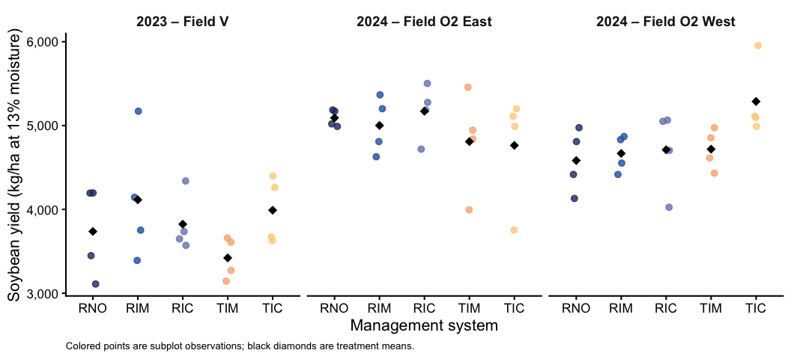
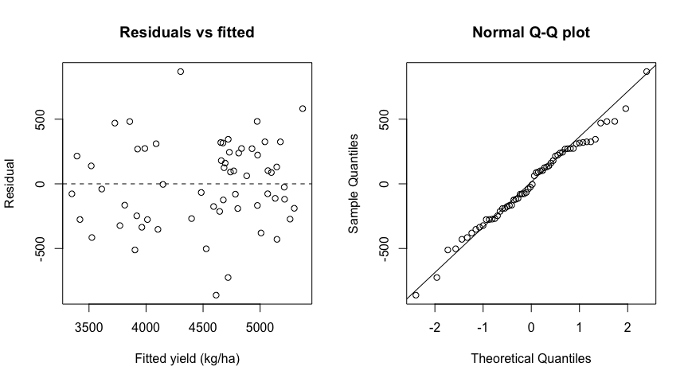
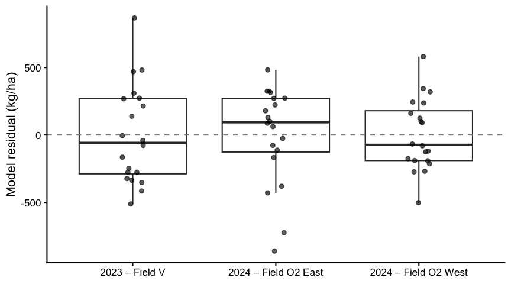
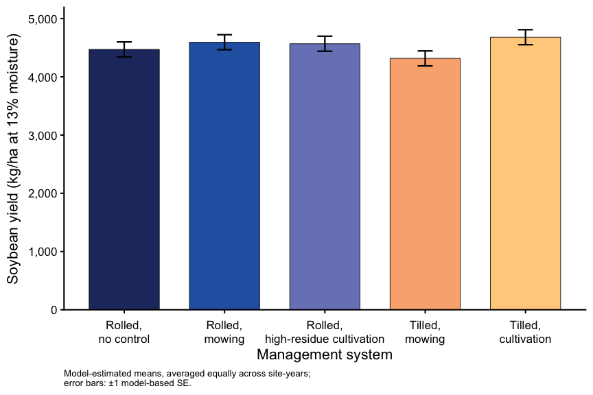

Soybean yield
================

- [Question and experimental design](#question-and-experimental-design)
- [Setup](#setup)
- [Data preparation](#data-preparation)
- [Exploratory analysis](#exploratory-analysis)
- [Primary model](#primary-model)
- [Check assumptions and whole-plot
  variance](#check-assumptions-and-whole-plot-variance)
- [Model diagnostics](#model-diagnostics)
- [Tests and overall estimates](#tests-and-overall-estimates)
- [Estimated means and planned
  comparisons](#estimated-means-and-planned-comparisons)
- [Final figure: model-estimated means ±
  SE](#final-figure-model-estimated-means--se)
- [Yield estimates in bushels per
  acre](#yield-estimates-in-bushels-per-acre)
- [Results summary](#results-summary)
- [Interpretation notes](#interpretation-notes)
- [Appendix: sensitivity to the singular block
  effect](#appendix-sensitivity-to-the-singular-block-effect)
- [Appendix: exploratory yield noninferiority and
  equivalence](#appendix-exploratory-yield-noninferiority-and-equivalence)
  - [Secondary treatment comparisons against tilled
    cultivation](#secondary-treatment-comparisons-against-tilled-cultivation)
- [R session](#r-session)

# Question and experimental design

Did soybean yield differ among the five weed-management treatments, and
was yield different between roller-crimped cereal rye and tilled
systems? Did treatment differences vary among site-years?

The study used a split-plot randomized complete block design. Rye
termination system (rolled or tilled) was randomized to whole plots
within blocks, and weed-control treatments were assigned to subplots
within each system. There were three rolled treatments (no supplemental
control, inter-row mowing, and high-residue cultivation) and two tilled
treatments (inter-row mowing and cultivation). The trial includes three
site-years: 2023 Field V, 2024 O2 East, and 2024 O2 West.

The primary analysis includes all site-years. Site-year is fixed because
these three specific experiments are of interest; blocks and whole plots
are random. The five-level treatment factor is used because the design
is not a complete system-by-weed-control factorial. Consequently, a
rolled-versus-tilled contrast averages over *different* weed-control
treatment sets and should be interpreted as a comparison of the tested
management packages, not a pure termination-method effect.

# Setup

``` r
library(tidyverse)
```

    ## ── Attaching core tidyverse packages ──────────────────────── tidyverse 2.0.0 ──
    ## ✔ dplyr     1.1.4     ✔ readr     2.1.5
    ## ✔ forcats   1.0.1     ✔ stringr   1.5.2
    ## ✔ ggplot2   4.0.0     ✔ tibble    3.3.0
    ## ✔ lubridate 1.9.4     ✔ tidyr     1.3.1
    ## ✔ purrr     1.1.0     
    ## ── Conflicts ────────────────────────────────────────── tidyverse_conflicts() ──
    ## ✖ dplyr::filter() masks stats::filter()
    ## ✖ dplyr::lag()    masks stats::lag()
    ## ℹ Use the conflicted package (<http://conflicted.r-lib.org/>) to force all conflicts to become errors

``` r
library(lmerTest)
```

    ## Loading required package: lme4
    ## Loading required package: Matrix
    ## 
    ## Attaching package: 'Matrix'
    ## 
    ## The following objects are masked from 'package:tidyr':
    ## 
    ##     expand, pack, unpack
    ## 
    ## 
    ## Attaching package: 'lmerTest'
    ## 
    ## The following object is masked from 'package:lme4':
    ## 
    ##     lmer
    ## 
    ## The following object is masked from 'package:stats':
    ## 
    ##     step

``` r
library(emmeans)
```

    ## Welcome to emmeans.
    ## Caution: You lose important information if you filter this package's results.
    ## See '? untidy'

``` r
library(here)
```

    ## here() starts at /Users/ey239/Github/Mowtivation

``` r
library(WrensBookshelf)

options(contrasts = c("contr.sum", "contr.poly"))

trt_levels <- c("Rolled, no control", "Rolled, mowing",
                "Rolled, high-residue cultivation", "Tilled, mowing",
                "Tilled, cultivation")
trt_labels <- c("Rolled,\nno control", "Rolled,\nmowing",
                "Rolled,\nhigh-residue cultivation", "Tilled,\nmowing",
                "Tilled,\ncultivation")
treatment_codes <- c("RNO", "RIM", "RIC", "TIM", "TIC")
experiment_labels <- c(
  V_2023 = "2023 – Field V",
  O2E_2024 = "2024 – Field O2 East",
  O2W_2024 = "2024 – Field O2 West"
)
# Reuse the exact five-treatment palette used in the other Mowtivation Rmds.
treatment_colors <- setNames(
  WrensBookshelf::WB_brewer(name = "WhatWellBuild", n = 5,
                            type = "discrete"), treatment_codes
)
fill_cols <- setNames(unname(treatment_colors), trt_levels)
theme_set(theme_classic(base_size = 16))
emm_options(lmer.df = "satterthwaite")
# Format p-values for display only; CSV exports retain numeric precision.
fmt_p <- function(x) {
  ifelse(is.na(x), NA_character_,
         ifelse(x < 0.001, "<0.001", formatC(x, format = "g", digits = 3, flag = "#")))
}
show_table <- function(x, caption, digits = 1) {
  x <- as.data.frame(x)
  p_columns <- names(x)[grepl("^p[._]|[._]p$", names(x)) |
                          startsWith(names(x), "Pr(")]
  x[p_columns] <- lapply(x[p_columns], fmt_p)
  knitr::kable(x, digits = digits, caption = caption)
}
package_comparisons <- list(
  "Rolled minus tilled packages" = c(1/3, 1/3, 1/3, -1/2, -1/2),
  "Rolled mowing minus tilled mowing" = c(0, 1, 0, -1, 0)
)
kg_ha_per_bu_ac <- 67.2511  # Soybean: 60 lb/bu, for reporting conversions.

fig_dir <- here("figures")
tab_dir <- here("output", "tables", "soybean_yield")
dir.create(fig_dir, recursive = TRUE, showWarnings = FALSE)
dir.create(tab_dir, recursive = TRUE, showWarnings = FALSE)
```

# Data preparation

Read the standardized dataset created by `data_prep.Rmd`, as in the
other Mowtivation analyses. Grain yield (`bean_yield_adj_kg_ha`) is
already converted to kg/ha at 13% moisture. **Do not repeat raw import,
harvested-area conversion, or moisture adjustment in this Rmd.** Check
the input’s identity, columns, factor levels, and experimental
replication before fitting the model.

``` r
processed_file <- here("data", "processed", "combined_processed.rds")
processed_data <- readRDS(processed_file)

show_table(
  tibble(input = "data/processed/combined_processed.rds",
         MD5 = unname(tools::md5sum(processed_file))),
  "Processed-data provenance"
)
```

| input                                 | MD5                              |
|:--------------------------------------|:---------------------------------|
| data/processed/combined_processed.rds | 217fbf0aa2d75c95b9463ee4a0f0bbb8 |

Processed-data provenance

``` r
required <- c("site_year", "block", "treatment", "bean_yield_adj_kg_ha")
missing_columns <- setdiff(required, names(processed_data))
if (length(missing_columns)) {
  stop("Missing processed-data columns: ", paste(missing_columns, collapse = ", "),
       ". Confirm names and yield units in data_prep.Rmd before proceeding.")
}

plot_data <- processed_data |>
  select(all_of(required)) |>
  mutate(across(c(site_year, block, treatment), as.character))

if (anyNA(plot_data) ||
    any(vapply(plot_data[c("site_year", "block", "treatment")],
               function(x) any(trimws(x) == ""), logical(1)))) {
  stop("Missing values or blank identifiers; inspect data_prep.Rmd output.")
}
if (!is.numeric(plot_data$bean_yield_adj_kg_ha) ||
    any(!is.finite(plot_data$bean_yield_adj_kg_ha)) ||
    any(plot_data$bean_yield_adj_kg_ha < 0)) {
  stop("Processed soybean yield must be finite, nonnegative numeric kg/ha values.")
}
if (!setequal(unique(plot_data$site_year), names(experiment_labels)) ||
    !setequal(unique(plot_data$treatment), treatment_codes)) {
  stop("Site-year or treatment identifiers differ from the Mowtivation design.")
}

replication_check <- plot_data |> count(site_year, block, treatment)
block_check <- replication_check |> count(site_year, block, name = "n_treatments")
experiment_check <- block_check |> count(site_year, name = "n_blocks")
if (any(replication_check$n != 1L) || any(block_check$n_treatments != 5L) ||
    any(experiment_check$n_blocks != 4L)) {
  stop("Expected one yield value per subplot, five treatments per block, and four blocks per site-year.")
}

yield_dat <- plot_data |>
  mutate(
    site_year = factor(site_year, levels = names(experiment_labels)),
    block = factor(block),
    weed_trt = factor(trt_levels[match(treatment, treatment_codes)],
                      levels = trt_levels),
    system = factor(if_else(treatment %in% c("RNO", "RIM", "RIC"),
                            "Rolled", "Tilled"), levels = c("Rolled", "Tilled")),
    whole_plot = interaction(site_year, block, system, drop = TRUE),
    yield_kg_ha = bean_yield_adj_kg_ha
  )

# Check the number of observations and randomization units.
yield_dat |>
  count(site_year, block, system, weed_trt) |>
  print(n = Inf)
```

    ## # A tibble: 60 × 5
    ##    site_year block system weed_trt                             n
    ##    <fct>     <fct> <fct>  <fct>                            <int>
    ##  1 V_2023    1     Rolled Rolled, no control                   1
    ##  2 V_2023    1     Rolled Rolled, mowing                       1
    ##  3 V_2023    1     Rolled Rolled, high-residue cultivation     1
    ##  4 V_2023    1     Tilled Tilled, mowing                       1
    ##  5 V_2023    1     Tilled Tilled, cultivation                  1
    ##  6 V_2023    2     Rolled Rolled, no control                   1
    ##  7 V_2023    2     Rolled Rolled, mowing                       1
    ##  8 V_2023    2     Rolled Rolled, high-residue cultivation     1
    ##  9 V_2023    2     Tilled Tilled, mowing                       1
    ## 10 V_2023    2     Tilled Tilled, cultivation                  1
    ## 11 V_2023    3     Rolled Rolled, no control                   1
    ## 12 V_2023    3     Rolled Rolled, mowing                       1
    ## 13 V_2023    3     Rolled Rolled, high-residue cultivation     1
    ## 14 V_2023    3     Tilled Tilled, mowing                       1
    ## 15 V_2023    3     Tilled Tilled, cultivation                  1
    ## 16 V_2023    4     Rolled Rolled, no control                   1
    ## 17 V_2023    4     Rolled Rolled, mowing                       1
    ## 18 V_2023    4     Rolled Rolled, high-residue cultivation     1
    ## 19 V_2023    4     Tilled Tilled, mowing                       1
    ## 20 V_2023    4     Tilled Tilled, cultivation                  1
    ## 21 O2E_2024  1     Rolled Rolled, no control                   1
    ## 22 O2E_2024  1     Rolled Rolled, mowing                       1
    ## 23 O2E_2024  1     Rolled Rolled, high-residue cultivation     1
    ## 24 O2E_2024  1     Tilled Tilled, mowing                       1
    ## 25 O2E_2024  1     Tilled Tilled, cultivation                  1
    ## 26 O2E_2024  2     Rolled Rolled, no control                   1
    ## 27 O2E_2024  2     Rolled Rolled, mowing                       1
    ## 28 O2E_2024  2     Rolled Rolled, high-residue cultivation     1
    ## 29 O2E_2024  2     Tilled Tilled, mowing                       1
    ## 30 O2E_2024  2     Tilled Tilled, cultivation                  1
    ## 31 O2E_2024  3     Rolled Rolled, no control                   1
    ## 32 O2E_2024  3     Rolled Rolled, mowing                       1
    ## 33 O2E_2024  3     Rolled Rolled, high-residue cultivation     1
    ## 34 O2E_2024  3     Tilled Tilled, mowing                       1
    ## 35 O2E_2024  3     Tilled Tilled, cultivation                  1
    ## 36 O2E_2024  4     Rolled Rolled, no control                   1
    ## 37 O2E_2024  4     Rolled Rolled, mowing                       1
    ## 38 O2E_2024  4     Rolled Rolled, high-residue cultivation     1
    ## 39 O2E_2024  4     Tilled Tilled, mowing                       1
    ## 40 O2E_2024  4     Tilled Tilled, cultivation                  1
    ## 41 O2W_2024  1     Rolled Rolled, no control                   1
    ## 42 O2W_2024  1     Rolled Rolled, mowing                       1
    ## 43 O2W_2024  1     Rolled Rolled, high-residue cultivation     1
    ## 44 O2W_2024  1     Tilled Tilled, mowing                       1
    ## 45 O2W_2024  1     Tilled Tilled, cultivation                  1
    ## 46 O2W_2024  2     Rolled Rolled, no control                   1
    ## 47 O2W_2024  2     Rolled Rolled, mowing                       1
    ## 48 O2W_2024  2     Rolled Rolled, high-residue cultivation     1
    ## 49 O2W_2024  2     Tilled Tilled, mowing                       1
    ## 50 O2W_2024  2     Tilled Tilled, cultivation                  1
    ## 51 O2W_2024  3     Rolled Rolled, no control                   1
    ## 52 O2W_2024  3     Rolled Rolled, mowing                       1
    ## 53 O2W_2024  3     Rolled Rolled, high-residue cultivation     1
    ## 54 O2W_2024  3     Tilled Tilled, mowing                       1
    ## 55 O2W_2024  3     Tilled Tilled, cultivation                  1
    ## 56 O2W_2024  4     Rolled Rolled, no control                   1
    ## 57 O2W_2024  4     Rolled Rolled, mowing                       1
    ## 58 O2W_2024  4     Rolled Rolled, high-residue cultivation     1
    ## 59 O2W_2024  4     Tilled Tilled, mowing                       1
    ## 60 O2W_2024  4     Tilled Tilled, cultivation                  1

``` r
show_table(yield_dat |>
  group_by(site_year) |>
  summarise(n_subplots = n(), n_whole_plots = n_distinct(whole_plot),
            yield_min = min(yield_kg_ha), yield_max = max(yield_kg_ha),
            .groups = "drop"),
  "Validated soybean yield records and range (kg/ha)")
```

| site_year | n_subplots | n_whole_plots | yield_min | yield_max |
|:----------|-----------:|--------------:|----------:|----------:|
| V_2023    |         20 |             8 |    3109.8 |    5171.1 |
| O2E_2024  |         20 |             8 |    3753.6 |    5502.2 |
| O2W_2024  |         20 |             8 |    4024.9 |    5954.5 |

Validated soybean yield records and range (kg/ha)

# Exploratory analysis

``` r
raw_summary <- yield_dat |>
  group_by(site_year, weed_trt) |>
  summarise(n = n(), raw_mean = mean(yield_kg_ha),
            raw_sd = sd(yield_kg_ha), .groups = "drop")
show_table(raw_summary, "Observed soybean yield: mean and SD (kg/ha)", digits = 1)
```

| site_year | weed_trt                         |   n | raw_mean | raw_sd |
|:----------|:---------------------------------|----:|---------:|-------:|
| V_2023    | Rolled, no control               |   4 |   3737.1 |  546.9 |
| V_2023    | Rolled, mowing                   |   4 |   4114.7 |  768.5 |
| V_2023    | Rolled, high-residue cultivation |   4 |   3823.5 |  350.2 |
| V_2023    | Tilled, mowing                   |   4 |   3421.2 |  251.7 |
| V_2023    | Tilled, cultivation              |   4 |   3990.0 |  397.4 |
| O2E_2024  | Rolled, no control               |   4 |   5091.5 |  101.0 |
| O2E_2024  | Rolled, mowing                   |   4 |   5001.0 |  341.4 |
| O2E_2024  | Rolled, high-residue cultivation |   4 |   5170.6 |  329.6 |
| O2E_2024  | Tilled, mowing                   |   4 |   4808.8 |  606.1 |
| O2E_2024  | Tilled, cultivation              |   4 |   4763.6 |  678.9 |
| O2W_2024  | Rolled, no control               |   4 |   4582.7 |  381.6 |
| O2W_2024  | Rolled, mowing                   |   4 |   4667.5 |  218.7 |
| O2W_2024  | Rolled, high-residue cultivation |   4 |   4710.8 |  486.8 |
| O2W_2024  | Tilled, mowing                   |   4 |   4718.4 |  243.1 |
| O2W_2024  | Tilled, cultivation              |   4 |   5287.4 |  447.9 |

Observed soybean yield: mean and SD (kg/ha)

``` r
readr::write_csv(raw_summary, file.path(tab_dir, "soybean_yield_raw_summary.csv"))
```

``` r
observed_yield_fig <- yield_dat |>
  mutate(treatment_code = factor(treatment_codes[as.integer(weed_trt)],
                                 levels = treatment_codes)) |>
  ggplot(aes(treatment_code, yield_kg_ha)) +
  geom_point(aes(color = treatment_code),
             position = position_jitter(width = 0.08, height = 0, seed = 123),
             size = 2.5, alpha = 0.8) +
  stat_summary(fun = mean, geom = "point", shape = 18, size = 3.8,
               color = "black") +
  facet_wrap(~ site_year, nrow = 1,
             labeller = labeller(site_year = experiment_labels)) +
  scale_color_manual(values = treatment_colors, guide = "none") +
  scale_y_continuous(labels = scales::label_comma()) +
  labs(x = "Management system", y = "Soybean yield (kg/ha at 13% moisture)",
       caption = "Colored points are subplot observations; black diamonds are treatment means.") +
  theme_classic(base_size = 16) +
  theme(strip.background = element_blank(),
        strip.text = element_text(face = "bold", size = 14),
        axis.text.x = element_text(size = 13),
        plot.caption = element_text(size = 10, hjust = 0))

observed_yield_fig
```

<!-- -->

``` r
ggsave(file.path(fig_dir, "fig_soybean-yield_observed_by-site-year.png"),
       observed_yield_fig, width = 11, height = 5, dpi = 300, bg = "white")
```

# Primary model

The model includes a treatment-by-site-year interaction and separate
random intercepts for blocks within site-years and whole plots within
blocks. The whole-plot term preserves the correct randomization level
for comparisons between rolled and tilled systems. Treatment differences
within a system are estimated using subplot-level information. Inspect
the whole-plot variance component and singular-fit warning; do not
automatically remove this term solely because its fitted variance is
small.

``` r
yield_mod <- lmer(
  yield_kg_ha ~ weed_trt * site_year +
    (1 | site_year:block) + (1 | whole_plot),
  data = yield_dat, REML = TRUE
)
```

    ## boundary (singular) fit: see help('isSingular')

``` r
show_table(as.data.frame(coef(summary(yield_mod))) |>
             tibble::rownames_to_column("Coefficient"),
           "Primary model coefficients (sum coding; Satterthwaite tests)", digits = 2)
```

| Coefficient          | Estimate | Std. Error |    df | t value | Pr(\>\|t\|) |
|:---------------------|---------:|-----------:|------:|--------:|:------------|
| (Intercept)          |  4525.91 |      65.35 | 17.33 |   69.25 | \<0.001     |
| weed_trt1            |   -55.50 |     108.80 | 40.37 |   -0.51 | 0.613       |
| weed_trt2            |    68.47 |     108.80 | 40.37 |    0.63 | 0.533       |
| weed_trt3            |    42.39 |     108.80 | 40.37 |    0.39 | 0.699       |
| weed_trt4            |  -209.78 |     114.15 | 44.15 |   -1.84 | 0.0728      |
| site_year1           |  -708.62 |      92.42 | 17.33 |   -7.67 | \<0.001     |
| site_year2           |   441.18 |      92.42 | 17.33 |    4.77 | \<0.001     |
| weed_trt1:site_year1 |   -24.69 |     153.86 | 40.37 |   -0.16 | 0.873       |
| weed_trt2:site_year1 |   228.90 |     153.86 | 40.37 |    1.49 | 0.145       |
| weed_trt3:site_year1 |   -36.18 |     153.86 | 40.37 |   -0.24 | 0.815       |
| weed_trt4:site_year1 |  -186.29 |     161.43 | 44.15 |   -1.15 | 0.255       |
| weed_trt1:site_year2 |   179.86 |     153.86 | 40.37 |    1.17 | 0.249       |
| weed_trt2:site_year2 |   -34.56 |     153.86 | 40.37 |   -0.22 | 0.823       |
| weed_trt3:site_year2 |   161.11 |     153.86 | 40.37 |    1.05 | 0.301       |
| weed_trt4:site_year2 |    51.50 |     161.43 | 44.15 |    0.32 | 0.751       |

Primary model coefficients (sum coding; Satterthwaite tests)

# Check assumptions and whole-plot variance

``` r
isSingular(yield_mod)
```

    ## [1] TRUE

``` r
VarCorr(yield_mod)
```

    ##  Groups          Name        Std.Dev.
    ##  whole_plot      (Intercept) 189.13  
    ##  site_year:block (Intercept)   0.00  
    ##  Residual                    404.04

# Model diagnostics

Check the shape and spread of residuals, especially whether variability
differs among site-years. The site-year summaries below are descriptive
and do not constitute a formal test of equal variances.

``` r
par(mfrow = c(1, 2))
plot(fitted(yield_mod), resid(yield_mod),
     xlab = "Fitted yield (kg/ha)", ylab = "Residual",
     main = "Residuals vs fitted")
abline(h = 0, lty = 2)
qqnorm(resid(yield_mod), main = "Normal Q-Q plot")
qqline(resid(yield_mod))
```

<!-- -->

``` r
par(mfrow = c(1, 1))

yield_residuals <- yield_dat |>
  mutate(residual = resid(yield_mod))

residual_by_site_year <- yield_residuals |>
  group_by(site_year) |>
  summarise(n = n(), residual_sd = sd(residual),
            residual_min = min(residual), residual_max = max(residual),
            .groups = "drop")
show_table(residual_by_site_year, digits = 1,
             caption = "Residual variation by site-year (kg/ha)")
```

| site_year |   n | residual_sd | residual_min | residual_max |
|:----------|----:|------------:|-------------:|-------------:|
| V_2023    |  20 |       365.5 |       -511.5 |        868.0 |
| O2E_2024  |  20 |       359.4 |       -860.7 |        482.9 |
| O2W_2024  |  20 |       263.9 |       -502.3 |        581.5 |

Residual variation by site-year (kg/ha)

``` r
yield_residuals |>
  ggplot(aes(site_year, residual)) +
  geom_boxplot(outlier.shape = NA) +
  geom_point(position = position_jitter(width = 0.08, height = 0, seed = 123),
             alpha = 0.65) +
  geom_hline(yintercept = 0, linetype = 2, color = "grey50") +
  scale_x_discrete(labels = experiment_labels) +
  labs(x = NULL, y = "Model residual (kg/ha)") +
  theme_classic(base_size = 16)
```

<!-- -->

# Tests and overall estimates

``` r
# Satterthwaite denominator degrees of freedom for fixed-effect tests.
yield_anova <- anova(yield_mod, type = 3, ddf = "Satterthwaite")
show_table(as.data.frame(yield_anova) |> tibble::rownames_to_column("Effect"),
           "Type III tests (Satterthwaite degrees of freedom)", digits = 3)
```

| Effect             |    Sum Sq |   Mean Sq | NumDF |  DenDF | F value | Pr(\>F) |
|:-------------------|----------:|----------:|------:|-------:|--------:|:--------|
| weed_trt           |  918454.3 |  229613.6 |     4 | 31.531 |   1.407 | 0.254   |
| site_year          | 9789121.6 | 4894560.8 |     2 | 17.335 |  29.982 | \<0.001 |
| weed_trt:site_year | 1563531.8 |  195441.5 |     8 | 31.531 |   1.197 | 0.332   |

Type III tests (Satterthwaite degrees of freedom)

# Estimated means and planned comparisons

Estimated marginal means give equal weight to each of the three
site-years. Pairwise treatment differences and their 95% confidence
intervals are reported without compact-letter displays, because a
nonsignificant test does not prove the treatments are equal. Fisher’s
LSD-style comparisons use `emmeans` with `adjust = "none"`: all ten
pairwise tests and their pointwise 95% confidence intervals are
**unadjusted**. These exploratory comparisons do not control the
family-wise error rate and are computed regardless of the omnibus
treatment test.

The two targeted contrasts are separately defined, exploratory,
unadjusted comparisons, each with a pointwise 95% confidence interval.
They do not constitute a jointly multiplicity-adjusted family.

``` r
emm_trt <- emmeans(yield_mod, ~ weed_trt, weights = "equal")
```

    ## NOTE: Results may be misleading due to involvement in interactions

``` r
emm_sy <- emmeans(yield_mod, ~ weed_trt | site_year)

trt_table <- as_tibble(confint(emm_trt, level = 0.95, adjust = "none"))
pair_table <- as_tibble(summary(pairs(emm_trt, adjust = "none"), infer = TRUE))
sy_table <- as_tibble(confint(emm_sy, level = 0.95, adjust = "none"))

show_table(trt_table, digits = 1,
             caption = "Model-estimated yield by treatment (kg/ha, 13% moisture; pointwise 95% CIs)")
```

| weed_trt                         | emmean |    SE |   df | lower.CL | upper.CL |
|:---------------------------------|-------:|------:|-----:|---------:|---------:|
| Rolled, no control               | 4470.4 | 128.8 | 42.9 |   4210.7 |   4730.2 |
| Rolled, mowing                   | 4594.4 | 128.8 | 42.9 |   4334.6 |   4854.1 |
| Rolled, high-residue cultivation | 4568.3 | 128.8 | 42.9 |   4308.6 |   4828.0 |
| Tilled, mowing                   | 4316.1 | 128.8 | 42.9 |   4056.4 |   4575.9 |
| Tilled, cultivation              | 4680.3 | 128.8 | 42.9 |   4420.6 |   4940.1 |

Model-estimated yield by treatment (kg/ha, 13% moisture; pointwise 95%
CIs)

``` r
show_table(pair_table, digits = 2,
             caption = "Fisher's LSD-style pairwise yield differences: unadjusted tests and pointwise 95% CIs")
```

| contrast | estimate | SE | df | lower.CL | upper.CL | t.ratio | p.value |
|:---|---:|---:|---:|---:|---:|---:|:---|
| Rolled, no control - Rolled, mowing | -123.97 | 164.95 | 27.55 | -462.10 | 214.16 | -0.75 | 0.459 |
| Rolled, no control - (Rolled, high-residue cultivation) | -97.89 | 164.95 | 27.55 | -436.02 | 240.24 | -0.59 | 0.558 |
| Rolled, no control - Tilled, mowing | 154.29 | 182.13 | 42.85 | -213.04 | 521.62 | 0.85 | 0.402 |
| Rolled, no control - Tilled, cultivation | -209.91 | 182.13 | 42.85 | -577.24 | 157.42 | -1.15 | 0.255 |
| Rolled, mowing - (Rolled, high-residue cultivation) | 26.08 | 164.95 | 27.55 | -312.05 | 364.21 | 0.16 | 0.876 |
| Rolled, mowing - Tilled, mowing | 278.26 | 182.13 | 42.85 | -89.07 | 645.59 | 1.53 | 0.134 |
| Rolled, mowing - Tilled, cultivation | -85.94 | 182.13 | 42.85 | -453.27 | 281.39 | -0.47 | 0.639 |
| (Rolled, high-residue cultivation) - Tilled, mowing | 252.18 | 182.13 | 42.85 | -115.15 | 619.51 | 1.38 | 0.173 |
| (Rolled, high-residue cultivation) - Tilled, cultivation | -112.02 | 182.13 | 42.85 | -479.35 | 255.31 | -0.62 | 0.542 |
| Tilled, mowing - Tilled, cultivation | -364.20 | 164.95 | 27.55 | -702.33 | -26.07 | -2.21 | 0.0357 |

Fisher’s LSD-style pairwise yield differences: unadjusted tests and
pointwise 95% CIs

``` r
# Specific rolled vs tilled management-package comparison: equal weight
# among the three rolled treatments and among the two tilled treatments.
system_contrast <- contrast(emm_trt, package_comparisons[1])
system_table <- as_tibble(summary(system_contrast, infer = TRUE, level = 0.95, adjust = "none"))
show_table(system_table, digits = 2,
             caption = "Exploratory rolled vs tilled packages (kg/ha; unadjusted test, pointwise 95% CI)")
```

| contrast | estimate | SE | df | lower.CL | upper.CL | t.ratio | p.value |
|:---|---:|---:|---:|---:|---:|---:|:---|
| Rolled minus tilled packages | 46.14 | 131.52 | 19.19 | -228.95 | 321.24 | 0.35 | 0.730 |

Exploratory rolled vs tilled packages (kg/ha; unadjusted test, pointwise
95% CI)

``` r
# A direct comparison with both systems receiving inter-row mowing.
mowing_contrast <- contrast(emm_trt, package_comparisons[2])
mowing_table <- as_tibble(summary(mowing_contrast, infer = TRUE, level = 0.95, adjust = "none"))
show_table(mowing_table, "Exploratory rolled vs tilled mowing (kg/ha; unadjusted test, pointwise 95% CI)", digits = 2)
```

| contrast | estimate | SE | df | lower.CL | upper.CL | t.ratio | p.value |
|:---|---:|---:|---:|---:|---:|---:|:---|
| Rolled mowing minus tilled mowing | 278.26 | 182.13 | 42.85 | -89.07 | 645.59 | 1.53 | 0.134 |

Exploratory rolled vs tilled mowing (kg/ha; unadjusted test, pointwise
95% CI)

``` r
readr::write_csv(trt_table, file.path(tab_dir, "yield_treatment_means.csv"))
readr::write_csv(pair_table, file.path(tab_dir, "yield_pairwise_comparisons.csv"))
readr::write_csv(sy_table, file.path(tab_dir, "yield_site_year_treatment_means.csv"))
readr::write_csv(system_table, file.path(tab_dir, "yield_rolled_vs_tilled.csv"))
readr::write_csv(mowing_table, file.path(tab_dir, "yield_mowing_system_comparison.csv"))
```

# Final figure: model-estimated means ± SE

The error bars show model-based standard errors, not confidence
intervals. There are no significance letters when treatment differences
are not detected.

``` r
fig_df <- trt_table |>
  mutate(weed_trt = factor(weed_trt, levels = trt_levels))

yield_fig <- ggplot(fig_df, aes(weed_trt, emmean, fill = weed_trt)) +
  geom_col(width = 0.7, color = "black", linewidth = 0.3) +
  geom_errorbar(aes(ymin = emmean - SE, ymax = emmean + SE),
                width = 0.15, linewidth = 0.8) +
  scale_fill_manual(values = fill_cols, guide = "none") +
  scale_x_discrete(labels = trt_labels) +
  scale_y_continuous(labels = scales::label_comma(),
                     expand = expansion(mult = c(0, 0.08))) +
  labs(x = "Management system", y = "Soybean yield (kg/ha at 13% moisture)",
       caption = paste("Model-estimated means, averaged equally across site-years;",
                       "error bars: ±1 model-based SE.", sep = "\n")) +
  theme_classic(base_size = 16) +
  theme(axis.text.x = element_text(lineheight = 0.95, margin = margin(t = 8)),
        axis.title.y = element_text(margin = margin(r = 8)),
        plot.caption = element_text(size = 10, hjust = 0))

yield_fig
```

<!-- -->

``` r
ggsave(file.path(fig_dir, "fig_soybean-yield_total_model_kg_ha.png"),
       yield_fig, width = 10, height = 8, dpi = 300, bg = "white")
```

# Yield estimates in bushels per acre

The unit conversion below uses estimates from the same fitted model.

``` r
# Bushels per acre are a display conversion of the SAME model, not a refit.
trt_table_bu <- trt_table |>
  mutate(across(any_of(c("emmean", "SE", "lower.CL", "upper.CL")),
                ~ .x / kg_ha_per_bu_ac))
show_table(trt_table_bu, digits = 2,
             caption = "Model-estimated soybean yield in bu/ac")
```

| weed_trt                         | emmean |   SE |    df | lower.CL | upper.CL |
|:---------------------------------|-------:|-----:|------:|---------:|---------:|
| Rolled, no control               |  66.47 | 1.91 | 42.85 |    62.61 |    70.34 |
| Rolled, mowing                   |  68.32 | 1.91 | 42.85 |    64.45 |    72.18 |
| Rolled, high-residue cultivation |  67.93 | 1.91 | 42.85 |    64.07 |    71.79 |
| Tilled, mowing                   |  64.18 | 1.91 | 42.85 |    60.32 |    68.04 |
| Tilled, cultivation              |  69.59 | 1.91 | 42.85 |    65.73 |    73.46 |

Model-estimated soybean yield in bu/ac

# Results summary

The primary split-plot model detected no evidence of an overall
treatment effect (Satterthwaite F = 1.41; p = 0.254) or
treatment-by-site-year interaction (F = 1.20; p = 0.332). Yield differed
among site-years (p \<0.001). The exploratory rolled-minus-tilled
package difference was 46 kg/ha (pointwise 95% CI: -229 to 321;
unadjusted p = 0.730). Nonsignificant difference tests do not establish
equivalence.

# Interpretation notes

Report the estimated contrasts, confidence intervals, and
treatment-by-site-year test alongside the overall treatment test. If
treatment differences are not statistically detected, conclude **no
evidence of a yield difference was detected**, not that yields were
equivalent. A formal equivalence claim would require a defensible
equivalence margin chosen independently of the observed data and a
correctly specified two-one-sided-test (TOST) analysis. The former Rmd’s
±10% margin based on the observed tilled mean is therefore omitted from
this primary analysis.

Because site-years are fixed, conclusions describe these experiments
rather than a random population of environments. Interpret results in
light of the weed-biomass and stand-establishment analyses: similar
yield despite differences in weed suppression can be biologically
informative without demonstrating that supplemental control has no
agronomic value.

# Appendix: sensitivity to the singular block effect

The primary model estimated zero variance for blocks within site-years
but a positive whole-plot variance. This sensitivity analysis drops only
the zero-variance block intercept, retaining the whole-plot random
effect required by the split-plot randomization. It uses the same
response, fixed effects, and REML fitting method. The primary
design-based model remains the reference.

``` r
yield_mod_reduced <- lmer(
  yield_kg_ha ~ weed_trt * site_year + (1 | whole_plot),
  data = yield_dat, REML = TRUE
)

model_checks <- tibble(
  model = c("Primary: block + whole plot", "Sensitivity: whole plot only"),
  singular = c(isSingular(yield_mod), isSingular(yield_mod_reduced)),
  whole_plot_sd = c(
    as.data.frame(VarCorr(yield_mod)) |>
      filter(grp == "whole_plot") |> pull(sdcor),
    as.data.frame(VarCorr(yield_mod_reduced)) |>
      filter(grp == "whole_plot") |> pull(sdcor)
  ),
  residual_sd = c(sigma(yield_mod), sigma(yield_mod_reduced))
)
show_table(model_checks, digits = 2,
             caption = "Random-effect sensitivity: variance components (kg/ha)")
```

| model                        | singular | whole_plot_sd | residual_sd |
|:-----------------------------|:---------|--------------:|------------:|
| Primary: block + whole plot  | TRUE     |        189.13 |      404.04 |
| Sensitivity: whole plot only | FALSE    |        189.13 |      404.04 |

Random-effect sensitivity: variance components (kg/ha)

``` r
get_sensitivity <- function(model, label) {
  means <- emmeans(model, ~ weed_trt, weights = "equal")
  comparisons <- contrast(means, package_comparisons)
  as_tibble(summary(comparisons, infer = TRUE, level = 0.95,
                    adjust = "none")) |>
    mutate(model = label, .before = 1) |>
    select(model, contrast, estimate, SE, df, lower.CL, upper.CL, p.value)
}

sensitivity_contrasts <- bind_rows(
  get_sensitivity(yield_mod, "Primary: block + whole plot"),
  get_sensitivity(yield_mod_reduced, "Sensitivity: whole plot only")
)
```

    ## NOTE: Results may be misleading due to involvement in interactions
    ## NOTE: Results may be misleading due to involvement in interactions

``` r
show_table(sensitivity_contrasts, digits = 2,
             caption = "Planned contrasts under both random-effect structures (kg/ha; pointwise 95% CI)")
```

| model | contrast | estimate | SE | df | lower.CL | upper.CL | p.value |
|:---|:---|---:|---:|---:|---:|---:|:---|
| Primary: block + whole plot | Rolled minus tilled packages | 46.14 | 131.52 | 19.19 | -228.95 | 321.24 | 0.730 |
| Primary: block + whole plot | Rolled mowing minus tilled mowing | 278.26 | 182.13 | 42.85 | -89.07 | 645.59 | 0.134 |
| Sensitivity: whole plot only | Rolled minus tilled packages | 46.14 | 131.52 | 19.19 | -228.95 | 321.24 | 0.730 |
| Sensitivity: whole plot only | Rolled mowing minus tilled mowing | 278.26 | 182.13 | 42.85 | -89.07 | 645.59 | 0.134 |

Planned contrasts under both random-effect structures (kg/ha; pointwise
95% CI)

``` r
readr::write_csv(sensitivity_contrasts,
                 file.path(tab_dir, "yield_random_effect_sensitivity.csv"))
```

If estimates and SEs are effectively unchanged, the zero block variance
is unlikely to materially affect the main conclusions. This check does
not by itself establish equal residual variance among site-years. If
site-year residual SDs differ markedly, consider a separate
heteroscedastic model sensitivity analysis before finalizing
site-year-specific inference.

# Appendix: exploratory yield noninferiority and equivalence

The primary scientific question here is whether the rolled management
packages avoid an agronomically important yield penalty relative to the
tilled packages. We therefore emphasize **noninferiority** (rolled minus
tilled yield greater than −450 kg/ha), followed by a two-sided
**equivalence** check (the difference within ±450 kg/ha). These are
different hypotheses, and neither follows from a nonsignificant
conventional treatment test.

The fixed working margin of 450 kg/ha is approximately 10% of a rounded
4,500 kg/ha soybean yield benchmark (approximately 66.9 bu/ac). The 450
kg/ha margin is approximately 6.7 bu/ac. This benchmark is a transparent
*working assumption*, not an independently validated economic threshold.
It must be justified using agronomic or economic considerations before
confirmatory manuscript claims. These analyses are exploratory because
the margin and hypotheses were revisited after seeing the yield results.
The margin is intentionally **not** recalculated from the observed TIC
or rolled/tilled model means. Margins of 225 and 675 kg/ha
(approximately 5% and 15% of the same benchmark) illustrate sensitivity
to the chosen threshold.

The analysis uses the same split-plot model, equal weighting of
site-years, and equal weighting of the three rolled and two tilled
management packages. Because these packages contain different
supplemental weed-control treatments, the contrast is not an isolated
effect of termination method.

``` r
margin_kg_ha <- 450
contrast_packages <- system_contrast

# The 95% one-sided lower bound and one-sided p-value evaluate noninferiority.
# emmeans: side = ">", delta > 0 tests H0: difference <= -delta.
noninferiority_primary <- as_tibble(summary(
  contrast_packages, infer = c(TRUE, TRUE), level = 0.95,
  side = ">", delta = margin_kg_ha, adjust = "none"
))
show_table(noninferiority_primary, digits = 2,
  caption = "Exploratory noninferiority: rolled minus tilled management packages; margin −450 kg/ha")
```

| contrast | estimate | SE | df | lower.CL | upper.CL | t.ratio | p.value |
|:---|---:|---:|---:|---:|---:|---:|:---|
| Rolled minus tilled packages | 46.14 | 131.52 | 19.19 | -181.16 | Inf | 3.77 | \<0.001 |

Exploratory noninferiority: rolled minus tilled management packages;
margin −450 kg/ha

``` r
# TOST tests both boundaries simultaneously. Equivalence requires the entire
# ordinary two-sided 90% CI to lie inside [-450, +450] kg/ha.
equivalence_primary <- as_tibble(summary(
  contrast_packages, infer = c(TRUE, TRUE), level = 0.90,
  side = "equivalence", delta = margin_kg_ha, adjust = "none"
))
show_table(equivalence_primary, digits = 2,
  caption = "Exploratory TOST equivalence: rolled versus tilled packages; margin ±450 kg/ha")
```

| contrast | estimate | SE | df | lower.CL | upper.CL | t.ratio | p.value |
|:---|---:|---:|---:|---:|---:|---:|:---|
| Rolled minus tilled packages | 46.14 | 131.52 | 19.19 | -181.16 | 273.45 | -3.07 | 0.00312 |

Exploratory TOST equivalence: rolled versus tilled packages; margin ±450
kg/ha

``` r
ordinary_90ci <- as_tibble(confint(
  contrast_packages, level = 0.90, adjust = "none"
))
show_table(ordinary_90ci, digits = 2,
  caption = "Ordinary two-sided 90% confidence interval for checking equivalence boundaries")
```

| contrast                     | estimate |     SE |    df | lower.CL | upper.CL |
|:-----------------------------|---------:|-------:|------:|---------:|---------:|
| Rolled minus tilled packages |    46.14 | 131.52 | 19.19 |  -181.16 |   273.45 |

Ordinary two-sided 90% confidence interval for checking equivalence
boundaries

``` r
# A sensitivity table makes dependence on the chosen margin explicit.
margin_sensitivity <- purrr::map_dfr(c(225, 450, 675), function(margin) {
  ni <- as_tibble(test(contrast_packages, side = ">",
                       delta = margin, adjust = "none"))
  eq <- as_tibble(test(contrast_packages, side = "equivalence",
                       delta = margin, adjust = "none"))
  tibble(
    margin_kg_ha = margin,
    margin_bu_ac = margin / kg_ha_per_bu_ac,
    noninferiority_p = ni$p.value,
    equivalence_p = eq$p.value,
    noninferiority_supported = ni$p.value < 0.05,
    equivalence_supported = eq$p.value < 0.05
  )
})
show_table(margin_sensitivity, digits = 3,
  caption = "Exploratory threshold sensitivity (unadjusted p-values)")
```

| margin_kg_ha | margin_bu_ac | noninferiority_p | equivalence_p | noninferiority_supported | equivalence_supported |
|---:|---:|:---|:---|:---|:---|
| 225 | 3.346 | 0.0265 | 0.0948 | TRUE | FALSE |
| 450 | 6.691 | \<0.001 | 0.00312 | TRUE | TRUE |
| 675 | 10.037 | \<0.001 | \<0.001 | TRUE | TRUE |

Exploratory threshold sensitivity (unadjusted p-values)

``` r
readr::write_csv(noninferiority_primary,
                 file.path(tab_dir, "yield_exploratory_noninferiority.csv"))
readr::write_csv(equivalence_primary,
                 file.path(tab_dir, "yield_exploratory_equivalence.csv"))
readr::write_csv(margin_sensitivity,
                 file.path(tab_dir, "yield_exploratory_margin_sensitivity.csv"))
```

## Secondary treatment comparisons against tilled cultivation

The four comparisons against TIC are exploratory and share a common
reference. For these, we report the differences and 90% confidence
intervals, together with both unadjusted and Holm-adjusted TOST
equivalence-test p-values. Fisher’s LSD applies only to conventional
pairwise difference tests above, not to these equivalence tests. The
adjustment is conservative, and the fixed margin remains ±450 kg/ha.
Individual differences may have wider intervals than the average
management-package contrast.

``` r
vs_tic <- contrast(emm_trt, method = "trt.vs.ctrl",
                   ref = which(trt_levels == "Tilled, cultivation"))
vs_tic_ci <- as_tibble(confint(vs_tic, level = 0.90, adjust = "none"))
vs_tic_tost <- as_tibble(test(vs_tic, side = "equivalence",
                              delta = margin_kg_ha, adjust = "none")) |>
  transmute(contrast, p_equiv = p.value)
vs_tic_table <- vs_tic_ci |>
  left_join(vs_tic_tost, by = "contrast") |>
  mutate(p_equiv_holm = p.adjust(p_equiv, method = "holm"),
         equivalence_supported_holm = p_equiv_holm < 0.05)
show_table(vs_tic_table, digits = 2,
  caption = "Exploratory equivalence to TIC (±450 kg/ha): pointwise 90% CIs, unadjusted and Holm-adjusted TOST p-values")
```

| contrast | estimate | SE | df | lower.CL | upper.CL | p_equiv | p_equiv_holm | equivalence_supported_holm |
|:---|---:|---:|---:|---:|---:|:---|:---|:---|
| Rolled, no control - Tilled, cultivation | -209.91 | 182.13 | 42.85 | -516.10 | 96.28 | 0.0972 | 0.194 | FALSE |
| Rolled, mowing - Tilled, cultivation | -85.94 | 182.13 | 42.85 | -392.13 | 220.25 | 0.0260 | 0.104 | FALSE |
| (Rolled, high-residue cultivation) - Tilled, cultivation | -112.02 | 182.13 | 42.85 | -418.21 | 194.17 | 0.0352 | 0.106 | FALSE |
| Tilled, mowing - Tilled, cultivation | -364.20 | 164.95 | 27.55 | -644.95 | -83.44 | 0.304 | 0.304 | FALSE |

Exploratory equivalence to TIC (±450 kg/ha): pointwise 90% CIs,
unadjusted and Holm-adjusted TOST p-values

``` r
readr::write_csv(vs_tic_table,
                 file.path(tab_dir, "yield_exploratory_vs_tic.csv"))
```

Methodological references: Mahala et al. (2026), *Weed Research*,
<doi:10.1111/wre.70100> (published agricultural ±10% precedent); Horita
and Yuan (2026), bioRxiv <doi:10.64898/2026.06.16.732230> (preprint
evaluating ±10% and ±15% of control yield). Neither establishes a
universal soybean yield equivalence threshold.

# R session

``` r
sessionInfo()
```

    ## R version 4.5.2 (2025-10-31)
    ## Platform: aarch64-apple-darwin20
    ## Running under: macOS Tahoe 26.7.1
    ## 
    ## Matrix products: default
    ## BLAS:   /System/Library/Frameworks/Accelerate.framework/Versions/A/Frameworks/vecLib.framework/Versions/A/libBLAS.dylib 
    ## LAPACK: /Library/Frameworks/R.framework/Versions/4.5-arm64/Resources/lib/libRlapack.dylib;  LAPACK version 3.12.1
    ## 
    ## locale:
    ## [1] C.UTF-8/C.UTF-8/C.UTF-8/C/C.UTF-8/C.UTF-8
    ## 
    ## time zone: America/New_York
    ## tzcode source: internal
    ## 
    ## attached base packages:
    ## [1] stats     graphics  grDevices utils     datasets  methods   base     
    ## 
    ## other attached packages:
    ##  [1] WrensBookshelf_0.1.0 here_1.0.2           emmeans_1.11.2-8    
    ##  [4] lmerTest_3.1-3       lme4_1.1-37          Matrix_1.7-4        
    ##  [7] lubridate_1.9.4      forcats_1.0.1        stringr_1.5.2       
    ## [10] dplyr_1.1.4          purrr_1.1.0          readr_2.1.5         
    ## [13] tidyr_1.3.1          tibble_3.3.0         ggplot2_4.0.0       
    ## [16] tidyverse_2.0.0     
    ## 
    ## loaded via a namespace (and not attached):
    ##  [1] gtable_0.3.6        xfun_0.61           lattice_0.22-7     
    ##  [4] tzdb_0.5.0          numDeriv_2016.8-1.1 vctrs_0.6.5        
    ##  [7] tools_4.5.2         Rdpack_2.6.4        generics_0.1.4     
    ## [10] parallel_4.5.2      sandwich_3.1-1      pkgconfig_2.0.3    
    ## [13] RColorBrewer_1.1-3  S7_0.2.0            lifecycle_1.0.4    
    ## [16] compiler_4.5.2      farver_2.1.2        textshaping_1.0.4  
    ## [19] codetools_0.2-20    htmltools_0.5.8.1   yaml_2.3.10        
    ## [22] crayon_1.5.3        pillar_1.11.1       nloptr_2.2.1       
    ## [25] MASS_7.3-65         reformulas_0.4.4    boot_1.3-32        
    ## [28] multcomp_1.4-29     nlme_3.1-168        tidyselect_1.2.1   
    ## [31] digest_0.6.37       mvtnorm_1.3-3       stringi_1.8.7      
    ## [34] labeling_0.4.3      splines_4.5.2       rprojroot_2.1.1    
    ## [37] fastmap_1.2.0       grid_4.5.2          cli_3.6.5          
    ## [40] magrittr_2.0.4      utf8_1.2.6          survival_3.8-3     
    ## [43] TH.data_1.1-4       withr_3.0.2         scales_1.4.0       
    ## [46] bit64_4.6.0-1       timechange_0.3.0    estimability_1.5.1 
    ## [49] rmarkdown_2.30      bit_4.6.0           ragg_1.5.0         
    ## [52] zoo_1.8-14          hms_1.1.4           coda_0.19-4.1      
    ## [55] evaluate_1.0.5      knitr_1.50          rbibutils_2.3      
    ## [58] rlang_1.1.6         Rcpp_1.1.0          xtable_1.8-4       
    ## [61] glue_1.8.0          vroom_1.6.6         minqa_1.2.8        
    ## [64] R6_2.6.1            systemfonts_1.3.1
