Weed biomass
================

- [Question and experimental design](#question-and-experimental-design)
- [Analysis plan](#analysis-plan)
- [Setup](#setup)
- [Import and validate](#import-and-validate)
- [Total weed biomass](#total-weed-biomass)
  - [Observed summaries](#observed-summaries)
  - [Primary Tweedie model](#primary-tweedie-model)
  - [Model diagnostics](#model-diagnostics)
  - [Management effects and planned
    contrasts](#management-effects-and-planned-contrasts)
  - [Whole-plot sensitivity checks](#whole-plot-sensitivity-checks)
- [Inter-row weed biomass](#inter-row-weed-biomass)
  - [Observed summaries](#observed-summaries-1)
  - [Split-plot Tweedie model and
    diagnostics](#split-plot-tweedie-model-and-diagnostics)
  - [Joint tests, estimates, and
    contrasts](#joint-tests-estimates-and-contrasts)
  - [Inter-row post hoc groupings and model-estimated
    figure](#inter-row-post-hoc-groupings-and-model-estimated-figure)
- [In-row weed biomass: descriptive
  only](#in-row-weed-biomass-descriptive-only)
- [Combined observed weed biomass
  figure](#combined-observed-weed-biomass-figure)
- [Interpretation and limitations](#interpretation-and-limitations)
- [Reproducibility](#reproducibility)

# Question and experimental design

Did weed biomass differ among five soybean management systems, and did
system responses vary among site-years? Total weed biomass is the
primary outcome. Inter-row weed biomass is a secondary modeled outcome,
while in-row biomass is reported descriptively because exploratory
inferential models were unstable or showed residual problems.

The experiment included three site-years and four blocks per site-year.
Cereal rye termination was assigned to whole plots within blocks:
roller-crimped (rolled) or moldboard-plowed (tilled). Within rolled
whole plots, management subplots received no supplemental weed control
(RNO), inter-row mowing (RIM), or high-residue cultivation (RIC). Within
tilled whole plots, subplots received mowing (TIM) or cultivation (TIC).
Thus, the five systems are not a fully crossed factorial. Comparisons
involving different termination methods require whole-plot replication;
comparisons within a termination method use subplot replication.

Field records should be checked for the documented 2023 treatment
implementation error and incomplete RIC cultivation schedule before
manuscript reporting. Treatment labels here follow randomized
assignments.

# Analysis plan

Total weed biomass is the primary response. We fit a split-plot Tweedie
GLMM with site-year-specific dispersion and report planned
within-site-year contrasts. Inter-row weed biomass is analyzed
separately with a full treatment × site-year Tweedie GLMM. In-row
biomass is summarized descriptively; exploratory models were examined
but are not used for inference. Finally, an observed stacked
in-row/inter-row figure presents total biomass with arithmetic SE bars
and model-derived compact-letter displays (CLDs) for total and inter-row
weed biomass. These CLDs summarize unadjusted model-based pairwise Wald
tests within each site-year (an unprotected Fisher LSD-style procedure),
separately from the Holm-adjusted planned contrasts. They are
exploratory rather than familywise-error-controlled inference.

All zone biomass values are expressed per hectare of the **entire 0.5 m²
quadrat**, so in-row and inter-row components sum to total weed biomass.

# Setup

``` r
library(tidyverse)
library(here)
library(conflicted)
library(glmmTMB)
library(DHARMa)
library(emmeans)
library(WrensBookshelf)

conflicts_prefer(dplyr::filter)
conflicts_prefer(dplyr::select)

method_levels <- c("Roller-crimper", "Moldboard plow")
treatment_levels <- c("RNO", "RIM", "RIC", "TIM", "TIC")
treatment_labels <- c(
  RNO = "Rolled,\nno control",
  RIM = "Rolled,\nmowing",
  RIC = "Rolled,\nhigh-residue cultivation",
  TIM = "Tilled,\nmowing",
  TIC = "Tilled,\ncultivation"
)
experiment_labels <- c(
  V_2023 = "2023 – Field V",
  O2E_2024 = "2024 – Field O2 East",
  O2W_2024 = "2024 – Field O2 West"
)
method_lookup <- c(
  RNO = "Roller-crimper", RIM = "Roller-crimper",
  RIC = "Roller-crimper", TIM = "Moldboard plow", TIC = "Moldboard plow"
)
treatment_colors <- setNames(
  WrensBookshelf::WB_brewer(name = "WhatWellBuild", n = 5, type = "discrete"),
  treatment_levels
)
theme_set(theme_classic(base_size = 16))
show_table <- function(x, caption, digits = 1) {
  knitr::kable(x, caption = caption, digits = digits)
}

tab_dir <- here("output", "tables", "weed_biomass")
dir.create(tab_dir, recursive = TRUE, showWarnings = FALSE)
```

# Import and validate

The processed data are assumed already converted to kg/ha. Do not
convert these quantities again. Check the source and units against
`data_prep.Rmd`.

``` r
processed_file <- here("data", "processed", "combined_processed.rds")
processed_data <- readRDS(processed_file)

show_table(
  tibble(input = "data/processed/combined_processed.rds",
         MD5 = unname(tools::md5sum(processed_file))),
  "Processed-data provenance"
)
```

| input                                 | MD5                              |
|:--------------------------------------|:---------------------------------|
| data/processed/combined_processed.rds | 217fbf0aa2d75c95b9463ee4a0f0bbb8 |

Processed-data provenance

``` r
responses <- c(
  "weed_biomass_kg_ha",
  "inrow_weed_biomass_kg_ha",
  "interrow_weed_biomass_kg_ha"
)
required <- c("site_year", "block", "treatment", responses)
missing_columns <- setdiff(required, names(processed_data))
if (length(missing_columns)) {
  stop("Missing processed-data columns: ", paste(missing_columns, collapse = ", "),
       ". Confirm the names and units in data_prep.Rmd before proceeding.")
}

weed_data <- processed_data |>
  select(all_of(required)) |>
  mutate(across(c(site_year, block, treatment), as.character))

if (anyNA(weed_data[c("site_year", "block", "treatment")]) ||
    any(vapply(weed_data[c("site_year", "block", "treatment")],
               function(x) any(trimws(x) == ""), logical(1)))) {
  stop("Missing or blank experimental identifiers.")
}
if (!setequal(unique(weed_data$site_year), names(experiment_labels))) {
  stop("Site-year codes do not match experiment_labels.")
}
if (!setequal(unique(weed_data$treatment), treatment_levels)) {
  stop("Treatment codes do not match treatment_levels.")
}
for (response in responses) {
  y <- weed_data[[response]]
  if (!is.numeric(y) || anyNA(y) || any(!is.finite(y)) || any(y < 0)) {
    stop(response, " must contain finite, nonnegative values without missing data.")
  }
}

plot_counts <- weed_data |> count(site_year, block, treatment)
block_counts <- plot_counts |> count(site_year, block, name = "n_treatments")
experiment_counts <- block_counts |> count(site_year, name = "n_blocks")
if (any(plot_counts$n != 1L) || any(block_counts$n_treatments != 5L) ||
    any(experiment_counts$n_blocks != 4L)) {
  stop("Expected one subplot per treatment and four blocks in each site-year.")
}

weed_data <- weed_data |>
  mutate(
    site_year = factor(site_year, levels = names(experiment_labels)),
    treatment = factor(treatment, levels = treatment_levels),
    primary_method = factor(
      unname(method_lookup[as.character(treatment)]), levels = method_levels
    ),
    block_id = interaction(site_year, block, drop = TRUE),
    whole_plot_id = interaction(block_id, primary_method, drop = TRUE)
  )

show_table(
  weed_data |>
    group_by(site_year) |>
    summarise(
      n_plots = n(), n_blocks = n_distinct(block_id),
      n_whole_plots = n_distinct(whole_plot_id),
      zero_total = sum(weed_biomass_kg_ha == 0),
      .groups = "drop"
    ),
  "Validated weed biomass observations"
)
```

| site_year | n_plots | n_blocks | n_whole_plots | zero_total |
|:----------|--------:|---------:|--------------:|-----------:|
| V_2023    |      20 |        4 |             8 |          0 |
| O2E_2024  |      20 |        4 |             8 |          4 |
| O2W_2024  |      20 |        4 |             8 |          3 |

Validated weed biomass observations

``` r
# The two zone components must sum to total biomass on the same area basis.
zone_discrepancy <- with(
  weed_data,
  weed_biomass_kg_ha - inrow_weed_biomass_kg_ha - interrow_weed_biomass_kg_ha
)
stopifnot(max(abs(zone_discrepancy)) < 1e-5)
```

# Total weed biomass

## Observed summaries

``` r
total_summary <- weed_data |>
  group_by(site_year, treatment) |>
  summarise(
    n_plots = n(),
    n_zeros = sum(weed_biomass_kg_ha == 0),
    mean_biomass = mean(weed_biomass_kg_ha),
    sd_biomass = sd(weed_biomass_kg_ha),
    .groups = "drop"
  )
show_table(total_summary, "Observed total weed biomass (kg/ha)")
```

| site_year | treatment | n_plots | n_zeros | mean_biomass | sd_biomass |
|:----------|:----------|--------:|--------:|-------------:|-----------:|
| V_2023    | RNO       |       4 |       0 |        419.6 |      381.2 |
| V_2023    | RIM       |       4 |       0 |        257.8 |      141.5 |
| V_2023    | RIC       |       4 |       0 |        463.4 |      108.4 |
| V_2023    | TIM       |       4 |       0 |       1184.3 |      309.7 |
| V_2023    | TIC       |       4 |       0 |        853.7 |      307.1 |
| O2E_2024  | RNO       |       4 |       2 |        124.8 |      224.3 |
| O2E_2024  | RIM       |       4 |       0 |         24.2 |       28.9 |
| O2E_2024  | RIC       |       4 |       2 |          2.3 |        2.8 |
| O2E_2024  | TIM       |       4 |       0 |        132.8 |      167.7 |
| O2E_2024  | TIC       |       4 |       0 |         93.7 |      172.5 |
| O2W_2024  | RNO       |       4 |       0 |        247.2 |      444.5 |
| O2W_2024  | RIM       |       4 |       0 |         87.8 |      138.8 |
| O2W_2024  | RIC       |       4 |       2 |        272.2 |      353.9 |
| O2W_2024  | TIM       |       4 |       0 |        195.0 |       78.9 |
| O2W_2024  | TIC       |       4 |       1 |         12.2 |       22.6 |

Observed total weed biomass (kg/ha)

## Primary Tweedie model

The model retains block and termination whole-plot intercepts for the
split-plot design, even if estimated variance components approach zero.
A near-zero estimate is a boundary estimate, not proof that whole-plot
uncertainty is negligible; including random intercepts does not by
itself calibrate asymptotic tests for four blocks per site-year. Sum
contrasts support joint Type III tests. The site-year dispersion model
is retained after the initial common-dispersion model showed
heterogeneous dispersion.

``` r
contrasts(weed_data$treatment) <- contr.sum(5)
contrasts(weed_data$site_year) <- contr.sum(3)

total_weed_model_full <- glmmTMB(
  weed_biomass_kg_ha ~ treatment * site_year +
    (1 | block_id) + (1 | whole_plot_id),
  family = tweedie(link = "log"),
  data = weed_data
)

weed_model_disp <- glmmTMB(
  weed_biomass_kg_ha ~ treatment * site_year +
    (1 | block_id) + (1 | whole_plot_id),
  dispformula = ~ site_year,
  family = tweedie(link = "log"),
  data = weed_data
)

show_table(
  as.data.frame(AIC(total_weed_model_full, weed_model_disp)) |>
    tibble::rownames_to_column("model"),
  "Comparison of Tweedie dispersion specifications", digits = 2
)
```

| model                 |  df |    AIC |
|:----------------------|----:|-------:|
| total_weed_model_full |  19 | 720.12 |
| weed_model_disp       |  21 | 707.90 |

Comparison of Tweedie dispersion specifications

``` r
anova(total_weed_model_full, weed_model_disp)
```

    ## Data: weed_data
    ## Models:
    ## total_weed_model_full: weed_biomass_kg_ha ~ treatment * site_year + (1 | block_id) + , zi=~0, disp=~1
    ## total_weed_model_full:     (1 | whole_plot_id), zi=~0, disp=~site_year
    ## weed_model_disp: weed_biomass_kg_ha ~ treatment * site_year + (1 | block_id) + , zi=~0, disp=~1
    ## weed_model_disp:     (1 | whole_plot_id), zi=~0, disp=~site_year
    ##                       Df    AIC    BIC  logLik deviance  Chisq Chi Df
    ## total_weed_model_full 19 720.12 759.92 -341.06   682.12              
    ## weed_model_disp       21 707.90 751.88 -332.95   665.90 16.229      2
    ##                       Pr(>Chisq)    
    ## total_weed_model_full               
    ## weed_model_disp        0.0002992 ***
    ## ---
    ## Signif. codes:  0 '***' 0.001 '**' 0.01 '*' 0.05 '.' 0.1 ' ' 1

## Model diagnostics

Simulation-based checks and convergence are reported for the retained
model. With only four blocks per site-year, asymptotic Wald tests (df =
Inf) and particularly borderline comparisons across termination systems
warrant caution. Estimated variance components near zero are reported,
not interpreted as proof of negligible whole-plot uncertainty.

``` r
stopifnot(weed_model_disp$fit$convergence == 0L)
stopifnot(isTRUE(weed_model_disp$sdr$pdHess))
cat("Optimizer message:", weed_model_disp$fit$message, "\n")
```

    ## Optimizer message: relative convergence (4)

``` r
print(VarCorr(weed_model_disp))
```

    ## 
    ## Conditional model:
    ##  Groups        Name        Std.Dev.  
    ##  block_id      (Intercept) 2.9423e-05
    ##  whole_plot_id (Intercept) 3.8893e-05

``` r
print(glmmTMB::family_params(weed_model_disp))
```

    ## Tweedie power 
    ##      1.738035

``` r
set.seed(123)
total_weed_resid <- DHARMa::simulateResiduals(weed_model_disp, n = 1000)
plot(total_weed_resid)
```

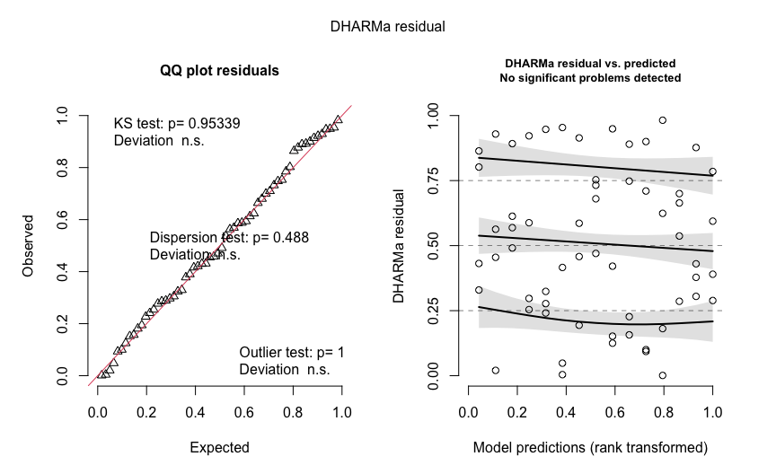<!-- -->

``` r
DHARMa::testDispersion(total_weed_resid)
```

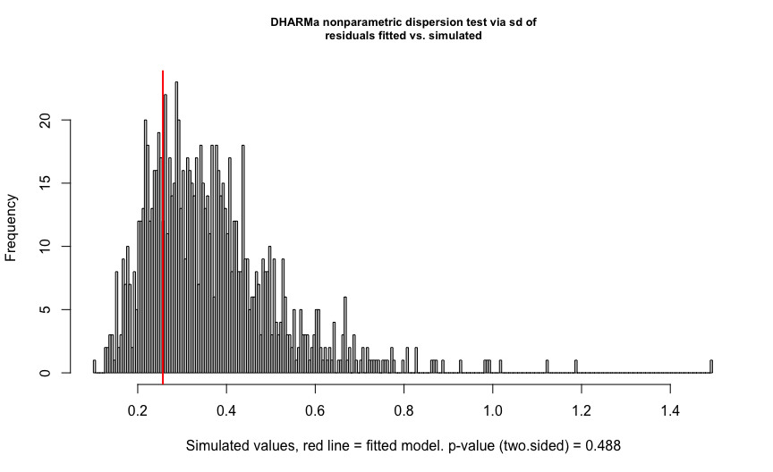<!-- -->

    ## 
    ##  DHARMa nonparametric dispersion test via sd of residuals fitted vs.
    ##  simulated
    ## 
    ## data:  simulationOutput
    ## dispersion = 0.70205, p-value = 0.488
    ## alternative hypothesis: two.sided

``` r
DHARMa::testZeroInflation(total_weed_resid)
```

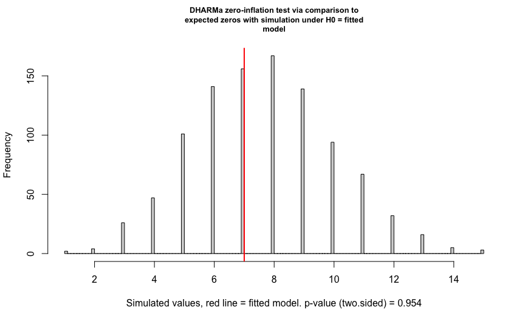<!-- -->

    ## 
    ##  DHARMa zero-inflation test via comparison to expected zeros with
    ##  simulation under H0 = fitted model
    ## 
    ## data:  simulationOutput
    ## ratioObsSim = 0.91027, p-value = 0.954
    ## alternative hypothesis: two.sided

``` r
DHARMa::testUniformity(total_weed_resid)
```

<!-- -->

    ## 
    ##  Exact one-sample Kolmogorov-Smirnov test
    ## 
    ## data:  simulationOutput$scaledResiduals
    ## D = 0.064, p-value = 0.9534
    ## alternative hypothesis: two-sided

``` r
DHARMa::plotResiduals(total_weed_resid, form = weed_data$site_year)
```

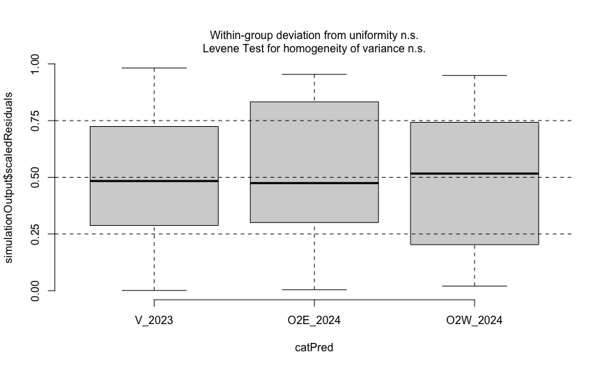<!-- -->

## Management effects and planned contrasts

Six selected comparisons are adjusted using Holm **within each
site-year**. The unadjusted model-based pairwise Wald tests used for
figure letters (Fisher LSD-style, without an omnibus protection step)
are distinct from Holm-adjusted planned contrasts. The letters are
descriptive summaries of model-based pairwise tests, not proof that
treatments sharing a letter are equivalent.

``` r
car::Anova(weed_model_disp, type = 3, component = "cond")
```

    ## Analysis of Deviance Table (Type III Wald chisquare tests)
    ## 
    ## Response: weed_biomass_kg_ha
    ##                       Chisq Df Pr(>Chisq)    
    ## (Intercept)         845.201  1  < 2.2e-16 ***
    ## treatment            14.321  4   0.006337 ** 
    ## site_year            66.700  2  3.283e-15 ***
    ## treatment:site_year  21.439  8   0.006069 ** 
    ## ---
    ## Signif. codes:  0 '***' 0.001 '**' 0.01 '*' 0.05 '.' 0.1 ' ' 1

``` r
total_weed_emm <- emmeans::emmeans(
  weed_model_disp, ~ treatment | site_year, component = "cond"
)
show_table(
  as.data.frame(summary(total_weed_emm, type = "response")),
  "Estimated total weed biomass by management system and site-year", digits = 2
)
```

| treatment | site_year | response |     SE |  df | asymp.LCL | asymp.UCL |
|:----------|:----------|---------:|-------:|----:|----------:|----------:|
| RNO       | V_2023    |   419.55 | 102.84 | Inf |    259.49 |    678.33 |
| RIM       | V_2023    |   257.75 |  67.35 | Inf |    154.45 |    430.13 |
| RIC       | V_2023    |   463.35 | 112.11 | Inf |    288.37 |    744.51 |
| TIM       | V_2023    |  1184.35 | 253.42 | Inf |    778.65 |   1801.43 |
| TIC       | V_2023    |   853.72 | 190.68 | Inf |    551.06 |   1322.62 |
| RNO       | O2E_2024  |   124.75 |  82.21 | Inf |     34.28 |    453.95 |
| RIM       | O2E_2024  |    24.22 |  19.79 | Inf |      4.89 |    120.10 |
| RIC       | O2E_2024  |     2.27 |   2.53 | Inf |      0.26 |     20.17 |
| TIM       | O2E_2024  |   132.85 |  86.83 | Inf |     36.90 |    478.33 |
| TIC       | O2E_2024  |    93.73 |  64.13 | Inf |     24.52 |    358.29 |
| RNO       | O2W_2024  |   247.20 | 162.09 | Inf |     68.37 |    893.72 |
| RIM       | O2W_2024  |    87.77 |  65.92 | Inf |     20.14 |    382.47 |
| RIC       | O2W_2024  |   272.25 | 176.28 | Inf |     76.53 |    968.52 |
| TIM       | O2W_2024  |   195.00 | 131.90 | Inf |     51.79 |    734.18 |
| TIC       | O2W_2024  |    12.15 |  11.82 | Inf |      1.80 |     81.81 |

Estimated total weed biomass by management system and site-year

``` r
stopifnot(identical(levels(weed_data$treatment), treatment_levels))
planned_contrast_weights <- list(
  "RIM vs TIM" = c(0, 1, 0, -1, 0),
  "RIC vs TIC" = c(0, 0, 1, 0, -1),
  "RIM vs RIC" = c(0, 1, -1, 0, 0),
  "RNO vs RIM" = c(1, -1, 0, 0, 0),
  "RNO vs RIC" = c(1, 0, -1, 0, 0),
  "RIM vs TIC" = c(0, 1, 0, 0, -1)
)
total_weed_contrasts <- emmeans::contrast(
  total_weed_emm, method = planned_contrast_weights, by = "site_year"
)
show_table(
  as.data.frame(summary(total_weed_contrasts, type = "response",
                        infer = c(TRUE, TRUE), adjust = "holm")),
  "Planned biomass ratios: Holm-adjusted p-values, Bonferroni-adjusted confidence intervals (within site-year)", digits = 3
)
```

| contrast   | site_year |  ratio |     SE |  df | asymp.LCL | asymp.UCL | null | z.ratio | p.value |
|:-----------|:----------|-------:|-------:|----:|----------:|----------:|-----:|--------:|--------:|
| RIM vs TIM | V_2023    |  0.218 |  0.073 | Inf |     0.089 |     0.530 |    1 |  -4.515 |   0.000 |
| RIC vs TIC | V_2023    |  0.543 |  0.179 | Inf |     0.228 |     1.294 |    1 |  -1.856 |   0.254 |
| RIM vs RIC | V_2023    |  0.556 |  0.198 | Inf |     0.217 |     1.423 |    1 |  -1.647 |   0.299 |
| RNO vs RIM | V_2023    |  1.628 |  0.583 | Inf |     0.633 |     4.189 |    1 |   1.360 |   0.348 |
| RNO vs RIC | V_2023    |  0.905 |  0.312 | Inf |     0.365 |     2.247 |    1 |  -0.288 |   0.773 |
| RIM vs TIC | V_2023    |  0.302 |  0.104 | Inf |     0.122 |     0.748 |    1 |  -3.484 |   0.002 |
| RIM vs TIM | O2E_2024  |  0.182 |  0.191 | Inf |     0.012 |     2.881 |    1 |  -1.627 |   0.347 |
| RIC vs TIC | O2E_2024  |  0.024 |  0.032 | Inf |     0.001 |     0.763 |    1 |  -2.845 |   0.022 |
| RIM vs RIC | O2E_2024  | 10.648 | 14.705 | Inf |     0.279 |   406.992 |    1 |   1.713 |   0.347 |
| RNO vs RIM | O2E_2024  |  5.150 |  5.405 | Inf |     0.323 |    82.097 |    1 |   1.562 |   0.347 |
| RNO vs RIC | O2E_2024  | 54.835 | 70.952 | Inf |     1.805 |  1665.713 |    1 |   3.095 |   0.012 |
| RIM vs TIC | O2E_2024  |  0.258 |  0.275 | Inf |     0.016 |     4.298 |    1 |  -1.270 |   0.347 |
| RIM vs TIM | O2W_2024  |  0.450 |  0.455 | Inf |     0.031 |     6.477 |    1 |  -0.790 |   1.000 |
| RIC vs TIC | O2W_2024  | 22.407 | 26.188 | Inf |     1.026 |   489.223 |    1 |   2.660 |   0.047 |
| RIM vs RIC | O2W_2024  |  0.322 |  0.320 | Inf |     0.024 |     4.411 |    1 |  -1.142 |   1.000 |
| RNO vs RIM | O2W_2024  |  2.816 |  2.808 | Inf |     0.203 |    39.082 |    1 |   1.039 |   1.000 |
| RNO vs RIC | O2W_2024  |  0.908 |  0.837 | Inf |     0.080 |    10.326 |    1 |  -0.105 |   1.000 |
| RIM vs TIC | O2W_2024  |  7.224 |  8.879 | Inf |     0.282 |   184.952 |    1 |   1.609 |   0.538 |

Planned biomass ratios: Holm-adjusted p-values, Bonferroni-adjusted
confidence intervals (within site-year)

``` r
readr::write_csv(as.data.frame(car::Anova(weed_model_disp, type = 3, component = "cond")) |>
                   tibble::rownames_to_column("Effect"),
                 file.path(tab_dir, "total_model_anova.csv"))
readr::write_csv(as.data.frame(summary(total_weed_emm, type = "response")),
                 file.path(tab_dir, "total_site_year_treatment_model_means.csv"))
readr::write_csv(as.data.frame(summary(total_weed_contrasts, type = "response",
                                       infer = c(TRUE, TRUE), adjust = "holm")),
                 file.path(tab_dir, "total_planned_comparisons_holm.csv"))
```

## Whole-plot sensitivity checks

These checks are exploratory sensitivity analyses, not replacement
inferential models. The 2^4 sign enumeration has a smallest attainable
two-sided p-value of 0.125 with four pairs. Treat it as a sign-flip
sensitivity check: an exact randomization-test interpretation would
require confirming that independent within-block flips correspond to
allowable assignments under the two-stage randomization. Otherwise,
validity rests on a symmetry/exchangeability assumption for paired
differences, which is not established here.

``` r
weed_wide <- weed_data |>
  select(site_year, block_id, treatment, weed_biomass_kg_ha) |>
  tidyr::pivot_wider(names_from = treatment,
                     values_from = weed_biomass_kg_ha)
stopifnot(nrow(weed_wide) == 12L, !anyNA(weed_wide[treatment_levels]))

planned_pairs <- tibble::tribble(
  ~contrast, ~a, ~b,
  "RIM vs TIM", "RIM", "TIM",
  "RIC vs TIC", "RIC", "TIC",
  "RIM vs RIC", "RIM", "RIC",
  "RNO vs RIM", "RNO", "RIM",
  "RNO vs RIC", "RNO", "RIC",
  "RIM vs TIC", "RIM", "TIC"
)

paired_results <- purrr::pmap_dfr(planned_pairs, function(contrast, a, b) {
  weed_wide |>
    mutate(difference = .data[[a]] - .data[[b]]) |>
    group_by(site_year) |>
    group_modify(~ {
      result <- stats::t.test(.x$difference)
      tibble::tibble(
        n_blocks = nrow(.x),
        mean_difference = mean(.x$difference),
        ci_lower = result$conf.int[1],
        ci_upper = result$conf.int[2],
        p_value_unadjusted = result$p.value
      )
    }) |>
    ungroup() |>
    mutate(contrast = contrast, .before = 1)
})
show_table(paired_results,
           "Block-paired sensitivity (kg/ha; unadjusted paired t-tests)", digits = 3)
```

| contrast | site_year | n_blocks | mean_difference | ci_lower | ci_upper | p_value_unadjusted |
|:---|:---|---:|---:|---:|---:|---:|
| RIM vs TIM | V_2023 | 4 | -926.600 | -1462.057 | -391.143 | 0.012 |
| RIM vs TIM | O2E_2024 | 4 | -108.625 | -389.463 | 172.213 | 0.306 |
| RIM vs TIM | O2W_2024 | 4 | -107.225 | -358.205 | 143.755 | 0.267 |
| RIC vs TIC | V_2023 | 4 | -390.375 | -850.140 | 69.390 | 0.074 |
| RIC vs TIC | O2E_2024 | 4 | -91.450 | -365.031 | 182.131 | 0.365 |
| RIC vs TIC | O2W_2024 | 4 | 260.100 | -271.687 | 791.887 | 0.217 |
| RIM vs RIC | V_2023 | 4 | -205.600 | -533.392 | 122.192 | 0.140 |
| RIM vs RIC | O2E_2024 | 4 | 21.950 | -19.935 | 63.835 | 0.194 |
| RIM vs RIC | O2W_2024 | 4 | -184.475 | -722.319 | 353.369 | 0.355 |
| RNO vs RIM | V_2023 | 4 | 161.800 | -494.136 | 817.736 | 0.490 |
| RNO vs RIM | O2E_2024 | 4 | 100.525 | -265.656 | 466.706 | 0.447 |
| RNO vs RIM | O2W_2024 | 4 | 159.425 | -328.592 | 647.442 | 0.375 |
| RNO vs RIC | V_2023 | 4 | -43.800 | -694.685 | 607.085 | 0.844 |
| RNO vs RIC | O2E_2024 | 4 | 122.475 | -233.050 | 478.000 | 0.353 |
| RNO vs RIC | O2W_2024 | 4 | -25.050 | -829.421 | 779.321 | 0.927 |
| RIM vs TIC | V_2023 | 4 | -595.975 | -944.628 | -247.322 | 0.012 |
| RIM vs TIC | O2E_2024 | 4 | -69.500 | -358.240 | 219.240 | 0.499 |
| RIM vs TIC | O2W_2024 | 4 | 75.625 | -154.278 | 305.528 | 0.372 |

Block-paired sensitivity (kg/ha; unadjusted paired t-tests)

``` r
# All 2^4 possible sign assignments for four block pairs
sign_matrix <- as.matrix(expand.grid(rep(list(c(-1, 1)), 4)))

sign_flip <- function(d) {
  stopifnot(length(d) == 4L, all(is.finite(d)))
  possible <- as.vector(sign_matrix %*% d / 4)
  tibble::tibble(
    n_blocks = 4L,
    n_negative = sum(d < 0),
    mean_difference = mean(d),
    sign_flip_p_two_sided = mean(abs(possible) >= abs(mean(d)) - 1e-10)
  )
}

randomization_results <- purrr::map_dfr(
  split(weed_wide, weed_wide$site_year), function(dat) {
    purrr::map_dfr(c("RIM vs TIM", "RIC vs TIC"), function(label) {
      pair <- planned_pairs |> filter(contrast == label)
      sign_flip(dat[[pair$a]] - dat[[pair$b]]) |>
        mutate(site_year = as.character(dat$site_year[1]),
               contrast = label, .before = 1)
    })
  }
)
show_table(randomization_results,
           "Exploratory whole-plot sign-flip sensitivity", digits = 3)
```

| site_year | contrast | n_blocks | n_negative | mean_difference | sign_flip_p_two_sided |
|:---|:---|---:|---:|---:|---:|
| V_2023 | RIM vs TIM | 4 | 4 | -926.600 | 0.125 |
| V_2023 | RIC vs TIC | 4 | 4 | -390.375 | 0.125 |
| O2E_2024 | RIM vs TIM | 4 | 3 | -108.625 | 0.250 |
| O2E_2024 | RIC vs TIC | 4 | 3 | -91.450 | 0.250 |
| O2W_2024 | RIM vs TIM | 4 | 3 | -107.225 | 0.375 |
| O2W_2024 | RIC vs TIC | 4 | 1 | 260.100 | 0.500 |

Exploratory whole-plot sign-flip sensitivity

# Inter-row weed biomass

## Observed summaries

``` r
# Observed inter-row weed biomass

interrow_summary <- weed_data %>%
  group_by(site_year, treatment) %>%
  summarise(
    n_plots = n(),
    n_zeros = sum(interrow_weed_biomass_kg_ha == 0),
    mean_biomass = mean(interrow_weed_biomass_kg_ha),
    sd_biomass = sd(interrow_weed_biomass_kg_ha),
    .groups = "drop"
  )

show_table(
  interrow_summary,
  "Observed inter-row weed biomass (kg/ha)"
)
```

| site_year | treatment | n_plots | n_zeros | mean_biomass | sd_biomass |
|:----------|:----------|--------:|--------:|-------------:|-----------:|
| V_2023    | RNO       |       4 |       0 |        395.3 |      388.2 |
| V_2023    | RIM       |       4 |       0 |        131.9 |       55.3 |
| V_2023    | RIC       |       4 |       0 |        293.3 |      171.4 |
| V_2023    | TIM       |       4 |       0 |        522.1 |      258.7 |
| V_2023    | TIC       |       4 |       2 |          3.8 |        7.0 |
| O2E_2024  | RNO       |       4 |       2 |        124.8 |      224.3 |
| O2E_2024  | RIM       |       4 |       0 |         24.1 |       29.0 |
| O2E_2024  | RIC       |       4 |       2 |          1.7 |        2.8 |
| O2E_2024  | TIM       |       4 |       1 |        116.0 |      162.0 |
| O2E_2024  | TIC       |       4 |       2 |         30.4 |       58.0 |
| O2W_2024  | RNO       |       4 |       0 |        220.8 |      391.8 |
| O2W_2024  | RIM       |       4 |       0 |         22.8 |       23.9 |
| O2W_2024  | RIC       |       4 |       2 |        214.5 |      347.9 |
| O2W_2024  | TIM       |       4 |       0 |        146.0 |       57.1 |
| O2W_2024  | TIC       |       4 |       2 |          0.5 |        0.7 |

Observed inter-row weed biomass (kg/ha)

``` r
# Number of zero observations by site-year
interrow_zeros <- weed_data %>%
  group_by(site_year) %>%
  summarise(
    n_plots = n(),
    n_zeros = sum(interrow_weed_biomass_kg_ha == 0),
    percent_zeros = 100 * n_zeros / n_plots,
    .groups = "drop"
  )

show_table(
  interrow_zeros,
  "Inter-row weed biomass: zero observations"
)
```

| site_year | n_plots | n_zeros | percent_zeros |
|:----------|--------:|--------:|--------------:|
| V_2023    |      20 |       2 |            10 |
| O2E_2024  |      20 |       7 |            35 |
| O2W_2024  |      20 |       4 |            20 |

Inter-row weed biomass: zero observations

## Split-plot Tweedie model and diagnostics

The full treatment × site-year model converged in the exploratory
analysis; no treatment × site-year cell consisted entirely of zeros. Its
dispersion was adequately represented by the common-dispersion
specification.

``` r
# Initial Tweedie model for inter-row weed biomass

library(glmmTMB)

# Fit the full treatment × site-year model
interrow_weed_model_full <- glmmTMB(
  interrow_weed_biomass_kg_ha ~
    treatment * site_year +
    (1 | block_id) +
    (1 | whole_plot_id),
  family = tweedie(link = "log"),
  data = weed_data
)

# Model summary
summary(interrow_weed_model_full)
```

    ##  Family: tweedie  ( log )
    ## Formula:          
    ## interrow_weed_biomass_kg_ha ~ treatment * site_year + (1 | block_id) +  
    ##     (1 | whole_plot_id)
    ## Data: weed_data
    ## 
    ##       AIC       BIC    logLik -2*log(L)  df.resid 
    ##     613.4     653.2    -287.7     575.4        41 
    ## 
    ## Random effects:
    ## 
    ## Conditional model:
    ##  Groups        Name        Variance  Std.Dev. 
    ##  block_id      (Intercept) 1.515e-01 0.3892899
    ##  whole_plot_id (Intercept) 5.071e-08 0.0002252
    ## Number of obs: 60, groups:  block_id, 12; whole_plot_id, 24
    ## 
    ## Dispersion parameter for tweedie family (): 6.61 
    ## 
    ## Conditional model:
    ##                       Estimate Std. Error z value Pr(>|z|)    
    ## (Intercept)            3.85569    0.24975  15.438  < 2e-16 ***
    ## treatment1             1.39953    0.32268   4.337 1.44e-05 ***
    ## treatment2            -0.17180    0.36628  -0.469 0.639045    
    ## treatment3            -0.05364    0.40587  -0.132 0.894848    
    ## treatment4             1.49991    0.33537   4.472 7.73e-06 ***
    ## site_year1             0.90468    0.30568   2.960 0.003081 ** 
    ## site_year2            -0.57752    0.32784  -1.762 0.078135 .  
    ## treatment1:site_year1 -0.28301    0.40771  -0.694 0.487585    
    ## treatment2:site_year1  0.29230    0.47031   0.621 0.534277    
    ## treatment3:site_year1  0.94929    0.48892   1.942 0.052185 .  
    ## treatment4:site_year1 -0.03936    0.40882  -0.096 0.923302    
    ## treatment1:site_year2 -0.01983    0.45370  -0.044 0.965131    
    ## treatment2:site_year2  0.07637    0.53664   0.142 0.886832    
    ## treatment3:site_year2 -2.70034    0.69707  -3.874 0.000107 ***
    ## treatment4:site_year2  0.01191    0.45223   0.026 0.978990    
    ## ---
    ## Signif. codes:  0 '***' 0.001 '**' 0.01 '*' 0.05 '.' 0.1 ' ' 1

``` r
# Convergence checks (fail early if the retained model is not regular)
stopifnot(interrow_weed_model_full$fit$convergence == 0L)
stopifnot(isTRUE(interrow_weed_model_full$sdr$pdHess))
cat("Optimizer message:", interrow_weed_model_full$fit$message, "\n")
```

    ## Optimizer message: relative convergence (4)

``` r
# Random-effect variance estimates
VarCorr(interrow_weed_model_full)
```

    ## 
    ## Conditional model:
    ##  Groups        Name        Std.Dev.  
    ##  block_id      (Intercept) 0.38928987
    ##  whole_plot_id (Intercept) 0.00022519

``` r
# Tweedie power parameter
glmmTMB::family_params(interrow_weed_model_full)
```

    ## Tweedie power 
    ##      1.647651

``` r
# Residual diagnostics for inter-row weed biomass

set.seed(123)

interrow_sim_full <- DHARMa::simulateResiduals(
  fittedModel = interrow_weed_model_full,
  n = 1000
)

# Standard DHARMa diagnostic plots
plot(interrow_sim_full)
```

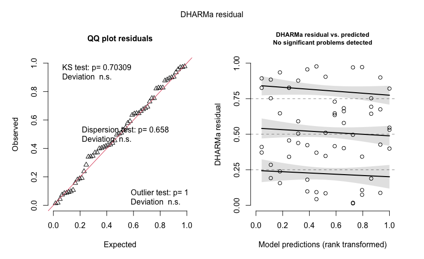<!-- -->

``` r
# Formal diagnostic tests
DHARMa::testDispersion(interrow_sim_full)
```

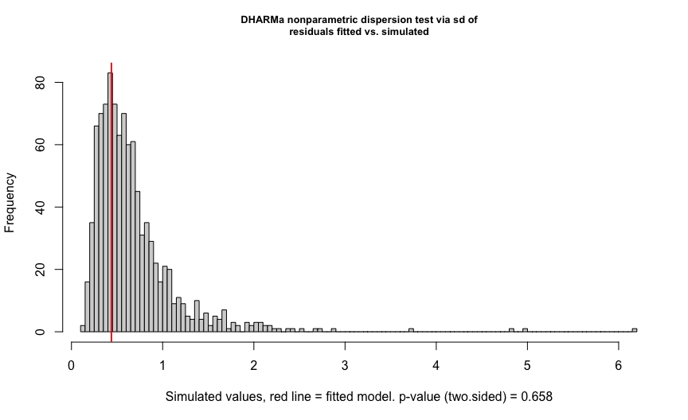<!-- -->

    ## 
    ##  DHARMa nonparametric dispersion test via sd of residuals fitted vs.
    ##  simulated
    ## 
    ## data:  simulationOutput
    ## dispersion = 0.64778, p-value = 0.658
    ## alternative hypothesis: two.sided

``` r
DHARMa::testZeroInflation(interrow_sim_full)
```

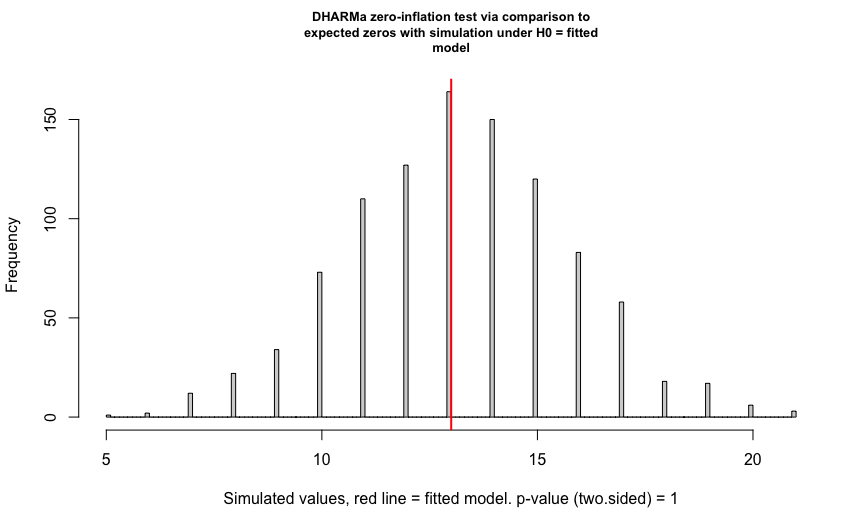<!-- -->

    ## 
    ##  DHARMa zero-inflation test via comparison to expected zeros with
    ##  simulation under H0 = fitted model
    ## 
    ## data:  simulationOutput
    ## ratioObsSim = 0.98314, p-value = 1
    ## alternative hypothesis: two.sided

``` r
DHARMa::testUniformity(interrow_sim_full)
```

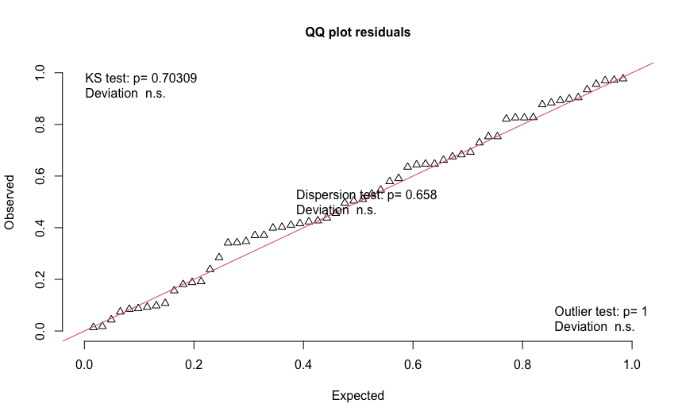<!-- -->

    ## 
    ##  Asymptotic one-sample Kolmogorov-Smirnov test
    ## 
    ## data:  simulationOutput$scaledResiduals
    ## D = 0.091, p-value = 0.7031
    ## alternative hypothesis: two-sided

``` r
# Residuals grouped by site-year
DHARMa::plotResiduals(
  interrow_sim_full,
  form = weed_data$site_year
)
```

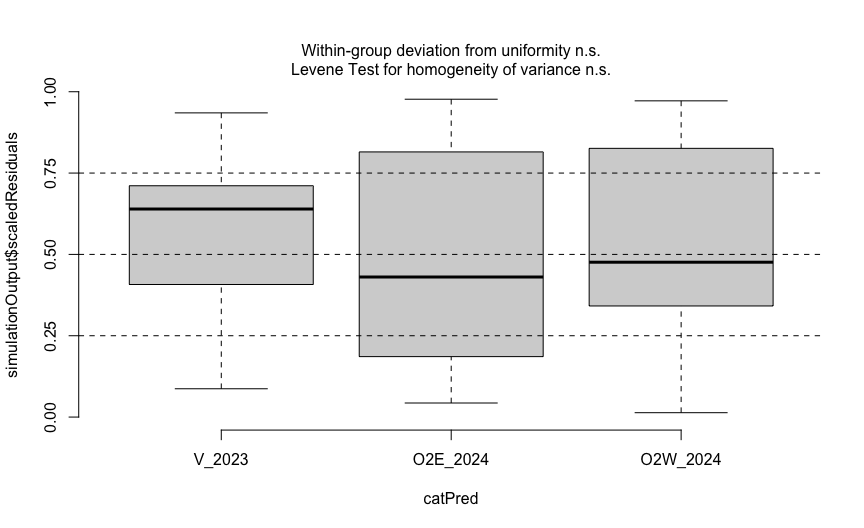<!-- -->

## Joint tests, estimates, and contrasts

Seven selected contrasts are assessed within each site-year with
Holm-adjusted p-values. Their displayed confidence intervals are
Bonferroni-adjusted, not Holm-adjusted. TIM vs TIC was added after
inspecting the results and should be identified as exploratory in
reporting. Wald-based tests are asymptotic and warrant caution with four
blocks per site-year.

``` r
# Fixed-effect tests for inter-row weed biomass

car::Anova(
  interrow_weed_model_full,
  type = 3,
  component = "cond"
)
```

    ## Analysis of Deviance Table (Type III Wald chisquare tests)
    ## 
    ## Response: interrow_weed_biomass_kg_ha
    ##                        Chisq Df Pr(>Chisq)    
    ## (Intercept)         238.3374  1  < 2.2e-16 ***
    ## treatment            45.9597  4  2.511e-09 ***
    ## site_year             9.0569  2    0.01080 *  
    ## treatment:site_year  23.6039  8    0.00267 ** 
    ## ---
    ## Signif. codes:  0 '***' 0.001 '**' 0.01 '*' 0.05 '.' 0.1 ' ' 1

``` r
# Estimated marginal means within each site-year
interrow_weed_emm <- emmeans::emmeans(
  interrow_weed_model_full,
  ~ treatment | site_year,
  component = "cond"
)

# Back-transformed estimates and confidence intervals
summary(
  interrow_weed_emm,
  type = "response"
)
```

    ## site_year = V_2023:
    ##  treatment response      SE  df asymp.LCL asymp.UCL
    ##  RNO        356.698 183.000 Inf   130.573    974.42
    ##  RIM        131.744  76.100 Inf    42.495    408.44
    ##  RIC        286.005 147.000 Inf   104.452    783.13
    ##  TIM        503.166 238.000 Inf   199.305   1270.29
    ##  TIC          3.213   3.490 Inf     0.381     27.07
    ## 
    ## site_year = O2E_2024:
    ##  treatment response      SE  df asymp.LCL asymp.UCL
    ##  RNO        105.412  70.300 Inf    28.518    389.63
    ##  RIM         24.113  18.400 Inf     5.385    107.96
    ##  RIC          1.689   2.020 Inf     0.162     17.58
    ##  TIM        120.301  72.200 Inf    37.119    389.89
    ##  TIC         25.433  20.700 Inf     5.160    125.35
    ## 
    ## site_year = O2W_2024:
    ##  treatment response      SE  df asymp.LCL asymp.UCL
    ##  RNO        186.964 115.000 Inf    55.885    625.49
    ##  RIM         19.847  16.100 Inf     4.050     97.26
    ##  RIC        186.037 112.000 Inf    56.892    608.34
    ##  TIM        156.945  89.800 Inf    51.147    481.59
    ##  TIC          0.424   0.639 Inf     0.022      8.15
    ## 
    ## Confidence level used: 0.95 
    ## Intervals are back-transformed from the log scale

``` r
readr::write_csv(as.data.frame(car::Anova(interrow_weed_model_full, type = 3, component = "cond")) |>
                   tibble::rownames_to_column("Effect"),
                 file.path(tab_dir, "interrow_model_anova.csv"))
readr::write_csv(as.data.frame(summary(interrow_weed_emm, type = "response")),
                 file.path(tab_dir, "interrow_site_year_treatment_model_means.csv"))
```

``` r
# Seven management-system contrasts within each site-year

# Reuse interrow_weed_emm calculated above.

interrow_contrasts <- emmeans::contrast(
  interrow_weed_emm,
  method = list(
    "RIM vs TIM" = c(0, 1, 0, -1, 0),
    "RIC vs TIC" = c(0, 0, 1, 0, -1),
    "RIM vs RIC" = c(0, 1, -1, 0, 0),
    "RNO vs RIM" = c(1, -1, 0, 0, 0),
    "RNO vs RIC" = c(1, 0, -1, 0, 0),
    "RIM vs TIC" = c(0, 1, 0, 0, -1),
    "TIM vs TIC" = c(0, 0, 0, 1, -1)
  ),
  by = "site_year"
)

# Ratios, confidence intervals, and adjusted p-values
summary(
  interrow_contrasts,
  type = "response",
  adjust = "holm",
  infer = c(TRUE, TRUE)
)
```

    ## site_year = V_2023:
    ##  contrast      ratio       SE  df asymp.LCL asymp.UCL null z.ratio p.value
    ##  RIM vs TIM   0.2618   0.1810 Inf   0.04064      1.69    1  -1.935  0.2119
    ##  RIC vs TIC  89.0193 104.0000 Inf   3.86633   2049.60    1   3.850  0.0007
    ##  RIM vs RIC   0.4606   0.3330 Inf   0.06574      3.23    1  -1.071  0.5683
    ##  RNO vs RIM   2.7075   1.9500 Inf   0.39065     18.77    1   1.384  0.4991
    ##  RNO vs RIC   1.2472   0.8310 Inf   0.20762      7.49    1   0.331  0.7403
    ##  RIM vs TIC  41.0056  49.2000 Inf   1.62675   1033.63    1   3.096  0.0098
    ##  TIM vs TIC 156.6109 179.0000 Inf   7.21695   3398.52    1   4.418  0.0001
    ## 
    ## site_year = O2E_2024:
    ##  contrast      ratio       SE  df asymp.LCL asymp.UCL null z.ratio p.value
    ##  RIM vs TIM   0.2004   0.1880 Inf   0.01612      2.49    1  -1.715  0.3452
    ##  RIC vs TIC   0.0664   0.0938 Inf   0.00148      2.97    1  -1.920  0.3224
    ##  RIM vs RIC  14.2756  19.7000 Inf   0.35028    581.80    1   1.929  0.3224
    ##  RNO vs RIM   4.3716   4.2700 Inf   0.31593     60.49    1   1.510  0.3539
    ##  RNO vs RIC  62.4072  83.2000 Inf   1.73095   2250.01    1   3.102  0.0135
    ##  RIM vs TIC   0.9481   1.0300 Inf   0.05141     17.48    1  -0.049  0.9608
    ##  TIM vs TIC   4.7300   4.7000 Inf   0.32633     68.56    1   1.563  0.3539
    ## 
    ## site_year = O2W_2024:
    ##  contrast      ratio       SE  df asymp.LCL asymp.UCL null z.ratio p.value
    ##  RIM vs TIM   0.1265   0.1240 Inf   0.00907      1.76    1  -2.111  0.0735
    ##  RIC vs TIC 438.8199 693.0000 Inf   6.25681  30776.53    1   3.851  0.0008
    ##  RIM vs RIC   0.1067   0.0979 Inf   0.00905      1.26    1  -2.440  0.0735
    ##  RNO vs RIM   9.4201   8.6700 Inf   0.79283    111.92    1   2.438  0.0735
    ##  RNO vs RIC   1.0050   0.7570 Inf   0.13249      7.62    1   0.007  0.9947
    ##  RIM vs TIC  46.8156  78.5000 Inf   0.51415   4262.77    1   2.293  0.0735
    ##  TIM vs TIC 370.1998 591.0000 Inf   5.03682  27209.22    1   3.702  0.0013
    ## 
    ## Confidence level used: 0.95 
    ## Conf-level adjustment: bonferroni method for 7 estimates 
    ## Intervals are back-transformed from the log scale 
    ## P value adjustment: holm method for 7 tests 
    ## Tests are performed on the log scale

``` r
readr::write_csv(as.data.frame(summary(interrow_contrasts, type = "response",
                                       adjust = "holm", infer = c(TRUE, TRUE))),
                 file.path(tab_dir, "interrow_planned_comparisons_holm.csv"))
```

## Inter-row post hoc groupings and model-estimated figure

For figure annotations, unadjusted model-based pairwise Wald comparisons
(Fisher LSD-style) are implemented using `adjust = "none"` for treatment
means **within each site-year**. These are *unprotected* LSD-style
tests, not a protected Fisher LSD procedure gated by a significant
site-year-specific omnibus F test. They do not control the familywise
error rate across all pairs; report this limitation and prioritize the
preselected, Holm-adjusted contrasts for confirmatory interpretation.
Lowercase CLD letters correspond to inter-row biomass only, with **a**
assigned to the highest estimated group. Shared letters indicate no
detected difference, not equivalence.

The bars and error bars show response-scale model estimates ± SE and are
separate from the observed stacked figure below.

``` r
library(dplyr)
library(ggplot2)
library(emmeans)

# Model-estimated means and SE on the response scale
interrow_fig_data <- summary(
  interrow_weed_emm,
  type = "response"
) %>%
  as.data.frame() %>%
  mutate(
    treatment = factor(
      treatment,
      levels = c("RNO", "RIM", "RIC", "TIM", "TIC")
    ),
    lower_se = pmax(0, response - SE),
    upper_se = response + SE
  )

# Unadjusted model-based pairwise CLDs (LSD-style; no multiplicity adjustment).
# The a group is assigned to the highest estimated treatment mean.
interrow_weed_cld <- multcomp::cld(
  interrow_weed_emm,
  by = "site_year",
  adjust = "none",
  alpha = 0.05,
  Letters = letters,
  reversed = TRUE
) %>%
  as.data.frame() %>%
  transmute(
    site_year,
    treatment,
    cld = trimws(.group)
  )

interrow_fig_data <- interrow_fig_data %>%
  left_join(interrow_weed_cld, by = c("site_year", "treatment")) %>%
  mutate(
    cld_y = response + SE + 0.05 * max(response + SE, na.rm = TRUE)
  )

# Final figure
interrow_weed_fig <- ggplot(
  interrow_fig_data,
  aes(x = treatment, y = response, fill = treatment)
) +
  geom_col(
    width = 0.7,
    color = "black",
    linewidth = 0.3
  ) +
  geom_errorbar(
    aes(ymin = lower_se, ymax = upper_se),
    width = 0.18,
    linewidth = 0.65
  ) +
  geom_text(
    aes(y = cld_y, label = cld),
    size = 4.5,
    fontface = "bold"
  ) +
  facet_wrap(
    ~ site_year,
    nrow = 1,
    labeller = labeller(
      site_year = experiment_labels
    )
  ) +
  scale_fill_manual(
    values = treatment_colors,
    guide = "none"
  ) +
  scale_y_continuous(
    expand = expansion(mult = c(0, 0.12))
  ) +
  labs(
    x = "Management system",
    y = "Inter-row weed biomass (kg/ha)"
  ) +
  theme_classic(base_size = 16) +
  theme(
    strip.background = element_blank(),
    strip.text = element_text(
      face = "bold",
      size = 14
    ),
    axis.text.x = element_text(
      size = 14,
      margin = margin(t = 8)
    ),
    axis.text.y = element_text(size = 13),
    axis.title = element_text(size = 16),
    panel.spacing = grid::unit(1.2, "lines")
  )

interrow_weed_fig
```

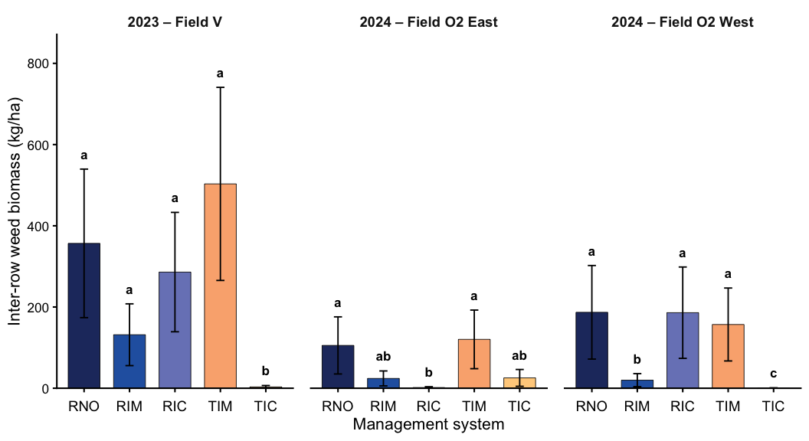

``` r
# Save publication-quality figure
dir.create(here::here("figures", "weed_biomass"), showWarnings = FALSE, recursive = TRUE)
ggsave(
  filename = here::here(
    "figures", "weed_biomass",
    "interrow_model_means.png"
  ),
  plot = interrow_weed_fig,
  width = 11,
  height = 6,
  dpi = 300,
  bg = "white"
)
```

# In-row weed biomass: descriptive only

Initial five-system Tweedie fits had unstable coefficients for the
all-zero RNO group in O2 East; reduced interaction models imposed
constant within-method ratios and did not reproduce some O2 West
observations. Whole-plot Tweedie averages showed underdispersion (DHARMa
p = 0.046), and a log1p linear mixed sensitivity analysis had
appreciable tail departures. Because this is a secondary outcome, no
in-row significance tests are retained.

The matched-system whole-plot summary averages RIM/RIC and TIM/TIC
separately, excluding RNO because it has no matched tilled counterpart.
It is descriptive and respects termination as a whole-plot treatment.

``` r
# Whole-plot summaries for matched management systems

inrow_whole_plot <- weed_data %>%
  filter(treatment %in% c("RIM", "RIC", "TIM", "TIC")) %>%
  mutate(
    termination = factor(
      if_else(
        treatment %in% c("RIM", "RIC"),
        "Rolled",
        "Tilled"
      ),
      levels = c("Rolled", "Tilled")
    )
  ) %>%
  group_by(
    site_year,
    block_id,
    whole_plot_id,
    termination
  ) %>%
  summarise(
    mean_inrow_biomass = mean(
      inrow_weed_biomass_kg_ha
    ),
    .groups = "drop"
  )

# Confirm number of whole plots
inrow_whole_plot %>%
  count(site_year, termination)
```

    ## # A tibble: 6 × 3
    ##   site_year termination     n
    ##   <fct>     <fct>       <int>
    ## 1 V_2023    Rolled          4
    ## 2 V_2023    Tilled          4
    ## 3 O2E_2024  Rolled          4
    ## 4 O2E_2024  Tilled          4
    ## 5 O2W_2024  Rolled          4
    ## 6 O2W_2024  Tilled          4

``` r
# Descriptive summaries by termination system
inrow_whole_plot %>%
  group_by(site_year, termination) %>%
  summarise(
    n = n(),
    mean_biomass = mean(mean_inrow_biomass),
    sd_biomass = sd(mean_inrow_biomass),
    .groups = "drop"
  )
```

    ## # A tibble: 6 × 5
    ##   site_year termination     n mean_biomass sd_biomass
    ##   <fct>     <fct>       <int>        <dbl>      <dbl>
    ## 1 V_2023    Rolled          4      148.        90.2  
    ## 2 V_2023    Tilled          4      756.       191.   
    ## 3 O2E_2024  Rolled          4        0.338      0.522
    ## 4 O2E_2024  Tilled          4       40.1       53.0  
    ## 5 O2W_2024  Rolled          4       61.4      114.   
    ## 6 O2W_2024  Tilled          4       30.3       10.4

``` r
inrow_summary <- weed_data %>%
  group_by(site_year, treatment) %>%
  summarise(
    n_plots = n(),
    n_zeros = sum(inrow_weed_biomass_kg_ha == 0),
    mean_biomass = mean(inrow_weed_biomass_kg_ha),
    sd_biomass = sd(inrow_weed_biomass_kg_ha),
    .groups = "drop"
  )
show_table(inrow_summary, "Observed in-row weed biomass (kg/ha)")
```

| site_year | treatment | n_plots | n_zeros | mean_biomass | sd_biomass |
|:----------|:----------|--------:|--------:|-------------:|-----------:|
| V_2023    | RNO       |       4 |       0 |         24.2 |        8.2 |
| V_2023    | RIM       |       4 |       0 |        125.9 |      107.3 |
| V_2023    | RIC       |       4 |       0 |        170.1 |      126.5 |
| V_2023    | TIM       |       4 |       0 |        662.2 |      342.3 |
| V_2023    | TIC       |       4 |       0 |        849.9 |      310.7 |
| O2E_2024  | RNO       |       4 |       4 |          0.0 |        0.0 |
| O2E_2024  | RIM       |       4 |       3 |          0.1 |        0.2 |
| O2E_2024  | RIC       |       4 |       3 |          0.6 |        1.1 |
| O2E_2024  | TIM       |       4 |       0 |         16.9 |       10.0 |
| O2E_2024  | TIC       |       4 |       1 |         63.4 |      114.5 |
| O2W_2024  | RNO       |       4 |       3 |         26.4 |       52.9 |
| O2W_2024  | RIM       |       4 |       1 |         65.0 |      122.8 |
| O2W_2024  | RIC       |       4 |       2 |         57.7 |      105.3 |
| O2W_2024  | TIM       |       4 |       0 |         49.0 |       35.1 |
| O2W_2024  | TIC       |       4 |       1 |         11.7 |       21.9 |

Observed in-row weed biomass (kg/ha)

# Combined observed weed biomass figure

The stacked treatment colors show observed arithmetic mean contributions
from inter-row (darker) and in-row (lighter). Their sum equals observed
total weed biomass. Error bars show the **observed total arithmetic mean
± SE** (four plots per treatment/site-year). Lowercase letters summarize
**unadjusted model-based pairwise Wald tests** (Fisher LSD-style) of
total weed biomass within each site-year. These letters apply to total
biomass only, not to the components; shared letters do not establish
equivalence. The SE bars are descriptive plot-to-plot variation, not
model-based uncertainty for treatment contrasts.

``` r
library(dplyr)
library(tidyr)
library(ggplot2)
library(emmeans)

# ----------------------------------------------------------
# 1. Treatment colors by sampling zone
# ----------------------------------------------------------

lighten_color <- function(color, amount = 0.55) {
  rgb <- grDevices::col2rgb(color) / 255
  light <- rgb + (1 - rgb) * amount

  grDevices::rgb(
    light[1, ],
    light[2, ],
    light[3, ]
  )
}

zone_colors <- c(
  setNames(
    treatment_colors,
    paste0(names(treatment_colors), "_Inter-row")
  ),
  setNames(
    vapply(
      treatment_colors,
      lighten_color,
      character(1)
    ),
    paste0(names(treatment_colors), "_In-row")
  )
)

# ----------------------------------------------------------
# 2. Observed means and SE by site-year and treatment
# ----------------------------------------------------------

weed_zone_means <- weed_data %>%
  group_by(site_year, treatment) %>%
  summarise(
    inrow = mean(inrow_weed_biomass_kg_ha),
    interrow = mean(interrow_weed_biomass_kg_ha),
    total_mean = mean(weed_biomass_kg_ha),
    total_se = sd(weed_biomass_kg_ha) / sqrt(n()),
    n_plots = n(),
    .groups = "drop"
  )

# Convert zone means to long format for stacked bars
weed_zone_plot_data <- weed_zone_means %>%
  select(site_year, treatment, inrow, interrow) %>%
  pivot_longer(
    cols = c(inrow, interrow),
    names_to = "zone",
    values_to = "mean_biomass"
  ) %>%
  mutate(
    zone = factor(
      zone,
      levels = c("inrow", "interrow"),
      labels = c("In-row", "Inter-row")
    ),
    treatment_zone = paste(treatment, zone, sep = "_")
  )

# ----------------------------------------------------------
# 3. CLDs from the total weed biomass model
# ----------------------------------------------------------

# Reuse total_weed_emm calculated above.

# Requires multcomp and multcompView packages.
# Fisher's LSD-style CLDs use unadjusted pairwise tests within site-year.
total_weed_cld <- multcomp::cld(
  total_weed_emm,
  by = "site_year",
  adjust = "none",
  alpha = 0.05,
  Letters = letters,
  reversed = TRUE
) %>%
  as.data.frame() %>%
  transmute(
    site_year,
    treatment,
    cld = trimws(.group)
  )

# Position letters above observed mean + SE
weed_annotations <- weed_zone_means %>%
  left_join(
    total_weed_cld,
    by = c("site_year", "treatment")
  ) %>%
  mutate(
    cld_y = total_mean + total_se + 65
  )

# ----------------------------------------------------------
# 4. Combined figure
# ----------------------------------------------------------

combined_weed_model_fig <- ggplot() +

  # Observed in-row and inter-row biomass
  geom_col(
    data = weed_zone_plot_data,
    aes(
      x = treatment,
      y = mean_biomass,
      fill = treatment_zone
    ),
    width = 0.72,
    color = "black",
    linewidth = 0.3
  ) +

  # Observed total weed biomass ± SE
  geom_errorbar(
    data = weed_zone_means,
    aes(
      x = treatment,
      ymin = pmax(0, total_mean - total_se),
      ymax = total_mean + total_se
    ),
    width = 0.18,
    linewidth = 0.7,
    color = "black"
  ) +

  # Total weed biomass significance groupings
  geom_text(
    data = weed_annotations,
    aes(
      x = treatment,
      y = cld_y,
      label = cld
    ),
    size = 4.5,
    fontface = "bold"
  ) +

  facet_wrap(
    ~ site_year,
    nrow = 1,
    labeller = labeller(
      site_year = experiment_labels
    )
  ) +

  scale_fill_manual(
    values = zone_colors,
    guide = "none"
  ) +

  scale_y_continuous(
    expand = expansion(mult = c(0, 0.12))
  ) +

  labs(
    x = "Management system",
    y = "Total weed biomass (kg/ha)",
    caption = paste(
      "Dark shading: inter-row; light shading: in-row.",
      "Stacked bars and SE are observed totals (n = 4).",
      "Lowercase letters: unadjusted model-based total-biomass comparisons."
    )
  ) +

  theme_classic(base_size = 16) +

  theme(
    strip.background = element_blank(),
    strip.text = element_text(
      face = "bold",
      size = 14
    ),
    axis.text.x = element_text(
      size = 14,
      margin = margin(t = 8)
    ),
    axis.text.y = element_text(size = 13),
    axis.title = element_text(size = 16),
    plot.caption = element_text(
      size = 11,
      hjust = 0.5,
      margin = margin(t = 15)
    ),
    panel.spacing = grid::unit(1.2, "lines")
  )

combined_weed_model_fig
```

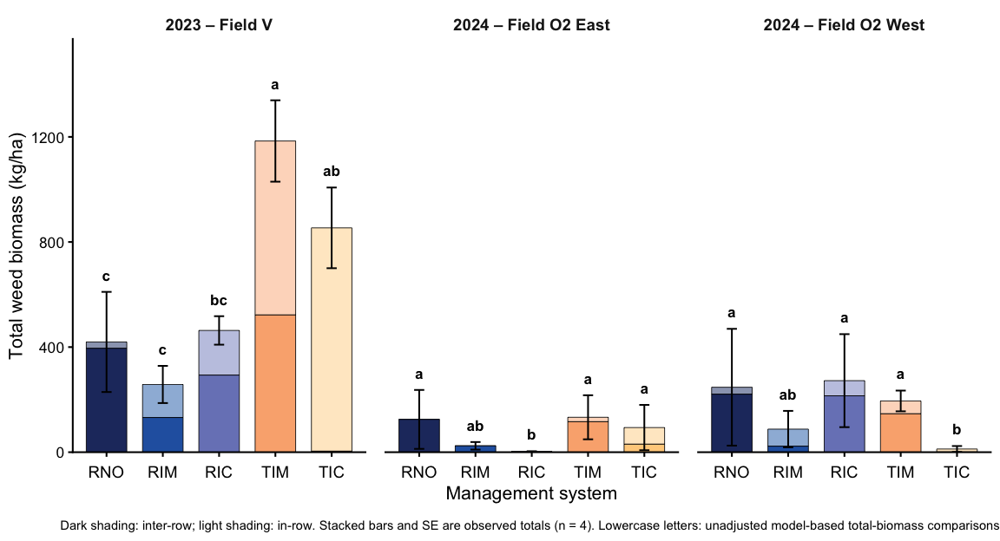

``` r
# Save figure
dir.create(here::here("figures", "weed_biomass"), showWarnings = FALSE, recursive = TRUE)
ggsave(
  filename = here::here(
    "figures", "weed_biomass",
    "combined_raw_means.png"
  ),
  plot = combined_weed_model_fig,
  width = 12,
  height = 6.5,
  dpi = 300,
  bg = "white"
)
```

# Interpretation and limitations

Across experiments, total weed biomass and its spatial distribution
varied substantially among management systems and site-years. In 2023,
TIC showed very little inter-row weed biomass but considerable in-row
biomass; the separate inter-row model provides tests specific to the
directly managed zone. In O2 West 2024, the unadjusted total-biomass
CLDs distinguished TIC (b) from RNO, RIC, and TIM (a), while RIM (ab)
was not distinguishable from either group. The planned RIC versus TIC
total-biomass contrast also passed the within-site-year Holm adjustment
(p approximately 0.047). These results should be interpreted cautiously
because the unadjusted CLDs do not control familywise error and
asymptotic Wald tests may be poorly calibrated with only four blocks per
site-year. Some inter-row contrasts were also significant, but those
address a separate response.

Cereal rye biomass collected before termination and from the weed
quadrats, and subsequent soybean yield analyses, will be considered
later for mechanistic and outcome relationships. Those variables are
intentionally not introduced into these baseline treatment-effect
models.

Before reporting, verify 2023 implementation details, processed-data
units, randomization, and the chosen inference families. Total and
inter-row CLDs reflect unadjusted model-based pairwise Wald comparisons
(unprotected Fisher LSD-style). Holm-adjusted p-values for selected
contrasts are reported separately; their confidence intervals use
Bonferroni adjustment. Near-zero random-effect variance estimates and
four blocks per site-year limit confidence in asymptotic, especially
borderline cross-termination, inference. The sign- flip enumeration is
an assumption-dependent sensitivity check, not confirmed as an exact
randomization test.

# Reproducibility

Package versions and R session information for this analysis run:

``` r
utils::sessionInfo()
```

    ## R version 4.5.2 (2025-10-31)
    ## Platform: aarch64-apple-darwin20
    ## Running under: macOS Tahoe 26.7.1
    ## 
    ## Matrix products: default
    ## BLAS:   /System/Library/Frameworks/Accelerate.framework/Versions/A/Frameworks/vecLib.framework/Versions/A/libBLAS.dylib 
    ## LAPACK: /Library/Frameworks/R.framework/Versions/4.5-arm64/Resources/lib/libRlapack.dylib;  LAPACK version 3.12.1
    ## 
    ## locale:
    ## [1] en_US.UTF-8/en_US.UTF-8/en_US.UTF-8/C/en_US.UTF-8/en_US.UTF-8
    ## 
    ## time zone: America/New_York
    ## tzcode source: internal
    ## 
    ## attached base packages:
    ## [1] stats     graphics  grDevices utils     datasets  methods   base     
    ## 
    ## other attached packages:
    ##  [1] WrensBookshelf_0.1.0 emmeans_1.11.2-8     DHARMa_0.4.7        
    ##  [4] glmmTMB_1.1.15.2     conflicted_1.2.0     here_1.0.2          
    ##  [7] lubridate_1.9.4      forcats_1.0.1        stringr_1.5.2       
    ## [10] dplyr_1.1.4          purrr_1.1.0          readr_2.1.5         
    ## [13] tidyr_1.3.1          tibble_3.3.0         ggplot2_4.0.0       
    ## [16] tidyverse_2.0.0     
    ## 
    ## loaded via a namespace (and not attached):
    ##  [1] Rdpack_2.6.4        sandwich_3.1-1      rlang_1.1.6        
    ##  [4] magrittr_2.0.4      multcomp_1.4-29     otel_0.2.0         
    ##  [7] compiler_4.5.2      mgcv_1.9-3          systemfonts_1.3.1  
    ## [10] vctrs_0.6.5         pkgconfig_2.0.3     crayon_1.5.3       
    ## [13] fastmap_1.2.0       labeling_0.4.3      utf8_1.2.6         
    ## [16] promises_1.4.0      rmarkdown_2.30      tzdb_0.5.0         
    ## [19] nloptr_2.2.1        ragg_1.5.0          bit_4.6.0          
    ## [22] xfun_0.61           cachem_1.1.0        later_1.4.4        
    ## [25] RTMB_2.0            parallel_4.5.2      R6_2.6.1           
    ## [28] gap.datasets_0.0.6  stringi_1.8.7       qgam_2.0.0         
    ## [31] RColorBrewer_1.1-3  car_3.1-3           boot_1.3-32        
    ## [34] numDeriv_2016.8-1.1 estimability_1.5.1  Rcpp_1.1.0         
    ## [37] iterators_1.0.14    knitr_1.50          zoo_1.8-14         
    ## [40] httpuv_1.6.16       Matrix_1.7-4        splines_4.5.2      
    ## [43] timechange_0.3.0    tidyselect_1.2.1    rstudioapi_0.17.1  
    ## [46] abind_1.4-8         yaml_2.3.10         doParallel_1.0.17  
    ## [49] TMB_1.9.25          codetools_0.2-20    lattice_0.22-7     
    ## [52] plyr_1.8.9          shiny_1.11.1        withr_3.0.2        
    ## [55] S7_0.2.0            coda_0.19-4.1       evaluate_1.0.5     
    ## [58] survival_3.8-3      pillar_1.11.1       gap_1.6            
    ## [61] carData_3.0-5       foreach_1.5.2       reformulas_0.4.4   
    ## [64] generics_0.1.4      vroom_1.6.6         rprojroot_2.1.1    
    ## [67] hms_1.1.4           scales_1.4.0        minqa_1.2.8        
    ## [70] xtable_1.8-4        glue_1.8.0          tools_4.5.2        
    ## [73] lme4_1.1-37         mvtnorm_1.3-3       grid_4.5.2         
    ## [76] rbibutils_2.3       nlme_3.1-168        Formula_1.2-5      
    ## [79] cli_3.6.5           textshaping_1.0.4   gtable_0.3.6       
    ## [82] digest_0.6.37       TH.data_1.1-4       farver_2.1.2       
    ## [85] memoise_2.0.1       htmltools_0.5.8.1   lifecycle_1.0.4    
    ## [88] multcompView_0.1-10 mime_0.13           bit64_4.6.0-1      
    ## [91] MASS_7.3-65
