Weed biomass
================

- [Question and experimental design](#question-and-experimental-design)
- [Analysis overview](#analysis-overview)
- [Setup](#setup)
- [Import and validate](#import-and-validate)
- [Total weed biomass](#total-weed-biomass)
  - [Observed summaries](#observed-summaries)
  - [Primary Tweedie model](#primary-tweedie-model)
  - [Model diagnostics](#model-diagnostics)
  - [Management effects and hypothesis-driven
    comparisons](#management-effects-and-hypothesis-driven-comparisons)
- [Inter-row weed biomass](#inter-row-weed-biomass)
  - [Observed summaries](#observed-summaries-1)
  - [Split-plot Tweedie model and
    diagnostics](#split-plot-tweedie-model-and-diagnostics)
  - [Joint tests, estimates, and
    contrasts](#joint-tests-estimates-and-contrasts)
  - [Inter-row weed biomass figure](#inter-row-weed-biomass-figure)
- [In-row weed biomass: descriptive
  only](#in-row-weed-biomass-descriptive-only)
- [Combined observed weed biomass
  figure](#combined-observed-weed-biomass-figure)
- [Interpretation and limitations](#interpretation-and-limitations)
- [Reproducibility](#reproducibility)

# Question and experimental design

Did weed biomass differ among five soybean management systems, and did
system responses vary among site-years? Total weed biomass is the
primary outcome. Inter-row weed biomass is a secondary modeled outcome,
while in-row biomass is reported descriptively because exploratory
inferential models were unstable or showed residual problems.

The experiment included three site-years and four blocks per site-year.
Cereal rye termination was assigned to whole plots within blocks:
roller-crimped (rolled) or moldboard-plowed (tilled). Within rolled
whole plots, management subplots received no supplemental weed control
(RNO), inter-row mowing (RIM), or high-residue cultivation (RIC). Within
tilled whole plots, subplots received mowing (TIM) or cultivation (TIC).
Thus, the five systems are not a fully crossed factorial. Comparisons
involving different termination methods require whole-plot replication;
comparisons within a termination method use subplot replication.

In 2023, an operations error caused one subplot randomized to RNO to
receive RIC (high-residue cultivation). The primary analysis retains its
original randomized treatment label. RIC received one late cultivation
rather than the intended repeated cultivation schedule. Interpretation
therefore concerns management as implemented; subplot assignments should
be cross-checked against the field randomization map.

# Analysis overview

Total weed biomass is the primary response, analyzed with a split-plot
Tweedie GLMM with site-year-specific dispersion. Inter-row weed biomass
is a secondary response analyzed with a full treatment × site-year
Tweedie GLMM and common dispersion. In-row biomass is summarized
descriptively because exploratory inferential fits were unstable or
showed residual problems.

The three original hypothesis-driven comparisons are TIC versus TIM, RIM
versus RNO, and RIC versus RNO. Because the treatment × site-year
interactions are retained, these contrasts are estimated within
site-years. They use unadjusted, two-sided Wald tests (LSD-style);
exploratory all-pairs comparisons are used only to annotate figures with
compact-letter displays (CLDs). These CLDs are unadjusted, not
familywise-error controlled, and do not establish equivalence.

Observed means and SEs describe measurements, while estimated means and
tests come from the fitted models. All zone biomass values are expressed
per hectare of the **entire 0.5 m² quadrat**, so in-row and inter-row
components sum to total weed biomass.

# Setup

``` r
library(tidyverse)
library(here)
library(conflicted)
library(glmmTMB)
library(DHARMa)
library(emmeans)
library(WrensBookshelf)

conflicts_prefer(dplyr::filter)
conflicts_prefer(dplyr::select)

method_levels <- c("Roller-crimper", "Moldboard plow")
treatment_levels <- c("RNO", "RIM", "RIC", "TIM", "TIC")
experiment_labels <- c(
  V_2023 = "2023 – Field V",
  O2E_2024 = "2024 – Field O2 East",
  O2W_2024 = "2024 – Field O2 West"
)
method_lookup <- c(
  RNO = "Roller-crimper", RIM = "Roller-crimper",
  RIC = "Roller-crimper", TIM = "Moldboard plow", TIC = "Moldboard plow"
)
treatment_colors <- setNames(
  WrensBookshelf::WB_brewer(name = "WhatWellBuild", n = 5, type = "discrete"),
  treatment_levels
)
theme_set(theme_classic(base_size = 16))
show_table <- function(x, caption, digits = 1) {
  # Format p-values for display only; CSV exports retain numeric precision.
  p_cols <- intersect(names(x), c("p.value", "Pr(>Chisq)"))
  for (nm in p_cols) {
    x[[nm]] <- ifelse(
      is.na(x[[nm]]), NA_character_,
      ifelse(x[[nm]] < 0.001, "<0.001", sprintf("%.3f", x[[nm]]))
    )
  }
  knitr::kable(x, caption = caption, digits = digits)
}

tab_dir <- here("output", "tables", "weed_biomass")
dir.create(tab_dir, recursive = TRUE, showWarnings = FALSE)
```

# Import and validate

The processed data are assumed already converted to kg/ha. Do not
convert these quantities again. Check the source and units against
`data_prep.Rmd`.

``` r
processed_file <- here("data", "processed", "combined_processed.rds")
processed_data <- readRDS(processed_file)

show_table(
  tibble(input = "data/processed/combined_processed.rds",
         MD5 = unname(tools::md5sum(processed_file))),
  "Processed-data provenance"
)
```

| input                                 | MD5                              |
|:--------------------------------------|:---------------------------------|
| data/processed/combined_processed.rds | 217fbf0aa2d75c95b9463ee4a0f0bbb8 |

Processed-data provenance

``` r
responses <- c(
  "weed_biomass_kg_ha",
  "inrow_weed_biomass_kg_ha",
  "interrow_weed_biomass_kg_ha"
)
required <- c("site_year", "block", "treatment", responses)
missing_columns <- setdiff(required, names(processed_data))
if (length(missing_columns)) {
  stop("Missing processed-data columns: ", paste(missing_columns, collapse = ", "),
       ". Confirm the names and units in data_prep.Rmd before proceeding.")
}

weed_data <- processed_data |>
  select(all_of(required)) |>
  mutate(across(c(site_year, block, treatment), as.character))

if (anyNA(weed_data[c("site_year", "block", "treatment")]) ||
    any(vapply(weed_data[c("site_year", "block", "treatment")],
               function(x) any(trimws(x) == ""), logical(1)))) {
  stop("Missing or blank experimental identifiers.")
}
if (!setequal(unique(weed_data$site_year), names(experiment_labels))) {
  stop("Site-year codes do not match experiment_labels.")
}
if (!setequal(unique(weed_data$treatment), treatment_levels)) {
  stop("Treatment codes do not match treatment_levels.")
}
for (response in responses) {
  y <- weed_data[[response]]
  if (!is.numeric(y) || anyNA(y) || any(!is.finite(y)) || any(y < 0)) {
    stop(response, " must contain finite, nonnegative values without missing data.")
  }
}

plot_counts <- weed_data |> count(site_year, block, treatment)
block_counts <- plot_counts |> count(site_year, block, name = "n_treatments")
experiment_counts <- block_counts |> count(site_year, name = "n_blocks")
if (any(plot_counts$n != 1L) || any(block_counts$n_treatments != 5L) ||
    any(experiment_counts$n_blocks != 4L)) {
  stop("Expected one subplot per treatment and four blocks in each site-year.")
}

weed_data <- weed_data |>
  mutate(
    site_year = factor(site_year, levels = names(experiment_labels)),
    treatment = factor(treatment, levels = treatment_levels),
    termination_method = factor(
      unname(method_lookup[as.character(treatment)]), levels = method_levels
    ),
    block_id = interaction(site_year, block, drop = TRUE),
    main_plot_id = interaction(block_id, termination_method, drop = TRUE)
  )

show_table(
  weed_data |>
    group_by(site_year) |>
    summarise(
      n_plots = n(), n_blocks = n_distinct(block_id),
      n_main_plots = n_distinct(main_plot_id),
      zero_total = sum(weed_biomass_kg_ha == 0),
      .groups = "drop"
    ),
  "Validated weed biomass observations"
)
```

| site_year | n_plots | n_blocks | n_main_plots | zero_total |
|:----------|--------:|---------:|-------------:|-----------:|
| V_2023    |      20 |        4 |            8 |          0 |
| O2E_2024  |      20 |        4 |            8 |          4 |
| O2W_2024  |      20 |        4 |            8 |          3 |

Validated weed biomass observations

``` r
# The two zone components must sum to total biomass on the same area basis.
zone_discrepancy <- with(
  weed_data,
  weed_biomass_kg_ha - inrow_weed_biomass_kg_ha - interrow_weed_biomass_kg_ha
)
stopifnot(max(abs(zone_discrepancy)) < 1e-5)
```

# Total weed biomass

## Observed summaries

``` r
total_summary <- weed_data |>
  group_by(site_year, treatment) |>
  summarise(
    n_plots = n(),
    n_zeros = sum(weed_biomass_kg_ha == 0),
    mean_biomass = mean(weed_biomass_kg_ha),
    sd_biomass = sd(weed_biomass_kg_ha),
    .groups = "drop"
  )
show_table(total_summary, "Observed total weed biomass (kg/ha)")
```

| site_year | treatment | n_plots | n_zeros | mean_biomass | sd_biomass |
|:----------|:----------|--------:|--------:|-------------:|-----------:|
| V_2023    | RNO       |       4 |       0 |        419.6 |      381.2 |
| V_2023    | RIM       |       4 |       0 |        257.8 |      141.5 |
| V_2023    | RIC       |       4 |       0 |        463.4 |      108.4 |
| V_2023    | TIM       |       4 |       0 |       1184.3 |      309.7 |
| V_2023    | TIC       |       4 |       0 |        853.7 |      307.1 |
| O2E_2024  | RNO       |       4 |       2 |        124.8 |      224.3 |
| O2E_2024  | RIM       |       4 |       0 |         24.2 |       28.9 |
| O2E_2024  | RIC       |       4 |       2 |          2.3 |        2.8 |
| O2E_2024  | TIM       |       4 |       0 |        132.8 |      167.7 |
| O2E_2024  | TIC       |       4 |       0 |         93.7 |      172.5 |
| O2W_2024  | RNO       |       4 |       0 |        247.2 |      444.5 |
| O2W_2024  | RIM       |       4 |       0 |         87.8 |      138.8 |
| O2W_2024  | RIC       |       4 |       2 |        272.2 |      353.9 |
| O2W_2024  | TIM       |       4 |       0 |        195.0 |       78.9 |
| O2W_2024  | TIC       |       4 |       1 |         12.2 |       22.6 |

Observed total weed biomass (kg/ha)

## Primary Tweedie model

The model retains block and termination whole-plot intercepts for the
split-plot design, even if estimated variance components approach zero.
A near-zero estimate is a boundary estimate, not proof that whole-plot
uncertainty is negligible; including random intercepts does not by
itself calibrate asymptotic tests for four blocks per site-year. Sum
contrasts support joint Type III tests. The site-year dispersion model
is retained after the initial common-dispersion model showed
heterogeneous dispersion.

``` r
contrasts(weed_data$treatment) <- contr.sum(5)
contrasts(weed_data$site_year) <- contr.sum(3)

total_weed_model_full <- glmmTMB(
  weed_biomass_kg_ha ~ treatment * site_year +
    (1 | block_id) + (1 | main_plot_id),
  family = tweedie(link = "log"),
  data = weed_data
)

weed_model_disp <- glmmTMB(
  weed_biomass_kg_ha ~ treatment * site_year +
    (1 | block_id) + (1 | main_plot_id),
  dispformula = ~ site_year,
  family = tweedie(link = "log"),
  data = weed_data
)

show_table(
  as.data.frame(AIC(total_weed_model_full, weed_model_disp)) |>
    tibble::rownames_to_column("model"),
  "Comparison of Tweedie dispersion specifications", digits = 2
)
```

| model                 |  df |    AIC |
|:----------------------|----:|-------:|
| total_weed_model_full |  19 | 720.12 |
| weed_model_disp       |  21 | 707.90 |

Comparison of Tweedie dispersion specifications

``` r
anova(total_weed_model_full, weed_model_disp)
```

    ## Data: weed_data
    ## Models:
    ## total_weed_model_full: weed_biomass_kg_ha ~ treatment * site_year + (1 | block_id) + , zi=~0, disp=~1
    ## total_weed_model_full:     (1 | main_plot_id), zi=~0, disp=~site_year
    ## weed_model_disp: weed_biomass_kg_ha ~ treatment * site_year + (1 | block_id) + , zi=~0, disp=~1
    ## weed_model_disp:     (1 | main_plot_id), zi=~0, disp=~site_year
    ##                       Df    AIC    BIC  logLik deviance  Chisq Chi Df
    ## total_weed_model_full 19 720.12 759.92 -341.06   682.12              
    ## weed_model_disp       21 707.90 751.88 -332.95   665.90 16.229      2
    ##                       Pr(>Chisq)    
    ## total_weed_model_full               
    ## weed_model_disp        0.0002992 ***
    ## ---
    ## Signif. codes:  0 '***' 0.001 '**' 0.01 '*' 0.05 '.' 0.1 ' ' 1

## Model diagnostics

Simulation-based checks and convergence are reported for the retained
model. With only four blocks per site-year, asymptotic Wald tests (df =
Inf) and particularly borderline comparisons across termination systems
warrant caution. Estimated variance components near zero are reported,
not interpreted as proof of negligible whole-plot uncertainty.

``` r
stopifnot(weed_model_disp$fit$convergence == 0L)
stopifnot(isTRUE(weed_model_disp$sdr$pdHess))
cat("Optimizer message:", weed_model_disp$fit$message, "\n")
```

    ## Optimizer message: relative convergence (4)

``` r
print(VarCorr(weed_model_disp))
```

    ## 
    ## Conditional model:
    ##  Groups       Name        Std.Dev.  
    ##  block_id     (Intercept) 2.9423e-05
    ##  main_plot_id (Intercept) 3.8893e-05

``` r
print(glmmTMB::family_params(weed_model_disp))
```

    ## Tweedie power 
    ##      1.738035

``` r
set.seed(123)
total_weed_resid <- DHARMa::simulateResiduals(weed_model_disp, n = 1000)
plot(total_weed_resid)
```

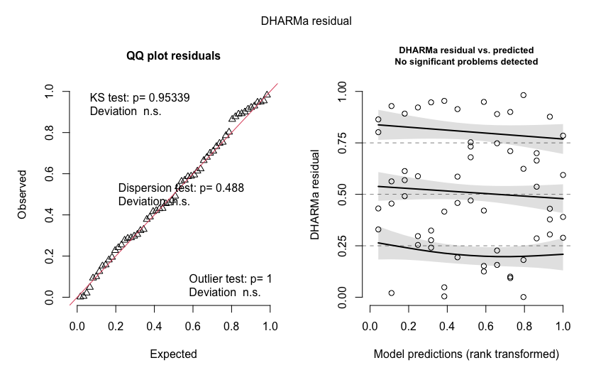<!-- -->

``` r
DHARMa::testDispersion(total_weed_resid)
```

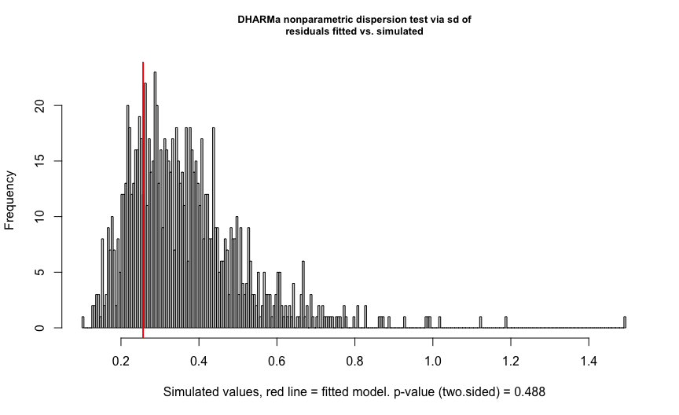<!-- -->

    ## 
    ##  DHARMa nonparametric dispersion test via sd of residuals fitted vs.
    ##  simulated
    ## 
    ## data:  simulationOutput
    ## dispersion = 0.70205, p-value = 0.488
    ## alternative hypothesis: two.sided

``` r
DHARMa::testZeroInflation(total_weed_resid)
```

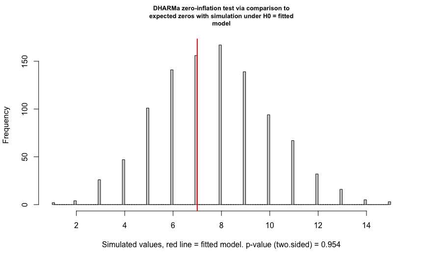<!-- -->

    ## 
    ##  DHARMa zero-inflation test via comparison to expected zeros with
    ##  simulation under H0 = fitted model
    ## 
    ## data:  simulationOutput
    ## ratioObsSim = 0.91027, p-value = 0.954
    ## alternative hypothesis: two.sided

``` r
DHARMa::testUniformity(total_weed_resid)
```

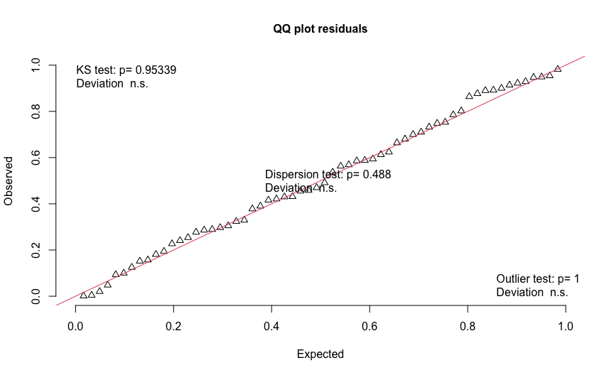<!-- -->

    ## 
    ##  Exact one-sample Kolmogorov-Smirnov test
    ## 
    ## data:  simulationOutput$scaledResiduals
    ## D = 0.064, p-value = 0.9534
    ## alternative hypothesis: two-sided

``` r
DHARMa::plotResiduals(total_weed_resid, form = weed_data$site_year)
```

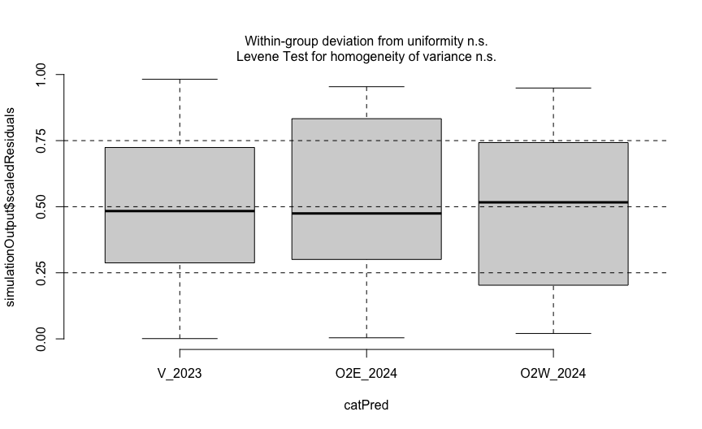<!-- -->

## Management effects and hypothesis-driven comparisons

The Type III tests assess treatment, site-year, and their interaction.
The three original hypothesis-driven comparisons are evaluated within
site-years using unadjusted, two-sided Wald tests (LSD-style). The
contrasts are specified in the same direction as the soybean biomass
Rmd. Model estimates are ratios after back-transformation because the
Tweedie models use a log link. These tests do not control the familywise
error rate, and tests involving different termination methods rely on
whole-plot replication.

``` r
total_weed_anova <- car::Anova(weed_model_disp, type = 3, component = "cond")
show_table(as.data.frame(total_weed_anova) |>
             tibble::rownames_to_column("Effect"),
           "Total weed biomass: Type III tests", digits = 3)
```

| Effect              |   Chisq |  Df | Pr(\>Chisq) |
|:--------------------|--------:|----:|:------------|
| (Intercept)         | 845.201 |   1 | \<0.001     |
| treatment           |  14.321 |   4 | 0.006       |
| site_year           |  66.700 |   2 | \<0.001     |
| treatment:site_year |  21.439 |   8 | 0.006       |

Total weed biomass: Type III tests

``` r
total_weed_emm <- emmeans::emmeans(
  weed_model_disp, ~ treatment | site_year, component = "cond"
)
show_table(
  as.data.frame(summary(total_weed_emm, type = "response")),
  "Estimated total weed biomass by treatment and site-year", digits = 2
)
```

| treatment | site_year | response |     SE |  df | asymp.LCL | asymp.UCL |
|:----------|:----------|---------:|-------:|----:|----------:|----------:|
| RNO       | V_2023    |   419.55 | 102.84 | Inf |    259.49 |    678.33 |
| RIM       | V_2023    |   257.75 |  67.35 | Inf |    154.45 |    430.13 |
| RIC       | V_2023    |   463.35 | 112.11 | Inf |    288.37 |    744.51 |
| TIM       | V_2023    |  1184.35 | 253.42 | Inf |    778.65 |   1801.43 |
| TIC       | V_2023    |   853.72 | 190.68 | Inf |    551.06 |   1322.62 |
| RNO       | O2E_2024  |   124.75 |  82.21 | Inf |     34.28 |    453.95 |
| RIM       | O2E_2024  |    24.22 |  19.79 | Inf |      4.89 |    120.10 |
| RIC       | O2E_2024  |     2.27 |   2.53 | Inf |      0.26 |     20.17 |
| TIM       | O2E_2024  |   132.85 |  86.83 | Inf |     36.90 |    478.33 |
| TIC       | O2E_2024  |    93.73 |  64.13 | Inf |     24.52 |    358.29 |
| RNO       | O2W_2024  |   247.20 | 162.09 | Inf |     68.37 |    893.72 |
| RIM       | O2W_2024  |    87.77 |  65.92 | Inf |     20.14 |    382.47 |
| RIC       | O2W_2024  |   272.25 | 176.28 | Inf |     76.53 |    968.52 |
| TIM       | O2W_2024  |   195.00 | 131.90 | Inf |     51.79 |    734.18 |
| TIC       | O2W_2024  |    12.15 |  11.82 | Inf |      1.80 |     81.81 |

Estimated total weed biomass by treatment and site-year

``` r
# Treatment order: RNO, RIM, RIC, TIM, TIC.
hypothesis_contrast_weights <- list(
  "TIC - TIM" = c(0, 0, 0, -1, 1),
  "RIM - RNO" = c(-1, 1, 0, 0, 0),
  "RIC - RNO" = c(-1, 0, 1, 0, 0)
)
stopifnot(identical(levels(weed_data$treatment), treatment_levels))
total_weed_contrasts <- emmeans::contrast(
  total_weed_emm, method = hypothesis_contrast_weights, by = "site_year"
)
total_weed_targeted_table <- as.data.frame(summary(
  total_weed_contrasts, type = "response", infer = c(TRUE, TRUE), adjust = "none"
))
show_table(total_weed_targeted_table,
           "Hypothesis-driven total weed biomass comparisons (unadjusted)", digits = 3)
```

| contrast  | site_year | ratio |    SE |  df | asymp.LCL | asymp.UCL | null | z.ratio | p.value |
|:----------|:----------|------:|------:|----:|----------:|----------:|-----:|--------:|:--------|
| TIC / TIM | V_2023    | 0.721 | 0.223 | Inf |     0.393 |     1.322 |    1 |  -1.058 | 0.290   |
| RIM / RNO | V_2023    | 0.614 | 0.220 | Inf |     0.304 |     1.240 |    1 |  -1.360 | 0.174   |
| RIC / RNO | V_2023    | 1.104 | 0.380 | Inf |     0.562 |     2.169 |    1 |   0.288 | 0.773   |
| TIC / TIM | O2E_2024  | 0.705 | 0.668 | Inf |     0.110 |     4.507 |    1 |  -0.369 | 0.712   |
| RIM / RNO | O2E_2024  | 0.194 | 0.204 | Inf |     0.025 |     1.519 |    1 |  -1.562 | 0.118   |
| RIC / RNO | O2E_2024  | 0.018 | 0.024 | Inf |     0.001 |     0.230 |    1 |  -3.095 | 0.002   |
| TIC / TIM | O2W_2024  | 0.062 | 0.074 | Inf |     0.006 |     0.636 |    1 |  -2.342 | 0.019   |
| RIM / RNO | O2W_2024  | 0.355 | 0.354 | Inf |     0.050 |     2.506 |    1 |  -1.039 | 0.299   |
| RIC / RNO | O2W_2024  | 1.101 | 1.015 | Inf |     0.181 |     6.704 |    1 |   0.105 | 0.917   |

Hypothesis-driven total weed biomass comparisons (unadjusted)

``` r
readr::write_csv(as.data.frame(total_weed_anova) |>
                   tibble::rownames_to_column("Effect"),
                 file.path(tab_dir, "total_model_anova.csv"))
readr::write_csv(as.data.frame(summary(total_weed_emm, type = "response")),
                 file.path(tab_dir, "total_site_year_treatment_model_means.csv"))
readr::write_csv(total_weed_targeted_table,
                 file.path(tab_dir, "total_hypothesis_aligned_comparisons_unadjusted.csv"))

# Descriptive model-based marginal summaries, averaged equally across factors.
# Interpret these in the context of the treatment × site-year interaction.
total_site_year_means <- emmeans::emmeans(
  weed_model_disp, ~ site_year, component = "cond", weights = "equal"
)
total_treatment_means <- emmeans::emmeans(
  weed_model_disp, ~ treatment, component = "cond", weights = "equal"
)
readr::write_csv(as.data.frame(summary(total_site_year_means, type = "response")),
                 file.path(tab_dir, "total_site_year_model_means.csv"))
readr::write_csv(as.data.frame(summary(total_treatment_means, type = "response")),
                 file.path(tab_dir, "total_treatment_model_means.csv"))
```

# Inter-row weed biomass

## Observed summaries

``` r
# Observed inter-row weed biomass

interrow_summary <- weed_data |>
  group_by(site_year, treatment) |>
  summarise(
    n_plots = n(),
    n_zeros = sum(interrow_weed_biomass_kg_ha == 0),
    mean_biomass = mean(interrow_weed_biomass_kg_ha),
    sd_biomass = sd(interrow_weed_biomass_kg_ha),
    .groups = "drop"
  )

show_table(
  interrow_summary,
  "Observed inter-row weed biomass (kg/ha)"
)
```

| site_year | treatment | n_plots | n_zeros | mean_biomass | sd_biomass |
|:----------|:----------|--------:|--------:|-------------:|-----------:|
| V_2023    | RNO       |       4 |       0 |        395.3 |      388.2 |
| V_2023    | RIM       |       4 |       0 |        131.9 |       55.3 |
| V_2023    | RIC       |       4 |       0 |        293.3 |      171.4 |
| V_2023    | TIM       |       4 |       0 |        522.1 |      258.7 |
| V_2023    | TIC       |       4 |       2 |          3.8 |        7.0 |
| O2E_2024  | RNO       |       4 |       2 |        124.8 |      224.3 |
| O2E_2024  | RIM       |       4 |       0 |         24.1 |       29.0 |
| O2E_2024  | RIC       |       4 |       2 |          1.7 |        2.8 |
| O2E_2024  | TIM       |       4 |       1 |        116.0 |      162.0 |
| O2E_2024  | TIC       |       4 |       2 |         30.4 |       58.0 |
| O2W_2024  | RNO       |       4 |       0 |        220.8 |      391.8 |
| O2W_2024  | RIM       |       4 |       0 |         22.8 |       23.9 |
| O2W_2024  | RIC       |       4 |       2 |        214.5 |      347.9 |
| O2W_2024  | TIM       |       4 |       0 |        146.0 |       57.1 |
| O2W_2024  | TIC       |       4 |       2 |          0.5 |        0.7 |

Observed inter-row weed biomass (kg/ha)

``` r
# Number of zero observations by site-year
interrow_zeros <- weed_data |>
  group_by(site_year) |>
  summarise(
    n_plots = n(),
    n_zeros = sum(interrow_weed_biomass_kg_ha == 0),
    percent_zeros = 100 * n_zeros / n_plots,
    .groups = "drop"
  )

show_table(
  interrow_zeros,
  "Inter-row weed biomass: zero observations"
)
```

| site_year | n_plots | n_zeros | percent_zeros |
|:----------|--------:|--------:|--------------:|
| V_2023    |      20 |       2 |            10 |
| O2E_2024  |      20 |       7 |            35 |
| O2W_2024  |      20 |       4 |            20 |

Inter-row weed biomass: zero observations

## Split-plot Tweedie model and diagnostics

The retained treatment × site-year Tweedie model uses common dispersion.

``` r
interrow_weed_model_full <- glmmTMB(
  interrow_weed_biomass_kg_ha ~
    treatment * site_year +
    (1 | block_id) +
    (1 | main_plot_id),
  family = tweedie(link = "log"),
  data = weed_data
)

# Convergence checks (fail early if the retained model is not regular)
stopifnot(interrow_weed_model_full$fit$convergence == 0L)
stopifnot(isTRUE(interrow_weed_model_full$sdr$pdHess))
cat("Optimizer message:", interrow_weed_model_full$fit$message, "\n")
```

    ## Optimizer message: relative convergence (4)

``` r
# Random-effect variance estimates
VarCorr(interrow_weed_model_full)
```

    ## 
    ## Conditional model:
    ##  Groups       Name        Std.Dev.  
    ##  block_id     (Intercept) 0.38928987
    ##  main_plot_id (Intercept) 0.00022519

``` r
# Tweedie power parameter
glmmTMB::family_params(interrow_weed_model_full)
```

    ## Tweedie power 
    ##      1.647651

``` r
# Residual diagnostics for inter-row weed biomass

set.seed(123)

interrow_sim_full <- DHARMa::simulateResiduals(
  fittedModel = interrow_weed_model_full,
  n = 1000
)

# Standard DHARMa diagnostic plots
plot(interrow_sim_full)
```

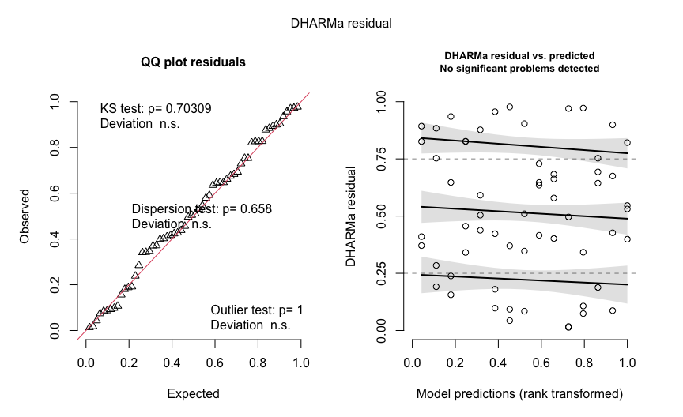<!-- -->

``` r
# Formal diagnostic tests
DHARMa::testDispersion(interrow_sim_full)
```

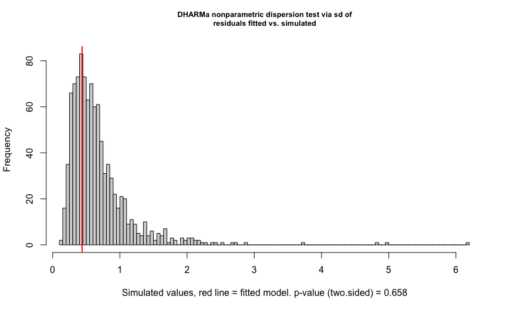<!-- -->

    ## 
    ##  DHARMa nonparametric dispersion test via sd of residuals fitted vs.
    ##  simulated
    ## 
    ## data:  simulationOutput
    ## dispersion = 0.64778, p-value = 0.658
    ## alternative hypothesis: two.sided

``` r
DHARMa::testZeroInflation(interrow_sim_full)
```

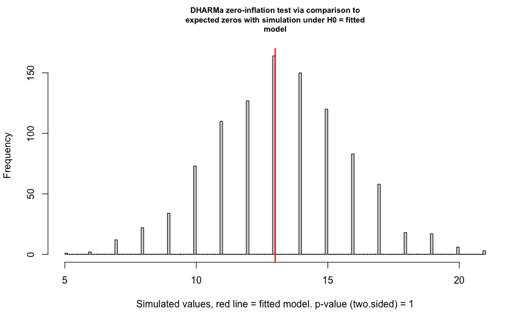<!-- -->

    ## 
    ##  DHARMa zero-inflation test via comparison to expected zeros with
    ##  simulation under H0 = fitted model
    ## 
    ## data:  simulationOutput
    ## ratioObsSim = 0.98314, p-value = 1
    ## alternative hypothesis: two.sided

``` r
DHARMa::testUniformity(interrow_sim_full)
```

<!-- -->

    ## 
    ##  Asymptotic one-sample Kolmogorov-Smirnov test
    ## 
    ## data:  simulationOutput$scaledResiduals
    ## D = 0.091, p-value = 0.7031
    ## alternative hypothesis: two-sided

``` r
# Residuals grouped by site-year
DHARMa::plotResiduals(
  interrow_sim_full,
  form = weed_data$site_year
)
```

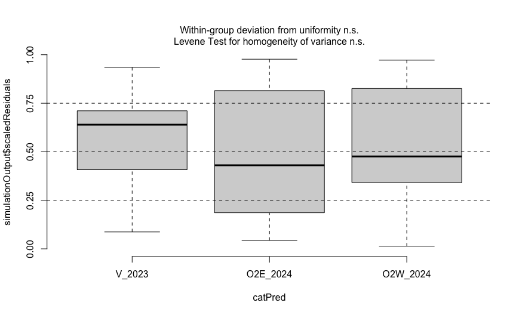<!-- -->

## Joint tests, estimates, and contrasts

The Type III tests and within-site-year marginal means come from the
retained Tweedie GLMM. The same three original hypothesis-driven
contrasts are reported using unadjusted, two-sided Wald tests,
consistent with total weed biomass. These are ratios on the response
scale; comparisons across termination methods warrant caution with four
blocks per site-year.

``` r
# Fixed-effect tests for inter-row weed biomass

interrow_weed_anova <- car::Anova(
  interrow_weed_model_full, type = 3, component = "cond"
)
show_table(
  as.data.frame(interrow_weed_anova) |>
    tibble::rownames_to_column("Effect"),
  "Inter-row weed biomass: Type III tests", digits = 3
)
```

| Effect              |   Chisq |  Df | Pr(\>Chisq) |
|:--------------------|--------:|----:|:------------|
| (Intercept)         | 238.337 |   1 | \<0.001     |
| treatment           |  45.960 |   4 | \<0.001     |
| site_year           |   9.057 |   2 | 0.011       |
| treatment:site_year |  23.604 |   8 | 0.003       |

Inter-row weed biomass: Type III tests

``` r
# Estimated marginal means within each site-year
interrow_weed_emm <- emmeans::emmeans(
  interrow_weed_model_full,
  ~ treatment | site_year,
  component = "cond"
)

readr::write_csv(as.data.frame(interrow_weed_anova) |>
                   tibble::rownames_to_column("Effect"),
                 file.path(tab_dir, "interrow_model_anova.csv"))
readr::write_csv(as.data.frame(summary(interrow_weed_emm, type = "response")),
                 file.path(tab_dir, "interrow_site_year_treatment_model_means.csv"))
# Additional marginal summaries for the working results table; no new tests.
interrow_site_year_means <- emmeans::emmeans(
  interrow_weed_model_full, ~ site_year, component = "cond", weights = "equal"
)
interrow_treatment_means <- emmeans::emmeans(
  interrow_weed_model_full, ~ treatment, component = "cond", weights = "equal"
)
readr::write_csv(as.data.frame(summary(interrow_site_year_means, type = "response")),
                 file.path(tab_dir, "interrow_site_year_model_means.csv"))
readr::write_csv(as.data.frame(summary(interrow_treatment_means, type = "response")),
                 file.path(tab_dir, "interrow_treatment_model_means.csv"))
```

``` r
# Reuse the same three hypothesis-driven contrasts and treatment order.
interrow_contrasts <- emmeans::contrast(
  interrow_weed_emm, method = hypothesis_contrast_weights, by = "site_year"
)
interrow_targeted_table <- as.data.frame(summary(
  interrow_contrasts, type = "response", adjust = "none", infer = c(TRUE, TRUE)
))
show_table(interrow_targeted_table,
           "Hypothesis-driven inter-row weed biomass comparisons (unadjusted)",
           digits = 3)
```

| contrast  | site_year | ratio |    SE |  df | asymp.LCL | asymp.UCL | null | z.ratio | p.value |
|:----------|:----------|------:|------:|----:|----------:|----------:|-----:|--------:|:--------|
| TIC / TIM | V_2023    | 0.006 | 0.007 | Inf |     0.001 |     0.060 |    1 |  -4.418 | \<0.001 |
| RIM / RNO | V_2023    | 0.369 | 0.266 | Inf |     0.090 |     1.514 |    1 |  -1.384 | 0.166   |
| RIC / RNO | V_2023    | 0.802 | 0.534 | Inf |     0.217 |     2.961 |    1 |  -0.331 | 0.740   |
| TIC / TIM | O2E_2024  | 0.211 | 0.210 | Inf |     0.030 |     1.483 |    1 |  -1.563 | 0.118   |
| RIM / RNO | O2E_2024  | 0.229 | 0.223 | Inf |     0.034 |     1.551 |    1 |  -1.510 | 0.131   |
| RIC / RNO | O2E_2024  | 0.016 | 0.021 | Inf |     0.001 |     0.218 |    1 |  -3.102 | 0.002   |
| TIC / TIM | O2W_2024  | 0.003 | 0.004 | Inf |     0.000 |     0.062 |    1 |  -3.702 | \<0.001 |
| RIM / RNO | O2W_2024  | 0.106 | 0.098 | Inf |     0.017 |     0.644 |    1 |  -2.438 | 0.015   |
| RIC / RNO | O2W_2024  | 0.995 | 0.749 | Inf |     0.227 |     4.355 |    1 |  -0.007 | 0.995   |

Hypothesis-driven inter-row weed biomass comparisons (unadjusted)

``` r
readr::write_csv(interrow_targeted_table,
                 file.path(tab_dir, "interrow_hypothesis_aligned_comparisons_unadjusted.csv"))
```

## Inter-row weed biomass figure

Bars and error bars show observed arithmetic means ± SE (four plots per
management system and site-year). Lowercase letters come from unadjusted
pairwise comparisons of model-estimated inter-row biomass within
site-years. Shared letters indicate no detected difference, not
equivalence.

``` r
# Observed means and SE, matching the other Mowtivation figures.
interrow_fig_data <- weed_data |>
  group_by(site_year, treatment) |>
  summarise(
    mean_biomass = mean(interrow_weed_biomass_kg_ha),
    se_biomass = sd(interrow_weed_biomass_kg_ha) / sqrt(n()),
    .groups = "drop"
  ) |>
  mutate(
    lower_se = pmax(0, mean_biomass - se_biomass),
    upper_se = mean_biomass + se_biomass
  )

# Unadjusted model-based pairwise CLDs (LSD-style; no multiplicity adjustment).
# The a group is assigned to the highest estimated treatment mean.
interrow_weed_cld <- multcomp::cld(
  interrow_weed_emm,
  by = "site_year",
  adjust = "none",
  alpha = 0.05,
  Letters = letters,
  reversed = TRUE
) |>
  as.data.frame() |>
  transmute(
    site_year,
    treatment,
    cld = trimws(.group)
  )

# Export the same within-site-year letters already used on the figure.
readr::write_csv(interrow_weed_cld,
                 file.path(tab_dir, "interrow_site_year_treatment_cld_unadjusted.csv"))

interrow_fig_data <- interrow_fig_data |>
  left_join(interrow_weed_cld, by = c("site_year", "treatment")) |>
  mutate(
    cld_y = mean_biomass + se_biomass +
      0.05 * max(mean_biomass + se_biomass, na.rm = TRUE)
  )

interrow_weed_fig <- ggplot(
  interrow_fig_data,
  aes(x = treatment, y = mean_biomass, fill = treatment)
) +
  geom_col(
    width = 0.7,
    color = "black",
    linewidth = 0.3
  ) +
  geom_errorbar(
    aes(ymin = lower_se, ymax = upper_se),
    width = 0.18,
    linewidth = 0.65
  ) +
  geom_text(
    aes(y = cld_y, label = cld),
    size = 4.5,
    fontface = "bold"
  ) +
  facet_wrap(
    ~ site_year,
    nrow = 1,
    labeller = labeller(
      site_year = experiment_labels
    )
  ) +
  scale_fill_manual(
    values = treatment_colors,
    guide = "none"
  ) +
  scale_y_continuous(
    expand = expansion(mult = c(0, 0.12))
  ) +
  labs(
    x = "Management system",
    y = "Inter-row weed biomass (kg/ha)",
    caption = "Bars and SE: observed biomass (n = 4); letters: unadjusted model-based comparisons."
  ) +
  theme_classic(base_size = 16) +
  theme(
    strip.background = element_blank(),
    strip.text = element_text(
      face = "bold",
      size = 14
    ),
    axis.text.x = element_text(
      size = 14,
      margin = margin(t = 8)
    ),
    axis.text.y = element_text(size = 13),
    axis.title = element_text(size = 16),
    panel.spacing = grid::unit(1.2, "lines")
  )

interrow_weed_fig
```

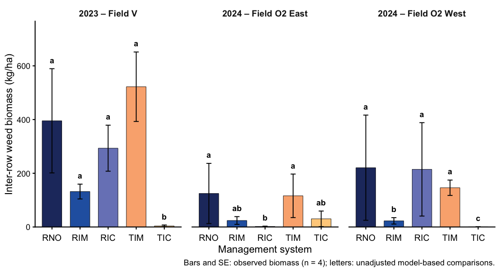

``` r
dir.create(here::here("figures", "weed_biomass"), showWarnings = FALSE, recursive = TRUE)
ggsave(
  filename = here::here(
    "figures", "weed_biomass",
    "interrow_raw_means.png"
  ),
  plot = interrow_weed_fig,
  width = 11,
  height = 6,
  dpi = 300,
  bg = "white"
)
```

# In-row weed biomass: descriptive only

Initial five-system Tweedie fits had unstable coefficients for the
all-zero RNO group in O2 East; reduced interaction models imposed
constant within-method ratios and did not reproduce some O2 West
observations. Whole-plot Tweedie averages showed underdispersion (DHARMa
p = 0.046), and a log1p linear mixed sensitivity analysis had
appreciable tail departures. Because this is a secondary outcome, no
in-row significance tests are retained.

The matched-system whole-plot summary averages RIM/RIC and TIM/TIC
separately, excluding RNO because it has no matched tilled counterpart.
It is descriptive and respects termination as a whole-plot treatment.

``` r
# Whole-plot summaries for matched management systems

inrow_main_plot <- weed_data |>
  filter(treatment %in% c("RIM", "RIC", "TIM", "TIC")) |>
  mutate(
    termination = factor(
      if_else(
        treatment %in% c("RIM", "RIC"),
        "Rolled",
        "Tilled"
      ),
      levels = c("Rolled", "Tilled")
    )
  ) |>
  group_by(
    site_year,
    block_id,
    main_plot_id,
    termination
  ) |>
  summarise(
    mean_inrow_biomass = mean(
      inrow_weed_biomass_kg_ha
    ),
    .groups = "drop"
  )

# Confirm number of whole plots
inrow_main_plot |>
  count(site_year, termination)
```

    ## # A tibble: 6 × 3
    ##   site_year termination     n
    ##   <fct>     <fct>       <int>
    ## 1 V_2023    Rolled          4
    ## 2 V_2023    Tilled          4
    ## 3 O2E_2024  Rolled          4
    ## 4 O2E_2024  Tilled          4
    ## 5 O2W_2024  Rolled          4
    ## 6 O2W_2024  Tilled          4

``` r
# Descriptive summaries by termination system
inrow_main_plot |>
  group_by(site_year, termination) |>
  summarise(
    n = n(),
    mean_biomass = mean(mean_inrow_biomass),
    sd_biomass = sd(mean_inrow_biomass),
    .groups = "drop"
  )
```

    ## # A tibble: 6 × 5
    ##   site_year termination     n mean_biomass sd_biomass
    ##   <fct>     <fct>       <int>        <dbl>      <dbl>
    ## 1 V_2023    Rolled          4      148.        90.2  
    ## 2 V_2023    Tilled          4      756.       191.   
    ## 3 O2E_2024  Rolled          4        0.338      0.522
    ## 4 O2E_2024  Tilled          4       40.1       53.0  
    ## 5 O2W_2024  Rolled          4       61.4      114.   
    ## 6 O2W_2024  Tilled          4       30.3       10.4

``` r
inrow_summary <- weed_data |>
  group_by(site_year, treatment) |>
  summarise(
    n_plots = n(),
    n_zeros = sum(inrow_weed_biomass_kg_ha == 0),
    mean_biomass = mean(inrow_weed_biomass_kg_ha),
    sd_biomass = sd(inrow_weed_biomass_kg_ha),
    .groups = "drop"
  )
show_table(inrow_summary, "Observed in-row weed biomass (kg/ha)")
```

| site_year | treatment | n_plots | n_zeros | mean_biomass | sd_biomass |
|:----------|:----------|--------:|--------:|-------------:|-----------:|
| V_2023    | RNO       |       4 |       0 |         24.2 |        8.2 |
| V_2023    | RIM       |       4 |       0 |        125.9 |      107.3 |
| V_2023    | RIC       |       4 |       0 |        170.1 |      126.5 |
| V_2023    | TIM       |       4 |       0 |        662.2 |      342.3 |
| V_2023    | TIC       |       4 |       0 |        849.9 |      310.7 |
| O2E_2024  | RNO       |       4 |       4 |          0.0 |        0.0 |
| O2E_2024  | RIM       |       4 |       3 |          0.1 |        0.2 |
| O2E_2024  | RIC       |       4 |       3 |          0.6 |        1.1 |
| O2E_2024  | TIM       |       4 |       0 |         16.9 |       10.0 |
| O2E_2024  | TIC       |       4 |       1 |         63.4 |      114.5 |
| O2W_2024  | RNO       |       4 |       3 |         26.4 |       52.9 |
| O2W_2024  | RIM       |       4 |       1 |         65.0 |      122.8 |
| O2W_2024  | RIC       |       4 |       2 |         57.7 |      105.3 |
| O2W_2024  | TIM       |       4 |       0 |         49.0 |       35.1 |
| O2W_2024  | TIC       |       4 |       1 |         11.7 |       21.9 |

Observed in-row weed biomass (kg/ha)

# Combined observed weed biomass figure

The stacked treatment colors show observed arithmetic mean contributions
from inter-row (darker) and in-row (lighter). Their sum equals observed
total weed biomass. Error bars show the **observed total arithmetic mean
± SE** (four plots per treatment/site-year). Lowercase letters summarize
**unadjusted model-based pairwise Wald tests** (Fisher LSD-style) of
total weed biomass within each site-year. These letters apply to total
biomass only, not to the components; shared letters do not establish
equivalence. The SE bars are descriptive plot-to-plot variation, not
model-based uncertainty for treatment contrasts.

``` r
lighten_color <- function(color, amount = 0.55) {
  rgb <- grDevices::col2rgb(color) / 255
  light <- rgb + (1 - rgb) * amount

  grDevices::rgb(
    light[1, ],
    light[2, ],
    light[3, ]
  )
}

zone_colors <- c(
  setNames(
    treatment_colors,
    paste0(names(treatment_colors), "_Inter-row")
  ),
  setNames(
    vapply(
      treatment_colors,
      lighten_color,
      character(1)
    ),
    paste0(names(treatment_colors), "_In-row")
  )
)


weed_zone_means <- weed_data |>
  group_by(site_year, treatment) |>
  summarise(
    inrow = mean(inrow_weed_biomass_kg_ha),
    interrow = mean(interrow_weed_biomass_kg_ha),
    total_mean = mean(weed_biomass_kg_ha),
    total_se = sd(weed_biomass_kg_ha) / sqrt(n()),
    n_plots = n(),
    .groups = "drop"
  )

# Convert zone means to long format for stacked bars
weed_zone_plot_data <- weed_zone_means |>
  select(site_year, treatment, inrow, interrow) |>
  pivot_longer(
    cols = c(inrow, interrow),
    names_to = "zone",
    values_to = "mean_biomass"
  ) |>
  mutate(
    zone = factor(
      zone,
      levels = c("inrow", "interrow"),
      labels = c("In-row", "Inter-row")
    ),
    treatment_zone = paste(treatment, zone, sep = "_")
  )


# Reuse total_weed_emm calculated above.

# Requires multcomp and multcompView packages.
# Fisher's LSD-style CLDs use unadjusted pairwise tests within site-year.
total_weed_cld <- multcomp::cld(
  total_weed_emm,
  by = "site_year",
  adjust = "none",
  alpha = 0.05,
  Letters = letters,
  reversed = TRUE
) |>
  as.data.frame() |>
  transmute(
    site_year,
    treatment,
    cld = trimws(.group)
  )

# Export the figure's existing unadjusted within-site-year letters.
readr::write_csv(total_weed_cld,
                 file.path(tab_dir, "total_site_year_treatment_cld_unadjusted.csv"))

# Position letters above observed mean + SE
weed_annotations <- weed_zone_means |>
  left_join(
    total_weed_cld,
    by = c("site_year", "treatment")
  ) |>
  mutate(
    cld_y = total_mean + total_se + 65
  )


combined_weed_model_fig <- ggplot() +

  # Observed in-row and inter-row biomass
  geom_col(
    data = weed_zone_plot_data,
    aes(
      x = treatment,
      y = mean_biomass,
      fill = treatment_zone
    ),
    width = 0.72,
    color = "black",
    linewidth = 0.3
  ) +

  # Observed total weed biomass ± SE
  geom_errorbar(
    data = weed_zone_means,
    aes(
      x = treatment,
      ymin = pmax(0, total_mean - total_se),
      ymax = total_mean + total_se
    ),
    width = 0.18,
    linewidth = 0.7,
    color = "black"
  ) +

  # Total weed biomass significance groupings
  geom_text(
    data = weed_annotations,
    aes(
      x = treatment,
      y = cld_y,
      label = cld
    ),
    size = 4.5,
    fontface = "bold"
  ) +

  facet_wrap(
    ~ site_year,
    nrow = 1,
    labeller = labeller(
      site_year = experiment_labels
    )
  ) +

  scale_fill_manual(
    values = zone_colors,
    guide = "none"
  ) +

  scale_y_continuous(
    expand = expansion(mult = c(0, 0.12))
  ) +

  labs(
    x = "Management system",
    y = "Total weed biomass (kg/ha)",
    caption = paste(
      "Dark shading: inter-row; light shading: in-row.",
      "Stacked bars and SE are observed totals (n = 4).",
      "Lowercase letters: unadjusted model-based total-biomass comparisons."
    )
  ) +

  theme_classic(base_size = 16) +

  theme(
    strip.background = element_blank(),
    strip.text = element_text(
      face = "bold",
      size = 14
    ),
    axis.text.x = element_text(
      size = 14,
      margin = margin(t = 8)
    ),
    axis.text.y = element_text(size = 13),
    axis.title = element_text(size = 16),
    plot.caption = element_text(
      size = 11,
      hjust = 0.5,
      margin = margin(t = 15)
    ),
    panel.spacing = grid::unit(1.2, "lines")
  )

combined_weed_model_fig
```

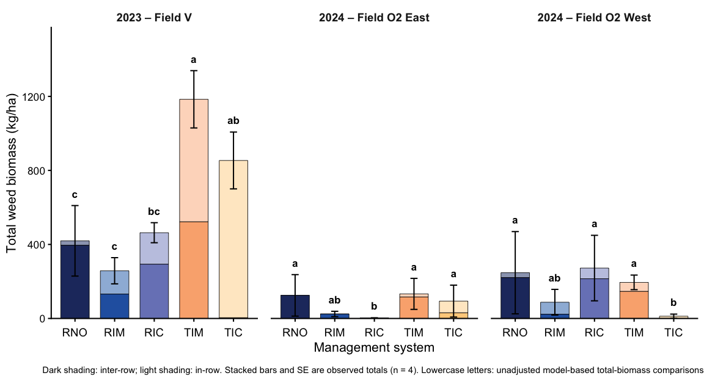

``` r
# Save figure
dir.create(here::here("figures", "weed_biomass"), showWarnings = FALSE, recursive = TRUE)
ggsave(
  filename = here::here(
    "figures", "weed_biomass",
    "combined_raw_means.png"
  ),
  plot = combined_weed_model_fig,
  width = 12,
  height = 6.5,
  dpi = 300,
  bg = "white"
)
```

# Interpretation and limitations

Treatment × site-year interactions support presenting the three planned
comparisons within site-years. The observed stacked figure displays
arithmetic means and SE, with letters derived from unadjusted pairwise
tests on the model-estimated total biomass means. The observed inter-row
figure has separate letters based on the inter-row model. Figure letters
are exploratory and do not establish equivalence.

The three original, hypothesis-driven contrasts are reported separately
for total and inter-row weed biomass. The unadjusted Wald p-values and
confidence intervals should be interpreted cautiously because there are
four blocks per site-year and comparisons across termination methods
depend on main-plot replication. The current models retain both block
and main-plot random intercepts, including when variance estimates
approach the boundary.

Before manuscript reporting, verify the treatment assignments against
field maps, the documented 2023 implementation error, the RIC
cultivation schedule, and processed-data units. The existing
fitted-model specifications and figure exports are preserved in this
revision; inferential results should be checked by knitting against the
processed dataset.

# Reproducibility

Package versions and R session information for this analysis run:

``` r
utils::sessionInfo()
```

    ## R version 4.5.2 (2025-10-31)
    ## Platform: aarch64-apple-darwin20
    ## Running under: macOS 27.2.1
    ## 
    ## Matrix products: default
    ## BLAS:   /System/Library/Frameworks/Accelerate.framework/Versions/A/Frameworks/vecLib.framework/Versions/A/libBLAS.dylib 
    ## LAPACK: /Library/Frameworks/R.framework/Versions/4.5-arm64/Resources/lib/libRlapack.dylib;  LAPACK version 3.12.1
    ## 
    ## locale:
    ## [1] en_US.UTF-8/en_US.UTF-8/en_US.UTF-8/C/en_US.UTF-8/en_US.UTF-8
    ## 
    ## time zone: America/New_York
    ## tzcode source: internal
    ## 
    ## attached base packages:
    ## [1] stats     graphics  grDevices utils     datasets  methods   base     
    ## 
    ## other attached packages:
    ##  [1] WrensBookshelf_0.1.0 emmeans_1.11.2-8     DHARMa_0.4.7        
    ##  [4] glmmTMB_1.1.15.2     conflicted_1.2.0     here_1.0.2          
    ##  [7] lubridate_1.9.4      forcats_1.0.1        stringr_1.5.2       
    ## [10] dplyr_1.1.4          purrr_1.1.0          readr_2.1.5         
    ## [13] tidyr_1.3.1          tibble_3.3.0         ggplot2_4.0.0       
    ## [16] tidyverse_2.0.0     
    ## 
    ## loaded via a namespace (and not attached):
    ##  [1] Rdpack_2.6.4        sandwich_3.1-1      rlang_1.1.6        
    ##  [4] magrittr_2.0.4      multcomp_1.4-29     otel_0.2.0         
    ##  [7] compiler_4.5.2      mgcv_1.9-3          systemfonts_1.3.1  
    ## [10] vctrs_0.6.5         pkgconfig_2.0.3     crayon_1.5.3       
    ## [13] fastmap_1.2.0       labeling_0.4.3      utf8_1.2.6         
    ## [16] promises_1.4.0      rmarkdown_2.30      tzdb_0.5.0         
    ## [19] nloptr_2.2.1        ragg_1.5.0          bit_4.6.0          
    ## [22] xfun_0.61           cachem_1.1.0        later_1.4.4        
    ## [25] RTMB_2.0            parallel_4.5.2      R6_2.6.1           
    ## [28] gap.datasets_0.0.6  stringi_1.8.7       qgam_2.0.0         
    ## [31] RColorBrewer_1.1-3  car_3.1-3           boot_1.3-32        
    ## [34] numDeriv_2016.8-1.1 estimability_1.5.1  Rcpp_1.1.0         
    ## [37] iterators_1.0.14    knitr_1.50          zoo_1.8-14         
    ## [40] httpuv_1.6.16       Matrix_1.7-4        splines_4.5.2      
    ## [43] timechange_0.3.0    tidyselect_1.2.1    rstudioapi_0.17.1  
    ## [46] abind_1.4-8         yaml_2.3.10         doParallel_1.0.17  
    ## [49] TMB_1.9.25          codetools_0.2-20    lattice_0.22-7     
    ## [52] plyr_1.8.9          shiny_1.11.1        withr_3.0.2        
    ## [55] S7_0.2.0            coda_0.19-4.1       evaluate_1.0.5     
    ## [58] survival_3.8-3      pillar_1.11.1       gap_1.6            
    ## [61] carData_3.0-5       foreach_1.5.2       reformulas_0.4.4   
    ## [64] generics_0.1.4      vroom_1.6.6         rprojroot_2.1.1    
    ## [67] hms_1.1.4           scales_1.4.0        minqa_1.2.8        
    ## [70] xtable_1.8-4        glue_1.8.0          tools_4.5.2        
    ## [73] lme4_1.1-37         mvtnorm_1.3-3       grid_4.5.2         
    ## [76] rbibutils_2.3       nlme_3.1-168        Formula_1.2-5      
    ## [79] cli_3.6.5           textshaping_1.0.4   gtable_0.3.6       
    ## [82] digest_0.6.37       TH.data_1.1-4       farver_2.1.2       
    ## [85] memoise_2.0.1       htmltools_0.5.8.1   lifecycle_1.0.4    
    ## [88] multcompView_0.1-10 mime_0.13           bit64_4.6.0-1      
    ## [91] MASS_7.3-65
